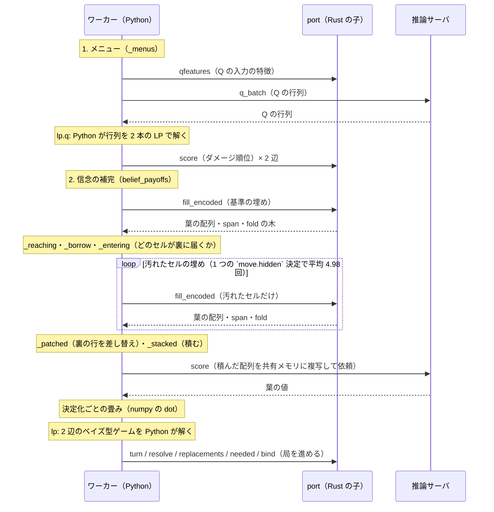
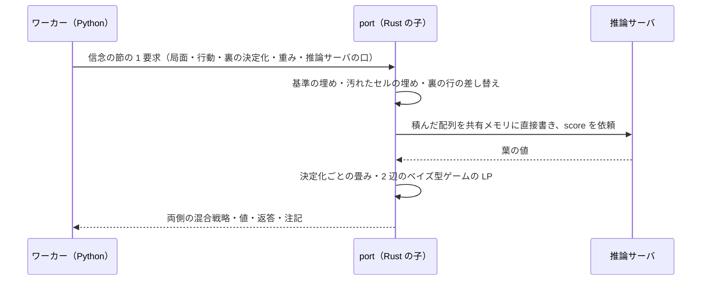

# IKA-455: 信念の補完と LP を Rust で行う設計（段 1）

課題: Notion の Issues（ID IKA-455、親 IKA-453）。枝 `worktree-agent-a8507334b8eede39f`。2026-11-26。
計測の駆動・捕捉・出力は `C:/tmp/ika455/` に置き、コミットしていない。

## 0. 要点

問いは、生成のワーカーの Python の CPU のうち最も大きい 2 つの段、LP（`lp.q` + `lp`）と信念の補完（`belief`）を、Rust に移す形である。

* **今の道（§1）**: 生成の `lp`・`lp.q`・`belief` は、ladder（人と打つ道具の読み）で作った Rust の部品（`portlp`・`portserved`・`portmenus`）を、1 つも通っていない。生成の呼び出し口が `solve`・`solve_bayesian`・`belief_payoffs` を直接呼ぶためである。
* **LP の中身（§2.1）**: 捕捉した 1,484 個の LP で、HiGHS の実行そのものは Q の LP で 61%、信念の LP で 51% だった。残りは Python が模型を組む時間である。LP だけを port に移すと減るのは、この Python 側の分だけである。
* **案（§3）**: (a) LP だけを port に送る。(b) 信念の補完・畳み・LP を port の 1 要求で行い、Python は混合戦略だけ受け取る。(c) 畳みと LP だけを port に移し、残りを Python に残す。推奨は (b) を後ろから前へ 4 つに分けて入れる順（§5）。
* **最初の段（§6）**: (a) を実装した。Q の行列の LP は、1 回の `prefetch` の分を 1 往復で、信念の 2 つの側の LP は 1 往復で、port の HiGHS に渡す。フラグ `POKEURAOU_GEN_PORT_LP=1`、既定 off。
  * 局のビット一致: 1 ワーカー 40 局（493 決定）で、off と on が全局一致した。
  * 速さ（§6.3、21 ワーカー・600 局、ABBA 2 組）: 1 局の過程木の CPU は 0.7016 → 0.6652 秒（−5.2%）。ワーカーは −26%、port の exe は +20%。局/分は、機械が空いていた 4 回で 1,126.5 → 1,122.2（−0.4%、誤差の中）。
  * 局/分に出ないので、この段だけでは生成は速くならない。節約は信念の補完（段 1.2 以降）と合わせて見る。

## 1. 今の道

### 1.1 生成の 1 決定（`move.hidden`、サーバ付き、本番の形）で何が往復するか

* 往復は 1 局あたり約 132 回（IKA-452 §3.2: 2,000 局で 263,768 回）。1 回は空いた機械で 0.185 ms、本番の形で 1.12 ms。
* Python と port の間を行き来するのは、局面（番号で渡す `hold`）、行動（番号で渡す `acts`）、埋めの結果（JSON の見出しと 2 進の配列）である。推論サーバとの間は、共有メモリの塊と TCP の依頼である。

### 1.2 すでに Rust にあるものが、生成の道で使われていない理由

| 部品 | できること | 生成で使われていない理由 |
|---|---|---|
| `portlp`（IKA-381・387、`rust/src/lp.rs`）| `equilibrium.solve`・`solve_bayesian` を port の HiGHS で解く。scipy と同じ HiGHS 1.12.0（`vendor/HiGHS` は scipy/HiGHS 4f96ee8）。59,050 個の LP で Python と同じビット | 呼び出し口が ladder の関数（`ladder.py`・`deepen._q_menus`・`search._refine_cells`）だけにある。生成の `qrank.q_ranking.rank` と `search.belief_solve` は `solve`・`solve_bayesian` を直接呼ぶ。旗 `POKEURAOU_LADDER_PORT_LP` は span ブロック（生成が読まない出力）も要求する |
| `portserved`（IKA-386、`fillsServed`）| 深さ 2 の部分ゲームを、埋め・推論サーバへの依頼・畳み・LP まで 1 往復で行う | 入力の形が違う。部分ゲームは「子の局面の 1 つの行列」で、信念の節は「基準の埋め + 裏の決定化ごとの汚れたセルの埋め + 裏の行の差し替え + 決定化ごとの畳み」である。推論サーバの口（`served.rs`）と共有メモリへの書き込み、葉の畳み（`lp::fold_and_solve`）は流用できる |
| `portmenus`（IKA-389、`qMenus`）| 子の局面の Q のメニューを、プールの列挙・Q の依頼・LP・順位付けまで port で行う | 子の局面（開いた局面）向けで、生成の `_menus` は見える局面（`views`）・両側の依頼を 1 往復にまとめる `prefetch`・`narrow` の cover なしの記録（`note_coverless`）を持つ。段 2 で根のメニューに広げる候補 |

* ladder の部品はどれも、`ladder.py` のワーカー過程の中で、旗と一緒に入る形で作られた。生成のワーカーは `play_game` から `belief_solve` を呼ぶので、同じ旗の下に入らない。

### 1.3 段の中身（測定）

1 ワーカー（100 局、サーバ 1 つ、`--regions`、コード変更なし）で、`move.hidden` 1 決定あたりの Python の自分の時間を部分ごとに分けた。

| 部分 | 1 決定あたり（ms）| `belief` の Python の自分の時間に対する割合 |
|---|---|---|
| `belief.stack`（`_stacked`: 配列を積む）| 3.14 | 37% |
| `belief.fold`（決定化ごとの畳み）| 2.50 | 29% |
| `belief.jobs`（`_reaching`・`_borrow`・`_entering`・`_patched` の組み立て）| 1.88 | 22% |
| `belief_payoffs` のその他 | 1.07 | 12% |
| 合計 | 8.59 | |
| `lp.side`（2 辺のベイズ型ゲーム）| 2.49 | |

* `move.exact` では `belief.exact` の Python の自分の時間が 0.25 ms で、小さい。信念の補完の CPU は `move.hidden` の決定が持つ。
* 同じ時間に port の子が使う時間（`belief.ref` 7.2 ms・`belief.jobs` の中の汚れたセルの埋め 11.7 ms）と推論サーバの待ち（4.9 ms）は別の行で、この表に入れていない。

## 2. LP の中身

### 2.1 HiGHS の実行と Python の模型づくり

生成の 1 ワーカー（60 局、`equilibrium._lp` の引数を 3 回に 1 回捕捉）で 1,484 個の LP を取り、`_lp` 全体の時間と、`HighsLp` を組む時間、`highs.run()` の時間を別々に測った（単独の過程、`C:/tmp/ika455/lpsplit.py`）。

| 種類 | 個数 | `_lp` 全体（µs）| 模型を組む（µs）| `run()`（µs）| その他（µs）| `run()` の割合 |
|---|---|---|---|---|---|---|
| Q の行列（`lp.q`）| 576 | 1,721 | 561 | 1,045 | 115 | 61% |
| 信念のベイズ型ゲーム | 687 | 598 | 177 | 306 | 115 | 51% |
| その他（小さい行列）| 221 | 329 | 110 | 123 | 97 | 37% |

* Q の行列の平均は 3,885 セルである。1 つの `solve` はこの LP を 2 つ（行側・列側）解く。
* LP だけを port に移して減るのは、「模型を組む」と「その他」の分である。HiGHS の実行は port の過程が行う。

### 2.2 同じ Q の 400 局面を Python と port で解いた（`C:/tmp/ika455/lpport.py`、空いた機械の 1 過程）

| 道 | 1 局面あたりの壁時計（ms）| 呼ぶ側の CPU（ms）|
|---|---|---|
| Python `solve` | 2.444 | 2.461 |
| port 1 往復に 1 局面 | 1.919 | 0.195 |
| port 1 往復に 8 局面 | 1.736 | 0.117 |

* 値・行側と列側の戦略・行側の EV は 400/400 局面でビット一致した。
* 呼ぶ側の CPU は 2.3 ms 減る。port の過程が HiGHS を動かす分（約 1.7 ms）が増えるので、機械全体の CPU の減りは 0.5 ms ほどである（壁時計から見積もった値で、port の過程の CPU は測っていない）。

## 3. 境界の案

| | (a) LP だけを port に送る | (b) 信念の補完・畳み・LP を port の 1 要求で行う | (c) 畳みと LP だけを port に移す |
|---|---|---|---|
| 移す関数 | `solve`・`solve_bayesian`（生成の 3 つの呼び出し口）| `belief_payoffs` 全体（`reaches_bench`・`_reaching`・`_borrow`・`_entering`・`_patched`・`_gather_dirty`・`_stacked`・畳み）と `belief_solve` の LP | `belief_payoffs` の最後の畳みの繰り返しと LP |
| Python が渡すもの | 行列（base64）| 局面（番号）・両側の行動（番号）・裏の決定化の局面と重み・予算・推論サーバの口 | 葉の値の配列と、決定化ごとの計画 |
| Python が受け取るもの | 戦略と値 | 両側の混合戦略・値・返答・注記 | 同じ |
| 増える往復 | Q の依頼ごと +1（Q の行列は 1 回の `prefetch` に 1 つ）、信念の節ごと +1 | 増減なし。基準の埋めと汚れたセルの埋めの往復（`move.hidden` 1 決定で 5.98 回。1 ワーカーの計測）が 1 回になる | 信念の節ごと +1。埋めの結果を port が持ち続ける状態が増える |
| 推論サーバへの依頼 | 今のまま Python | port が持つ（`served.rs`。配列を共有メモリに直接書く）。Python が積んで複写する分（`belief.stack`・`serve.copy`）がなくなる | Python（今のまま）|
| 見込みの CPU（IKA-452・§1.3 から。**測っていない**）| LP の Python 側 |  `belief` の Python の自分の時間のほぼ全部 + LP の Python 側 + 往復 | `belief.fold`（29%）+ LP の Python 側 |
| ビット一致 | 取れる（HiGHS が同じ commit。実測 §6）| 取るには、畳みの加算順（`lp::numpy_dot` が OpenBLAS の SkylakeX の順を写している）と、裏の行の符号化（Python の `encode_positions` と Rust の `encode.rs`）の一致が要る | 同じ畳みの条件 |
| 段 2 へのつながり | 往復の形は捨てる。`lp.rs` の `solve`・`solve_bayesian` はそのまま段 2 の中身になる | 段 2 で 1 ノードの解き（メニューと行列の埋め）を足すとき、同じ要求の形に載る | 状態を持つ要求は段 2 で作り直す |
| 段 3 へのつながり | | `GameRecord` に混合戦略だけを返す形は、そのまま対局の進行の入力になる | |
| 実装の大きさ（見積もり）| 小（Python 約 40 行・テスト 2 本）。済 | 大（Rust 数百行 + 段ごとのテスト。数日）| 中 |

## 4. 確かめ方

* **局のビット一致**を主にする。同じ種・同じワーカー数で、旗 off と on の局の記録（`decisions` の `ownPolicy`・`foePolicy`・`searchValue`・選んだ手）を JSON として比べる（`C:/tmp/ika455/cmpgames.py`。時間の欄は除く）。
  * 1 ワーカー・1 サーバにすると、推論サーバのバッチが決まった順になり、同じ旗どうしの 2 回が一致する。この「同じ旗の 2 回」を零の対照にする。
  * 比べが落ちうる対照は、種を変えた局との比べ（0/40）。
  * 21 ワーカーでは、推論サーバのバッチの組み方が実行ごとに変わり、葉の値が 1e-9 動く（beliefnode.py の説明）。ビット一致は 1 ワーカーで取る。21 ワーカーでは CPU と局/分を ABBA で比べる。
* **LP の解き方**: scipy の HiGHS と port の HiGHS は、同じ 1.12.0（`vendor/HiGHS` の commit 4f96ee8 は scipy 1.18.1 が作る commit）。IKA-381 が 59,050 個の LP で一致を確かめ、本課題でも Q の 400 局面と 40 局で一致した。HiGHS を作った compiler が違うので、同じ旋回を取らない LP が出る可能性は残る。
* **一致しない所の扱い**: 一致しない LP が出たら、(1) 件数、(2) 値の差、(3) 混合戦略の差の最大、(4) 選ぶ手が変わった決定の数を記録し、同じ費用で判定する。強さの比べは CLAUDE.md の「速さと強さの引き換え」に従い、同じ壁時計で作ったプールから学んだ葉の強さで行う。
* **速さ**は、同じ exe・同じ長さの環境で、旗 off（A）と on（B）を ABBA で回し、1 局あたりの過程木の CPU（ワーカー・port・推論サーバ）と局/分を比べる。局/分は他の過程が混ざると動くので、機械全体の CPU の使用率を各回の前に記録し、読む回を選ぶ。

## 5. 推奨と段の順番

推奨は (b) である。(a) は (b) の LP の部分に当たり、先に入れて失うものがない。

後ろから前へ分ける。各段は、前の段のあとに Python の道と局がビット一致し、生成を遅くしないことを確かめてから入れる。

| 段 | 内容 | 見込み（測っていない）| 確かめ方 |
|---|---|---|---|
| 1.1（済）| LP を port に送る。Q の行列は 1 回の `prefetch` に 1 往復、信念の 2 辺は 1 往復。旗 `POKEURAOU_GEN_PORT_LP` | LP の Python 側の分 | 1 ワーカー 40 局のビット一致、21 ワーカーの ABBA |
| 1.2（済、§6.5）| 畳みと LP を port に移す。port が基準の埋めと各決定化の埋めの結果（span・fold）を番号で持ち、Python は推論サーバの答えの値の配列と計画（どの決定化がどのブロックを読むか）だけを送る。LP の 2 辺も同じ要求 | `belief.fold` 2.5 ms/決定（`belief` の Python の 29%）| 1 ワーカーのビット一致。畳みの順が違う場合は §4 の記録 |
| 1.3（済、§11）| 積む・差し替えを port に移す。基準の配列と決定化の局面から、port が裏の行を差し替えて共有メモリの塊に直接書き、推論サーバへ依頼する | `belief.stack` 3.1 ms/決定 + `serve.copy` | 依頼ごとのバイト一致（IKA-386 §2.1 の道具を流用）|
| 1.4 | 計画（`reaches_bench`・`_reaching`・`_borrow`・`_entering`）を port に移す。Python は 1 要求を出して混合戦略を受け取る | `belief.jobs` 1.9 ms/決定 + 往復 | 計画をバイト列で Python の `_borrow` と比べる。局のビット一致 |

* 1.2〜1.4 の Rust は、そのまま段 2（1 ノードの解き）の部品になる。Python の道は、局のビット一致の基準として残す（旗 off）。
* 段 1.1 の測定（§6.3）で、往復の増加（1 局 17.7 回）は CPU では見合った（−5〜6%）が、局/分には出なかった。1.2 以降は往復を増やさず、埋めの往復を 1 回に減らす形なので、この点は 1.1 より有利になる見込みである（測っていない）。
* 各段の局/分は、ワーカー数を 21 のまま ABBA で比べ、そのあとにワーカー数を増やして空いたコアを使えるかを別に見る。

最後の形（段 1.4 のあと）の往復は、次の図になる。

## 6. 最初の段（1.1）

### 6.1 変えたもの

| ファイル | 内容 |
|---|---|
| `src/pokeuraou/portlp.py` | 旗 `GEN`（環境変数 `POKEURAOU_GEN_PORT_LP=1`、既定 off）と `set_gen`。ladder の旗 `ON` とは別。`ON` は span ブロック（生成が読まない出力）も要求するため |
| `src/pokeuraou/qrank.py` | `prefetch` が、旗 on のとき、その要求の Q の行列を `portlp.solve_many` で 1 往復で解き、結果を各要求の memo の `pre` に置く（`lp.q` の段に数える）。`q_ranking.rank` は `pre` があればそれを使い、なければ今までどおり `solve`。解けなかった行列は `rank` の None（平均で順位付け）と同じ |
| `src/pokeuraou/search.py` | `belief_solve` が、旗 on のとき、聞かれた側すべてのベイズ型ゲームを `portlp.solve_bayesian_many` で 1 往復で解く（`lp` の段）。旗 off の道は今までのまま |
| `tools/selfplay.py` | ワーカーの終わりに、旗の状態と `portlp.counts()` を標準エラーに出す（旗の確認と陽性対照）|
| `tests/test_gen_port_lp.py` | 2 本。ベイズ型ゲームと Q の順位が、旗 off と on でビット一致すること。陽性対照は port が受けたゲームの数、比べが落ちうる対照は重み 1 つ・Q の種を変えた場合 |

Rust は変えていない。`lp.rs` の `solve`・`solve_bayesian` と `lp` 要求を、そのまま使う。

### 6.2 局のビット一致（1 ワーカー・1 サーバ、種 777、40 局、493 決定）

| 比べ | 一致した局 |
|---|---|
| off と off（零の対照）| 40/40 |
| off と on | 40/40 |
| off と別の種の局（比べが落ちうる対照）| 0/40 |

* 比べた欄は局の記録の全欄から「秒」「ms」を含む名前を除いたもの。`ownPolicy`・`foePolicy`・`searchValue`・選んだ手・`unmodelled` を含む（`C:/tmp/ika455/cmpgames.py`）。
* 陽性対照: on のワーカーの標準エラーに `crossings 722, games 565, bayes 722, lps 2574`。off は全部 0。
* 21 ワーカーでは推論サーバのバッチが実行ごとに変わるので、ビット一致は取っていない（§4）。

### 6.3 速さ（21 ワーカー・サーバ 2 つ・600 局、同じ exe、`profile_stages.py generation`）

2 組の ABBA（組 1 は種 45301、組 2 は種 45302）を回した。`busy` は過程木が使ったコア数（定常状態）。

| 回 | 旗 | busy | 局/分（定常）| 1 局の CPU（秒、過程木）| ワーカー | port の exe | 推論サーバ |
|---|---|---|---|---|---|---|---|
| 組 1 A1 | off | 13.33 | 1,143.9 | 0.6994 | 0.3267 | 0.2732 | 0.0993 |
| 組 1 B1 | on | 6.83 | 598.5 | 0.6843 | 0.2544 | 0.3270 | 0.1017 |
| 組 1 B2 | on | 12.39 | 1,124.4 | 0.6613 | 0.2437 | 0.3213 | 0.0962 |
| 組 1 A2 | off | 9.76 | 808.5 | 0.7243 | 0.3473 | 0.2784 | 0.0982 |
| 組 2 A1 | off | 6.39 | 544.1 | 0.7048 | 0.3319 | 0.2673 | 0.1043 |
| 組 2 B1 | on | 6.47 | 570.5 | 0.6805 | 0.2530 | 0.3220 | 0.1046 |
| 組 2 B2 | on | 11.85 | 1,120.0 | 0.6348 | 0.2355 | 0.3076 | 0.0916 |
| 組 2 A2 | off | 12.53 | 1,109.0 | 0.6780 | 0.3208 | 0.2562 | 0.1009 |

| 読み | off（平均）| on（平均）| 変化 |
|---|---|---|---|
| 1 局の CPU、8 回すべて | 0.7016 | 0.6652 | −5.2% |
| 1 局の CPU、busy 11.8 以上の 4 回 | 0.6887 | 0.6481 | −5.9% |
| ワーカーの CPU（8 回）| 0.3317 | 0.2467 | −25.6% |
| port の exe の CPU（8 回）| 0.2688 | 0.3220 | +19.8% |
| 推論サーバの CPU（8 回）| 0.1007 | 0.0985 | −2.1% |
| 局/分、busy 11.8 以上の 4 回 | 1,126.5（1,143.9・1,109.0）| 1,122.2（1,124.4・1,120.0）| −0.4% |

* CPU の読みは 8 回とも向きが同じである（off の 4 回は 0.678〜0.724、on の 4 回は 0.635〜0.684）。ワーカーの減り 0.085 秒と port の exe の増え 0.053 秒の差が、1 局あたり 0.034 秒の正味の減りである。
* 局/分は、busy が 6〜10 の 4 回で半分に落ちた。原因は確かめていない。最初の ABBA の前には、別の担当の生成（作業木 aaa2bc…）が動いていたので、終わるまで待った。それ以後は、回の途中の他の過程を確かめていない。この 4 回は局/分の比べに入れていない。
* 局/分は、busy 11.8 以上の回どうしで差がない（−0.4%、各 2 回で幅は 3% ほど）。1 局の CPU が 5〜6% 減っても、局/分に出ていない。busy は off の 13.3・12.5 に対し on の 12.4・11.9 で、空きコアは 2.7・3.5 から 3.6・4.2 に動いた。対局が、CPU でなく往復の待ちで決まる部分が増えたと読むが、確かめていない。
* 往復は 600 局で 10,592 回（1 局 17.7 回）増えた（`r2B2` のワーカーのログの和）。今の往復は 1 局 132 回なので、13% 増える。
* 段の CPU（`thread_time` の値で偏りを含む。比べには使わない）では、`lp` が 19.4 → 3.5 秒、`lp.q` が 31.4 → 0.4 秒になった。陽性対照として読む。

### 6.4 この段の読み

* 同じ局を作り、過程木の CPU を 5〜6% 減らす。局/分には出ていない（−0.4%、誤差の中）。
* ワーカーの CPU が 26% 減り、port の exe が 20% 増える。LP の HiGHS の実行が port の exe に移った分である。
* 局/分を CPU の減りに合わせて上げるには、空いたコアを使う過程（ワーカーの数）を増やす必要がある。ワーカー数の掃引は今回していない。

## 6.5 段 1.2: 畳みと LP を port に移す（2026-11-26、続き）

枝は同じ（段 1.1 は master に入った b6a9f27 から続ける）。段の CPU は、master の新しい時計（IKA-454、サイクル数）で測った。以下の計測はすべて取り込み後の木（b6a9f27 の上）である。

### 6.5.1 旗の関係

* `POKEURAOU_GEN_PORT_FOLD=1`（`portlp.FOLD`、既定 off）。**段 1.2 は段 1.1 を含む**。on にすると `portlp.GEN` も on になり、Q の行列の LP と、畳みの対象でないノードのベイズ型ゲームは、1.1 の道で port に送る。
* `POKEURAOU_GEN_PORT_LP=1` だけが 1.1。FOLD も LP も off が Python の道（基準）。
* FOLD on は、各 fill の span ブロック（`rustnode._SPAN_BLOCKS`）を保持する。1 つでも span ブロックのない fill があるノードは、Python の畳みに戻る。

### 6.5.2 何を移したか

1 つの `move.hidden` のノードで、積んだ配列を推論サーバが採点したあと、Python が決定化ごとに行っていた畳み（`belief.fold`）と、`belief_solve` の 2 辺のベイズ型ゲームの LP を、port の 1 要求 `beliefFold` にした。

| 項目 | 内容 |
|---|---|
| Rust | `rust/src/beliefnode.rs`（新）と `node.rs` の分岐。`lp.rs` の `fold_value`・`numpy_dot`・`solve_bayesian` をそのまま使う |
| Python が送るもの | 全葉の値（f64）、汚れたセルの印、基準の fill の span ブロックと畳みの木、決定化ごとの「共有・自分の fill・借りたセル」の窓（開始位置と長さ）と、自分の fill の span ブロック、借りたセル（基準のセルは座標だけ、他の決定化から借りたセルは span ブロックの形に詰めたもの）、解く辺と重み |
| port が返すもの | 決定化ごとの行列（全部）と、聞かれた辺のベイズ型ゲームの答え。`BeliefNode.matrices` は Python の道と同じ形で残る |
| Python に残るもの | `reaches_bench`・`_reaching`・`_borrow`・`_entering`・`_patched`・`_stacked`（積む）・採点の依頼。段 1.3・1.4 の対象 |
| 往復 | 信念のノード 1 回あたり、畳み + LP の 1 往復（1.1 の「LP の 1 往復」が、畳みを含む 1 往復になる）。往復は増えない |

* 加算の順は Python の道と同じ。決定化の行列は、`values[indices] @ weights` を `lp::numpy_dot`（この機械の OpenBLAS の SkylakeX の `ddot` の順を写したもの）で、置換のセルの木は `lp::fold_value`（Python の `sum` の補正和も写したもの）で計算する。
* 辺 1 のゲームは、辺 0 の行列の符号を替えて転置したもの（`belief_solve` と同じ）を Rust で作る。符号は `-x` なので `-0.0` も Python と同じである。

### 6.5.3 局のビット一致（1 ワーカー・1 サーバ）

| 比べ | 局 | 決定 | 一致 |
|---|---|---|---|
| off と FOLD on（種 777）| 40 | 493 | 40/40 |
| off と off（零の対照、種 777）| 40 | 493 | 40/40 |
| off と FOLD on（種 999）| 200 | 2,441 | 200/200 |
| off と off（零の対照、種 999）| 200 | 2,441 | 200/200 |
| off と別の種の局（比べが落ちうる対照）| 40 | | 0/40 |

* 比べた欄は §6.2 と同じ（`ownPolicy`・`foePolicy`・`searchValue`・選んだ手など。時間の欄と、`engine`（ソースのハッシュ）は除く）。
* 陽性対照: FOLD on のワーカーの標準エラーに `folded 7857`（200 局）。off は 0。
* 一致しない所はなかった。**どの演算の順で変わるか、変化の大きさは、取れていないので記録がない**。ただし、この機械の OpenBLAS の核（SkylakeX）に依る。別の CPU では `numpy_dot` の順が numpy と変わり、畳みの値が最後の桁で動く（IKA-381 と同じ制約）。その場合の局の変化は測っていない。

### 6.5.4 テスト

* Python: `tests/test_belief_fold_port.py`（2 本）。turn 1 のノードと、交代・メガ・ダメージを含む中盤のノードで、旗 on の行列が旗 off と全決定化・全セルでビット一致し、ベイズ型ゲームの答えも `solve_bayesian` と一致する。陽性対照は port が畳んだ数と、他の決定化から借りたセルを詰めた数（`_packed` の呼び出し）。比べが落ちうる対照は、別の葉で採点したノードとの比べ。
* Rust: `beliefnode::tests` の 3 本。共有セルは決定化の窓で読む。汚れたセルは基準・自分の fill・借りたセルの 3 通りで読む。辺 1 は符号を替えて転置したものを解く。
* 直す前の exe では `beliefFold` を知らず落ちる（`kind` の分岐がない）。この確認は、本体の木の exe が他の点でも古く（符号化の幅が違う）、きれいな対照にならなかったため、していない。陽性対照は、port が畳んだ数で置いた。

### 6.5.5 速さ（21 ワーカー・サーバ 2 つ・600 局、同じ exe）

過程ごとの CPU は OS の値。段の CPU は master の新しい時計（サイクル数）。`busy` は過程木が使ったコア数（定常状態）。

組 1（種 45401、A B B A）と組 2（種 45402、B A A B）、組 3（種 45403、A C B B C A。C は段 1.1 だけ）:

| 回 | 構成 | busy | 局/分 | 1 局の CPU（秒）| ワーカー | port の exe | 推論サーバ |
|---|---|---|---|---|---|---|---|
| s2A1 | off | 13.42 | 1,182.1 | 0.6809 | 0.3269 | 0.2532 | 0.1009 |
| s2B1 | 1.2 | 13.33 | 1,224.8 | 0.6528 | 0.2313 | 0.3147 | 0.1067 |
| s2B2 | 1.2 | 13.16 | 1,216.1 | 0.6492 | 0.2302 | 0.3117 | 0.1071 |
| s2A2 | off | 13.40 | 1,173.8 | 0.6848 | 0.3287 | 0.2567 | 0.0993 |
| s3B1 | 1.2 | 13.31 | 1,206.1 | 0.6623 | 0.2383 | 0.3214 | 0.1025 |
| s3A1 | off | 13.27 | 1,133.6 | 0.7022 | 0.3321 | 0.2634 | 0.1067 |
| s3A2 | off | 13.44 | 1,160.3 | 0.6949 | 0.3313 | 0.2624 | 0.1011 |
| s3B2 | 1.2 | 12.85 | 1,166.3 | 0.6612 | 0.2367 | 0.3213 | 0.1031 |

| 読み（組 1・2 の 8 回）| off（4 回の平均）| 1.2（4 回の平均）| 変化 |
|---|---|---|---|
| 1 局の CPU（秒）| 0.6907 | 0.6564 | −5.0% |
| ワーカーの CPU | 0.3298 | 0.2341 | −29.0% |
| port の exe の CPU | 0.2589 | 0.3173 | +22.5% |
| 推論サーバの CPU | 0.1020 | 0.1049 | +2.8% |
| 局/分 | 1,162.5 | 1,203.3 | +3.5% |

* 組ごとの局/分は、組 1 が 1,177.9 → 1,220.5（+3.6%）、組 2 が 1,147.0 → 1,186.2（+3.4%）。
* 8 回すべてで `busy` は 12.85 以上だった。局/分が半分になる回は出なかった（IKA-456 に回す事象なし）。
* 段の CPU（サイクル数、600 局、秒）: `belief` 49.0 → 40.3、`lp` 22.7 → 5.5、`lp.q` 35.8 → 1.5、port の待ちの行（`rust.*`）31.5 → 34.6。

### 6.5.6 段 1.2 の読み

組 3（種 45403、A C B B C A）は、1.2 が 1.1 に何を足したかを分けるために、C（段 1.1 だけ）を入れた。

| 回 | 構成 | busy | 局/分 | 1 局の CPU（秒）| ワーカー | port の exe | 推論サーバ | `belief`（段の CPU、秒）|
|---|---|---|---|---|---|---|---|---|
| s4A1 | off | 13.40 | 1,191.6 | 0.6749 | 0.3195 | 0.2525 | 0.1029 | 47.5 |
| s4C1 | 1.1 | 13.17 | 1,218.8 | 0.6486 | 0.2408 | 0.3039 | 0.1038 | 47.4 |
| s4B1 | 1.2 | 13.24 | 1,235.8 | 0.6426 | 0.2264 | 0.3071 | 0.1090 | 39.2 |
| s4B2 | 1.2 | 12.88 | 1,211.6 | 0.6377 | 0.2285 | 0.3014 | 0.1077 | 39.0 |
| s4C2 | 1.1 | 12.60 | 1,185.2 | 0.6380 | 0.2400 | 0.3001 | 0.0978 | 47.4 |
| s4A2 | off | 12.97 | 1,173.6 | 0.6629 | 0.3198 | 0.2441 | 0.0988 | 47.1 |

| 構成（組 3、各 2 回の平均）| 1 局の CPU | ワーカー | port の exe | 局/分 | `belief` の段の CPU（秒）|
|---|---|---|---|---|---|
| off | 0.6689 | 0.3198 | 0.2483 | 1,182.6 | 47.3 |
| 1.1 | 0.6433（off に対し −3.8%）| 0.2404 | 0.3020 | 1,202.0（+1.6%）| 47.4 |
| 1.2 | 0.6402（off に対し −4.3%、1.1 に対し −0.5%）| 0.2275 | 0.3043 | 1,223.7（+3.5%、1.1 に対し +1.8%）| 39.1 |

* 1 局の CPU は、組 1・2（−5.0%）と組 3（−4.3%）で同じ向きに下がった。
* 段 1.2 が 1.1 に足した分は、1 局の CPU で −0.5%、`belief` の段の CPU で −17%（47.3 → 39.1 秒）である。ワーカーの CPU は 1 局 0.0129 秒減り、port の exe は 0.0023 秒増えた。畳みを Rust で行う費用は小さい。推論サーバの CPU は +0.0075 秒で、揺れの範囲か分けていない。
* 局/分は、1.1 に対し +1.8%、off に対し +3.5%（組 3）、+3.5%（組 1・2）。各構成 2〜4 回の差で、局/分の回ごとの幅（同じ構成の中で 1,134〜1,191、組 1・2 の off）と同じ桁である。差の有意性は出していない。
* 組 3 の s4C2 と s4A2 の最中に、私が pytest（段 1.2 の関係のテスト）を回した。この 2 回の `busy` は 12.60・12.97 で、他の回より 0.3〜0.6 低い。結果は表に入れてあるが、この 2 回は他の回より精度が低い。
* 局/分が半分になる回は 14 回中なかった（組 1〜3 のすべてで `busy` は 12.60 以上）。IKA-456 に回す回の番号はない。

### 6.5.7 段 1.2 の読み

* 局のビット一致が取れ、1 局の過程木の CPU は off に対し約 4〜5% 低い。そのうち 1.1 の分が約 4%、1.2 の分が約 0.5% である。
* `belief` の段の CPU の減りは 17% で、見込み（畳みの 29%）の 6 割である。1 局の CPU の中で `belief` は約 12%（47.3 秒 ÷ 600 局 ÷ 1 局 0.669 秒）なので、17% は約 2.0% になる。実測の過程木の減りは −0.5% で、これより小さい。差の大きな部分は推論サーバの CPU の +0.0075 秒である。推論サーバの CPU は同じ構成の中でも 0.098〜0.109 に動くので、揺れの範囲と見ているが、分けていない。
* 段 1.3（積む・差し替え）は `belief.stack` が畳みより大きい（1 決定 3.1 ms 対 2.5 ms）ので、同じ形で効く見込みは 1.2 の 1.3 倍ほどである（測っていない）。段 1.4 が通ったあとにまとめて測るほうが、1 局の CPU の差を読みやすい。

## 7. 確かめていないこと

* 21 ワーカーでの局のビット一致。推論サーバのバッチの組み方が実行ごとに変わるため取れない。1 ワーカー 40 局（493 決定）でだけ取った。
* 局/分の差は、busy 11.8 以上の 4 回（各側 2 回）でだけ読んだ。差の信頼区間は出していない。busy が低かった 4 回の原因は特定していない。
* 往復が増える（1 局 17.7 回）ことの、局の壁時計への影響は分けていない。
* port の exe の CPU が +0.053 秒/局増えた内訳（HiGHS の実行と、base64・JSON の組み立て）は測っていない。
* 信念の補完の各案（(b)・(c)）の節約は、1 ワーカーの区間計測（§1.3）と IKA-452 の割合からの見積もりで、実装して測った値ではない。
* §1.3 の区間計測は `thread_time` の CPU でなく、実時間の内訳（1 ワーカー・サーバ 1 つ）である。cProfile の `to_id` の呼び出し 120 万回（60 局の 34.4 秒のうち 4.0 秒。cProfile の負荷を含み、実際の割合は小さい）は、別の Python だけの節約になりうるが、測っていない。
* 捕捉した LP（§2.1）は 60 局の 1 ワーカー分で、局面の偏りがある。`lp.q` と信念の LP の「模型を組む」「その他」の分けは、単独の過程での値である。
* 旗 on の道で、`_both`（2 つの LP を 2 スレッドで解く）は使わない。生成でもすでに使っていない（`set_lp_pair` は生成で呼ばれない）。
* `belief_solve` の `select` が既定でない場合も、LP は旗 on なら port で解く。そのあとの `reselect_bayesian` は Python のままである。生成は既定の `lp` を使うので、この分岐は通らず、テストもしていない。

## 7.1 どの時計で測ったか（IKA-454 の取り込み前）

この記録の計測はすべて、IKA-454（段の CPU をサイクル数で数える）を取り込む前の木で行った。

* 過程ごとの CPU（§6.3 の表。ワーカー・port の exe・推論サーバ）は OS が数える値で、段の時計に依らない。判断はこの値で行った。
* 段の行の CPU（`lp` 19.4 → 3.5 秒、`lp.q` 31.4 → 0.4 秒。§6.3 の最後の項目）は、旧い `thread_time`（15.6 ms の刻み）の値である。陽性対照としてだけ読み、割合の比べには使っていない。
* §1.3 の区間計測は実時間の内訳（`--regions`）で、CPU の時計を使っていない。
* 取り込み後（origin/master の 0a2411a、枝の 740adf0）の新しい時計での段の CPU の測り直しはしていない。段 1.2 以降の計測は、この時計で行う。

## 8. 機械時間

計測の前に `python`・`pokeuraou-damage` の過程を確かめた。最初の ABBA の前に、別の担当の 600 局・21 ワーカーの生成が動いていたので、終わるまで待った。組 2 の回の前には `who.py` で持ち主を数え、自分の作業木だけだった。Windows 全体の CPU 使用率は、自分の過程がない時でも 26〜37% あった。原因は確かめていない。

| 内容 | 窓（UTC、2026-11-26）| 機械の使い方 |
|---|---|---|
| port の exe のビルド | およそ 08:54〜09:00 | 全コア数分 |
| 1 ワーカーの捕捉（cProfile 60 局、`--regions` 100 局、一致 40 局 × 3）| 08:57〜09:05 | 1 ワーカー + サーバ、各 40〜50 秒 |
| 捕捉した LP の再生（`lpsplit.py`・`lpport.py`）| 09:00〜09:03 | 1 過程 |
| ABBA 組 1、組 2（600 局 × 4 × 2）| 09:07〜09:19 | 全コア、各 50〜110 秒、合計 約 12 分 |
| テスト・`cargo test --release` | 09:20〜09:30 | 全コア数分 |

合計で 30 分に届かない。承認が要る専有時間には当たらない。

## 9. 生成物の場所

`C:/tmp/ika455/`: `run.sh`・`arm.sh`（駆動）、`lpsplit.py`・`lpport.py`（LP の再生）、`cmpgames.py`（局の比べ）、`abbasum.py`（ABBA の表）、`who.py`（過程の持ち主）、`cap1/`（捕捉した LP と cProfile）、`reg1*`（区間計測）、`id*`（一致の局）、`abba*`・`r2*`（ABBA の各回）、`arms.log`、`sitecustomize.py.bak`（捕捉の仕掛け。`src/` からは外した。コミットしていない）。

## 10. 段 1.2 の確かめていないこと・機械時間・生成物

確かめていないこと:

* 21 ワーカーでの局のビット一致（推論サーバのバッチが実行ごとに変わるため）。1 ワーカーの 240 局（2,934 決定）で取った。
* 別の CPU での畳みの一致。`numpy_dot` はこの機械の OpenBLAS の核に合わせてあり、別の CPU では最後の桁で動く可能性がある。変化の大きさは測っていない。
* 局/分の差（+1.8〜+3.5%）の有意性。各構成 2〜4 回で、同じ構成の中の幅と同じ桁。
* 組 3 の 2 回（s4C2、s4A2）は、私の pytest が重なった。他の回より `busy` が低い。
* 推論サーバの CPU が構成により 0.098〜0.109 に動く理由。
* ワーカー数を増やしたときの局/分（IKA-456 の範囲）。
* 直す前の exe で段 1.2 のテストが落ちること（§6.5.4）。

機械時間（UTC、2026-11-26）: 1 ワーカーの一致（40 局 × 3、200 局 × 3、各 0.5〜2 分）が合計およそ 12 分。ABBA は 600 局 × 14 回（各 約 42 秒の本体 + 起動）で合計およそ 15 分。Rust のビルドとテストが数分。専有は 30 分に届かない。計測の前に自分の作業木以外の生成がないことを `who.py` で確かめた（Windows 全体の CPU 使用率は自分の過程がなくても 25〜30%）。

生成物: `C:/tmp/ika455/` の `arm2.sh`（駆動）・`s2*`・`s3*`・`s4*`（ABBA の各回）・`fA*`・`fB*`・`gA*`・`gB*`（一致の局）・`arms2.log`。

## 11. 段 1.3: 積む・差し替えを port に移す（2026-11-26、続き）

枝は同じ（段 1.2 は master に入った f89f73f から続けた）。段の CPU は master の新しい時計（IKA-454、サイクル数）で測った。

### 11.1 旗の関係

* `POKEURAOU_GEN_PORT_STACK=1`（`portlp.STACK`、既定 off）。**段 1.3 は段 1.2 を含み、1.2 は 1.1 を含む**（STACK → FOLD → GEN の順に on になる）。
* FOLD だけが 1.2、GEN だけが 1.1。3 つとも off が Python の道（基準）。
* 推論サーバの葉（`inference.RemoteValue`）でないとき、`timing.DUPES` のとき、`rules.patch_shares_side` のときは、STACK on でも 1.2 の道になる。

### 11.2 何を移したか

1 つの `move.hidden` のノードで、Python が行っていた「各決定化の裏の行の差し替え（`_patched`）、行の切り出し（`_subset`）、1 つの批に積む（`_stacked`）、共有メモリへの複写（`serve.copy`）、推論サーバへの依頼」を port に移した。畳みと LP は 1.2 のまま、同じ要求に入る。

| 項目 | 内容 |
|---|---|
| port の状態（新）| fill に `hold`（番号）を付けると、port がその fill の配列と終局の葉の印を番号で持つ。ノードの最初の fill（基準）は `holdClear` で前のノードの分を捨てる。配列は今までどおり Python にも返る（Python の道に戻れる）|
| port の要求（新）| `beliefServed`。`beliefFold` の要求に、部品の並び（`parts`: 持っている fill の番号、切り出す行、差し替える辺・裏の枠・その決定化の裏の行）と、推論サーバの口を加えたもの。持っている fill から批を作り、`served::begin` で共有メモリに直接書いて依頼し、終局の葉を結果に置き換え（`encode.settle`）、畳みと LP を行う |
| Rust | `rust/src/beliefnode.rs` に `hold`・`subset`・`patch`・`belief_served`。`patch` は `_patched` の「辺のベクトルを作り直す規則」を写す。numpy の `np.rint` は `round_ties_even`、float32 への代入は `as f32`。HP は整数なので和は足す順に依らない |
| Python | `belief_payoffs` が、STACK のとき各 fill に番号を付け、各部品を「どの fill からどう作るか」の記述（`_Patcher.desc` など）といっしょに登録する。全部品に記述があれば 1 つの `beliefServed` を送る。裏の決定化の局面の符号化（`encode_positions`）は Python に残る（その行だけを送る）|
| 数える値 | 推論サーバの待ち・複写・依頼の数・終局の葉の数は、`portserved` と同じ形でその葉の時計に足す |

* Python の道との違いは、配列の積み方を port がすること以外にない。推論サーバへの依頼は、批を 8,192 行で切る位置まで同じである。
* 持っている fill は次のノードの基準 fill で捨てる。ワーカーの port の最大メモリは 120〜186 MB から 207〜273 MB になった（§11.5）。

### 11.3 局のビット一致（1 ワーカー・1 サーバ）

| 比べ | 局 | 決定 | 一致 |
|---|---|---|---|
| off と STACK on（種 777）| 40 | 493 | 40/40 |
| off と STACK on（種 999）| 200 | 2,441 | 200/200 |
| off と off（零の対照、種 777・999）| 40・200 | 493・2,441 | 40/40・200/200（段 1.2 の回）|
| off と別の種の局（比べが落ちうる対照）| 40 | | 0/40（段 1.2 の回）|

* 陽性対照: STACK on のワーカーの標準エラーに `stacked 204`（40 局）・`stacked 1043`（200 局）。off は 0。
* 比べた欄は §6.2 と同じ。一致しない所はなかった。

### 11.4 テスト

* Python: `tests/test_belief_stack_port.py`（5 本）。推論サーバの代役（`test_portserved` の `Stub`）が、依頼ごとに行数と配列のバイトの hash を残す。段 1.2（Python が積む）と段 1.3（port が積む）で、**サーバが受けた依頼の列が全部同じ**（行数も配列のバイトも、`batch_size` 100 で切った場合も）、行列・ベイズ型ゲームの答え・数える値が一致する。turn 1 のノード、中盤のノード（交代・メガ・ダメージ）、すでにメガ進化した側のノード（`can_mega` を消して辺のベクトルを作り直す枝）。陽性対照は port が積んだノードの数、比べが落ちうる対照は別の値を返すサーバ。
* Rust: `beliefnode::tests` に 3 本を足した（差し替えと辺のベクトルの作り直し、メガ済みの `can_mega` 消し、行の切り出し）。計 6 本。
* **直す前の exe で落ちること**: 段 1.2（f89f73f）の exe を `C:/tmp/ika455/old/` に別に作り、`POKEURAOU_RUST_NODE_BIN` で指して同じテストを回した。段 1.3 のテスト 5 本はすべて落ち（`beliefServed` を知らない）、段 1.2 のテスト（`test_belief_fold_port.py`）は通った。新しい exe では 5 本とも通る。

### 11.5 速さ（21 ワーカー・サーバ 2 つ・600 局、同じ exe）

組 1（種 45501、A F S S F A）と組 2（種 45502、S F A A F S）。A は off、F は段 1.2、S は段 1.3。過程ごとの CPU は OS の値、段の CPU は master の新しい時計（サイクル数）。`busy` は過程木が使ったコア数（定常状態）。この間、他の仕事（pytest など）は回していない。

| 回 | 構成 | busy | 局/分 | 1 局の CPU（秒）| ワーカー | port の exe | 推論サーバ | `belief`（段、秒）| `serve.copy`（段、秒）| port の最大メモリ（MB）|
|---|---|---|---|---|---|---|---|---|---|---|
| t1A1 | off | 13.03 | 1,200.2 | 0.6516 | 0.3107 | 0.2386 | 0.1023 | 47.6 | 3.6 | 120 |
| t1F1 | 1.2 | 13.04 | 1,259.8 | 0.6212 | 0.2220 | 0.2923 | 0.1069 | 39.1 | 3.7 | 146 |
| t1S1 | 1.3 | 12.87 | 1,288.4 | 0.5993 | 0.1851 | 0.3066 | 0.1075 | 22.0 | 0.5 | 207 |
| t1S2 | 1.3 | 12.92 | 1,299.2 | 0.5968 | 0.1909 | 0.3016 | 0.1042 | 22.2 | 0.5 | 214 |
| t1F2 | 1.2 | 12.84 | 1,255.7 | 0.6133 | 0.2217 | 0.2876 | 0.1040 | 39.3 | 3.7 | 130 |
| t1A2 | off | 13.01 | 1,207.5 | 0.6464 | 0.3146 | 0.2359 | 0.0958 | 47.4 | 3.6 | 186 |
| t2S1 | 1.3 | 12.53 | 1,224.0 | 0.6143 | 0.1914 | 0.3147 | 0.1082 | 22.4 | 0.4 | 219 |
| t2F1 | 1.2 | 12.75 | 1,191.3 | 0.6422 | 0.2325 | 0.3037 | 0.1058 | 39.3 | 3.8 | 129 |
| t2A1 | off | 13.09 | 1,172.5 | 0.6696 | 0.3193 | 0.2474 | 0.1028 | 47.6 | 3.7 | 123 |
| t2A2 | off | 13.32 | 1,187.6 | 0.6731 | 0.3203 | 0.2480 | 0.1046 | 47.9 | 3.7 | 133 |
| t2F2 | 1.2 | 12.98 | 1,215.9 | 0.6403 | 0.2298 | 0.3031 | 0.1073 | 39.0 | 3.8 | 138 |
| t2S2 | 1.3 | 12.82 | 1,242.6 | 0.6190 | 0.1859 | 0.3243 | 0.1087 | 22.5 | 0.4 | 273 |

| 構成（各 4 回の平均）| 1 局の CPU（秒）| ワーカー | port の exe | 推論サーバ | 局/分 | `belief`（段、秒）|
|---|---|---|---|---|---|---|
| off | 0.6602 | 0.3162 | 0.2424 | 0.1014 | 1,192.0 | 47.7 |
| 1.2 | 0.6293（off に対し −4.7%）| 0.2265 | 0.2967 | 0.1060 | 1,230.7（+3.2%）| 39.2 |
| 1.3 | 0.6073（off に対し −8.0%、1.2 に対し −3.5%）| 0.1883（1.2 に対し −17%）| 0.3118（+5.1%）| 0.1071 | 1,263.6（off に対し +6.0%、1.2 に対し +2.7%）| 22.3（1.2 に対し −43%）|

* 組ごとの局/分（off・1.2・1.3）は、組 1 が 1,203.8・1,257.7・1,293.8、組 2 が 1,180.1・1,203.6・1,233.3。どちらの組でも 1.3 が最も速い。
* 段の CPU（サイクル数）の他の行（秒）: `serve.copy` 3.6 → 3.7 → 0.4、`serve.wait` 1.9 → 2.0 → 1.4、`lp` 22.5 → 5.5 → 5.4、`lp.q` 34.9 → 1.5 → 1.5、port の待ちの行（`rust.*`）30.8 → 33.7 → 32.7。
* port の最大メモリは、off 120〜186、1.2 129〜146、1.3 207〜273 MB（持っている fill の分）。21 ワーカーで約 1.5〜2 GB の増加。
* 局/分が半分になる回は 12 回中なかった（`busy` は最低 12.53）。IKA-456 に回す回の番号はない。

### 11.6 段 1.3 の読み

* 局のビット一致が取れ、サーバが受ける依頼の列が段 1.2 と同じで、1 局の過程木の CPU は 1.2 に対し −3.5%、off に対し −8.0% になった。
* ワーカーの CPU が 1.2 に対し 17% 減り（0.2265 → 0.1883）、port の exe が 5% 増えた（0.2967 → 0.3118）。`belief` の段の CPU は 1.2 の 57%（39.2 → 22.3 秒）で、そのうち `serve.copy`（積んだ配列を共有メモリへ複写する分）は 3.7 → 0.4 秒になった。
* 局/分は 1.2 に対し +2.7%、off に対し +6.0%。局/分の回ごとの幅は off で 1,172〜1,207、1.2 で 1,191〜1,260 あり、1.2 に対する差（+2.7%）はこの幅より小さい。off に対する差（+6.0%）は 2 組とも同じ向きである。
* 1 局あたりの内訳（1.2 から 1.3）: ワーカーの CPU が 0.0382 秒減り（`belief` の段が 0.0282、`serve.copy` の段が 0.0055 の減り。残りは起動・符号化など他の行）、port の exe が 0.0151 秒増え、推論サーバが 0.0011 秒増えた。差し引き 0.0220 秒（−3.5%）。Python から外れた仕事のおよそ 4 割が、Rust での差し替えと積みの費用として port の exe に残った。
* 残る Python の `belief`（22.3 秒）は、計画（`reaches_bench`・`_reaching`・`_borrow`・`_entering`）、裏の決定化の局面の符号化（`_Patcher.desc` の `encode_positions`）、fill の依頼と受け取りである。段 1.4 の対象は計画で、符号化は Rust の符号化（`encode.rs`）を使うかどうかを 1.4 で決める。

### 11.7 段 1.3 の確かめていないこと

* 21 ワーカーでの局のビット一致（推論サーバのバッチが実行ごとに変わるため取れない）。1 ワーカーの 240 局（2,934 決定）で取った。
* 局/分の差の有意性（各構成 4 回、同じ構成の中の幅と同じ桁）。
* 別の CPU での畳みの一致（`numpy_dot` はこの機械の OpenBLAS の核に合わせてある）。パッチの float 演算は IEEE の加算・乗算・除算・丸めだけで、機械に依らないと見ているが、別の機械では試していない。
* §11.6 の 3 つ目の読み（`belief` の段の減りと過程木の減りの差）の内訳。
* 持っている fill のメモリの増えが、ワーカー数を増やしたときに効くか。
* 機械時間: 1 ワーカーの一致（40 局・200 局 各 1 回）が約 4 分、old exe のビルドが約 5 分、ABBA 12 回（各 約 42 秒 + 起動）が約 12 分、Rust のビルドとテストが数分。合計で 30 分に届かない。計測の前に `who.py` で自分の作業木以外の生成がないことを確かめた。Windows 全体の CPU 使用率は、自分の過程がなくても 25〜32% あった（原因は確かめていない）。
* 生成物: `C:/tmp/ika455/` の `arm3.sh`（駆動）・`tab3.py`（表）・`t1*`・`t2*`（ABBA の各回）・`hB*`・`iB*`（一致の局）・`old/`（段 1.2 の exe の別ビルド）。

## 12. 段 1.4 の前に: 差分レビューの 2 点の修正と、段 1.4 の見積もり（2026-11-26、続き）

### 12.1 直した 2 点（局は変わらない）

| 点 | 直し方 | 確かめ方 |
|---|---|---|
| Python の道に戻ったとき `encoder.note("patched side=rebuilt")` が 2 回数えられる | 記述（`_Patcher.desc`）では数えず、`beliefServed` が成功したときに記述の数だけ数える。戻った節は `_patched` だけが数える | `tests/test_belief_stack_port.py` に 1 本を足し、既存 2 本に、1.2 と 1.3 で数えた行数が同じことの確認を足した。**直す前の動作を一時的に戻すと 5 本が落ち**、直した版では 6 本とも通る |
| `belief_served` が `rows`・`slots` の数でない要素を捨て、`decided` の `i < values.len()` を黙って飛ばす | `usizes`（数でない要素や列でないものは誤りを返す）を使い、`decided` の長さと値の長さが違えば誤りを返す。切り出す行が持っている fill の外なら誤りを返す | Rust に 1 本（`a_part_read_wrongly_is_an_error_and_not_a_shorter_part`）。計 7 本 |

* 局のビット一致は、1 ワーカーで off と STACK on が 40 局（493 決定）と 200 局（2,441 決定）で全局一致した（`stacked 204`・`1043` の陽性対照つき）。
* ruff・関係する pytest・`cargo test --release`（29 本）・`port_coverage.py --check`・`port_gate_audit.py --check` は通った。

### 12.2 段 1.3 のあとに Python に残る `belief` と、段 1.4 の見積もり

1 ワーカー・サーバ 1 つ・100 局・`--regions`（段 1.3 on）で、`move.hidden` 1 決定あたりの時間（ms、実時間）:

| 部分 | 段 1.2 の回（§1.3）| 段 1.3 の回 |
|---|---|---|
| `belief` の Python の自分の時間 | 8.59（積む 3.14・畳む 2.50・計画 1.88・その他 1.07）| 約 3.3（計画 2.00・その他 1.30）|
| 基準の fill の待ち（`belief.ref`）| 7.7 | 7.0 |
| 汚れたセルの fill と計画（`belief.jobs`）| 15.3 | 15.5（うち port の待ち 11.3）|
| 採点（`belief.score`）| 5.5 | 8.8（積む・畳む・LP を含む。推論サーバの待ち 3.8）|
| 決定全体 | 55.3 | 46.9 |

* 残る Python の `belief` は決定の実時間の約 7%（3.3 ms）。残りの大部分は port の fill（約 18 ms）と推論サーバの待ちである。
* port との往復は、基準 1 回・汚れたセルの fill 約 5 回・`beliefServed` 1 回の計約 7 回。計画と汚れたセルの fill まで port に入れると 1 回になる。往復 1 回は空いた機械で 0.185 ms、21 ワーカーの生成中で約 1.1 ms（IKA-452 §3.2）。
* 見込み（測っていない）: Python の 3.3 ms と往復 6 回分（約 1〜6 ms）で、`move.hidden` の実時間の 1 割ほど。

### 12.3 段 1.4 を実装しなかった理由と、段 1.4 の形

計画だけ、または符号化だけを port に移しても、効果が往復の費用で消える。

* 符号化だけ: 補完の局面（約 15 KB の JSON）を port に送る費用が、Python の符号化（1 局面 0.1 ms ほど）と同じ桁である（`position.json` は 1 局面 0.06 ms）。
* 計画だけ: `_borrow` は持ち主の fill の結果（どのセルに span があるか）を読んで次の決定化の計画を決める。計画と汚れたセルの fill は互いに待ち合うので、計画だけを port に置いても往復は減らない。

段 1.4 の形は、**1 つの要求で、基準の fill・計画・汚れたセルの fill（決定化ごとに続けて）・積み・採点・畳み・LP を行うもの**になる。

| 要求に入れるもの | 持ち主 |
|---|---|
| 根の局面と各補完の局面（port に番号で持たせる。要求の最上位の鍵にして `_defined` が定義する）| Python が送る |
| 行・列の行動（`_candidates`）と、行動ごとの特徴（ふき飛ばしの技か、攻撃か、交代先の枠と種の id）| Python が行動ごとに 1 回計算する（補完ごとではない）|
| 補完ごとの特徴（各ポケモンの枠・`to_id(species)`・`to_id(base_species)`、重み、隠れた枠）| Python が送る（`_entering` の入力）|
| `reaches_bench`・`_reaching`・`_borrow`・`_entering`（約 250 行の Python）| Rust に移す。Python の実装を基準にする |
| 補完の根の符号化（裏の行）| port の `Encoder::encode_positions_with`。Python の `encode_positions(bind=False)` と同じ行になるかをテストで確かめる |

見積もり: Rust 約 700 行、Python 約 200 行、テスト 5 本前後、1 ワーカーのビット一致と ABBA を含めて 1 日ほど。注意が 2 点ある。

* 要求の応答から数え直す記録が増える（`rust.child.*` の時計、`port.note_port_rule` の符号化の規則の数え、`leaves.node` など）。数えないと `profile_stages` の行が減る。
* 持たせる状態が増える（補完の局面、各 fill、計画の途中）。`HELD` は thread_local で、1 つの要求は、要求を読む同じスレッドで完結する前提である。要求の中で `par::Pool` に仕事を出すと、プールのスレッドは `HELD` を見ない。段 1.4 では fill をこのスレッドで行い（`fill_list` の 1 件は並列にならない）、この前提を守る。

**判断を仰ぐ点**: 上の形で段 1.4 に進むか。それとも、先に局/分に効くかを確かめるため、汚れたセルの fill を 1 要求にまとめる中間の段（計画は Python のまま、`_borrow` が持ち主の結果を読む部分だけ port で行う）を挟むか。
