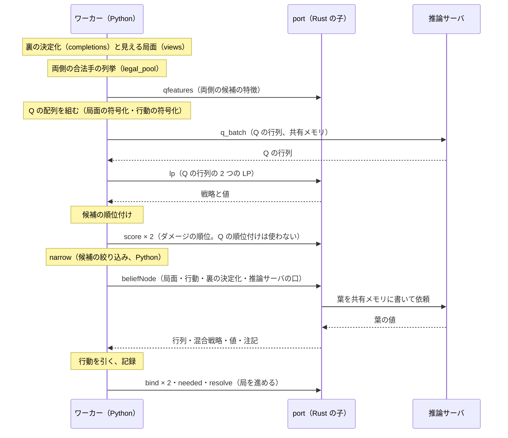
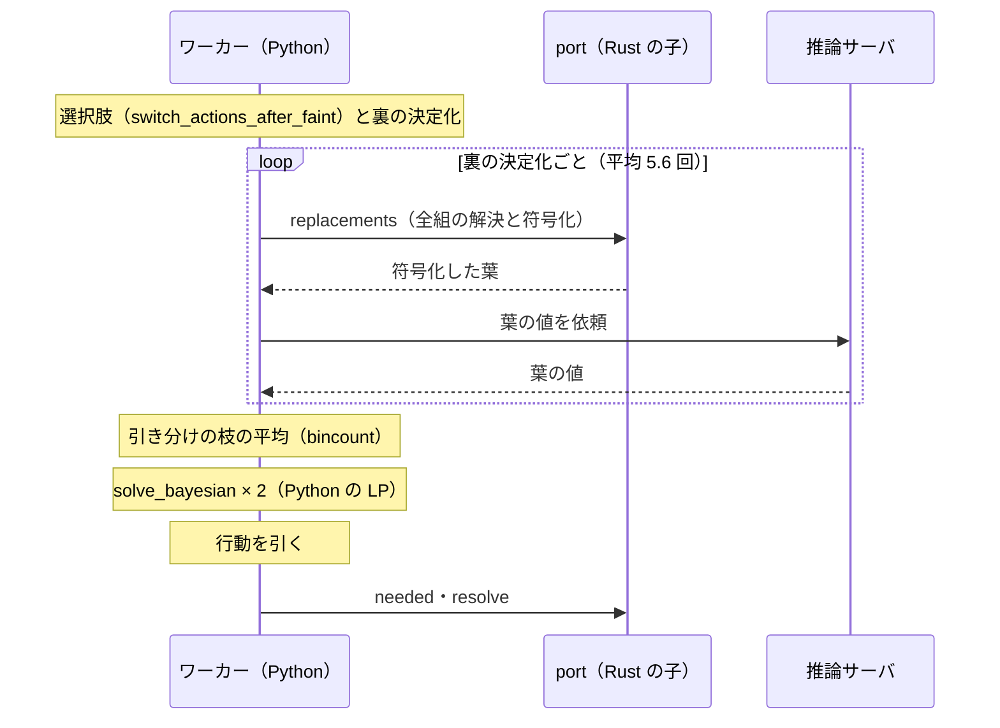
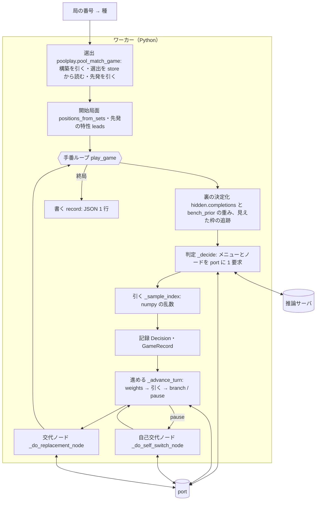

# IKA-457: 段 2、1 ノードの解きを Rust で完結させる

課題は Notion の Issues（ID IKA-457、親 IKA-453）。枝は `worktree-agent-a02d5a4eb668af2ea`。日付は 2026-11-26。
計測の駆動・生の出力は `C:/tmp/ika457/` に置き、コミットしていない。

## 0. 要点

* 段 1（IKA-455）が既定 on の今、生成の 1 局の CPU は 0.581 秒である。内訳は port の exe が 59%、ワーカーの Python が 21%、推論サーバが 20% だった（§1）。
* ワーカーの段の CPU（起動を除く）は 1 局 90 ms である。決定の種類ごとの推定では、裏ありのノードが 45 ms、交代のノードが 21 ms、裏なしのノードが 17 ms、局の間が 5 ms だった。
* ワーカーに残る最大のかたまりは、根のメニュー作りである（narrow・Q の配列・特徴・採点・Q の LP）。裏ありと裏なしの両ノードで、合わせて約 25 ms ある。
* 境界の案は 3 つ比べた（§3）。推奨は、小さな要求を後ろから足す案 A である。順番は、2.1 裏なしノード、2.2 交代ノード、2.3 根のメニュー、2.4 メニューとノードを 1 要求に束ねる、である（§4）。
* 最初の段 2.1 は実装まで進めた（§5）。裏なしのノードを、裏ありと同じ `beliefNode` の 1 要求で解く。Rust は変えていない。フラグは `POKEURAOU_GEN_PORT_EXACT` で、既定 off である。
  * 1 ワーカーで 40 局と 200 局、21 ワーカーで 600 局が、off と on で全局一致した。
  * 1 局の CPU は −0.5%、ワーカーの CPU は −1.7%、局/分は +0.8% だった。局/分は誤差の中で、見込みどおり小さい。
* ワーカーの Python をすべて移しても、減るのは 1 局の CPU の 1 割ほどである。port の exe が 59% を占めるので、段 2 と段 3 のあとの伸びしろは port 側の費用にある（§6）。

### 更新（段 2.2〜2.4 と段 3 の設計）

* 段 2.2（交代ノード、§10）、2.3（メニュー、§11）、2.4（メニューとノードを束ねる、§12）を、段 2.1 と同じ決まりで入れた。いずれも既定 off の旗で、前の段を含む。
* 段 2 の累計（段 1 に対し 2.1〜2.4 すべて on、§13）: 1 局の CPU −9.4%、ワーカー −50.6%、局/分 +4.0%。局のビット一致は 1 ワーカー 40・200 局と 21 ワーカー 600 局で取れた。
* 段 3 の設計は §14。案 1（手番ごとに Rust）から入れて案 2（局ごとに Rust）へ進む順を推奨した。

## 1. 今の道を測る

### 1.1 設定

| 項目 | 値 |
|---|---|
| 木と exe | 枝の先頭は 131d811（段 1 の既定 on）。port の exe は worktree で `cargo build --release`（75 秒）|
| Python | 本体の `.venv`。`PYTHONPATH` に worktree の `src` を入れ、`pokeuraou.__file__` が worktree を指すことを確かめた |
| 生成の形 | `profile_stages.py generation --games 600 --seed 45701 --served --servers 2 --device cuda --workers 21 --limit 12 --value data/models/value-mc7.pt --q-model data/models/q-mc6.pt --pool regmc-matchupweb --hide-bench -- --rank-leaf --selection-store data/selection-solved/value-mc7 --rank-fill q-nocover`（IKA-452 の設定表と同じ。旗は何も設定しない）|
| 時計 | IKA-454 のサイクル数の時計（`clocks: thread_cycles`）|
| 機械の状態 | 計測の前に python と pokeuraou-damage の過程を確かめ、自分の木以外になかった。Windows 全体の CPU 使用率は、自分の過程がなくても 33% あった。原因は確かめていない |

### 1.2 過程ごとの CPU（定常状態、1 局あたり）

| 過程 | CPU（秒/局）| 割合 |
|---|---|---|
| port の exe | 0.344 | 59% |
| ワーカーの Python | 0.123 | 21% |
| 推論サーバ | 0.114 | 20% |
| 合計 | 0.581 | |

### 1.3 ワーカーの段の CPU

起動（21 過程で 25.7 秒）を除いた 1 局あたりの値である。上位の行だけを書く。
決定の種類ごとの欄は、各行の CPU を、その種類の実時間の比で分けた**推定**である。CPU を種類ごとに測ったわけではない。

| 段 | ms/局 | 裏あり | 裏なし | 交代 | 局の間 |
|---|---|---|---|---|---|
| `narrow`（メニューの絞り込み）| 9.5 | 6.8 | 2.7 | | |
| `lp`（Python が解く LP）| 8.7 | | 0.7 | 8.0 | |
| `rust.ask`（要求の受け渡し）| 8.7 | 5.0 | 1.5 | 1.8 | 0.1 |
| `completions`（裏の決定化）| 8.3 | 5.7 | 0.1 | 2.3 | |
| `belief` | 5.9 | 4.0 | 1.9 | | |
| `rust.header` | 5.5 | 2.9 | 1.3 | 0.9 | 0.1 |
| `q.arrays`（Q の配列）| 4.8 | 4.0 | 0.8 | | |
| `encode` | 4.6 | 3.1 | 1.1 | | |
| `record` | 3.8 | | | | 3.8 |
| `rust.qfeatures` | 3.0 | 2.4 | 0.6 | | |
| `rust.score` | 2.7 | 1.9 | 0.9 | | |
| `lp.q`（Q の LP の後始末）| 2.3 | 1.8 | 0.5 | | |
| `rust.replacements` | 2.2 | 0.3 | 0.2 | 1.7 | |
| `serve.wait` | 2.2 | | 0.6 | 1.5 | |
| `rust.resolve` | 2.0 | 0.6 | 0.3 | 0.9 | 0.1 |
| `forward` | 1.9 | | 0.5 | 1.4 | |
| その他の行 | 約 14 | | | | |
| **段の和** | **90.0** | **44.8** | **17.2** | **21.0** | **5.3** |

自己交代の 314 決定は 1.7 ms/局で、表の列に入れていない（段の和には入っている）。

* 裏ありは 3,156 決定、裏なしは 2,162 決定、交代は 1,724 決定、自己交代は 314 決定、局の間は 600 だった（600 局、7,356 決定）。
* ワーカーの過程の CPU は定常状態で 1 局 0.123 秒、段の和は 0.090 秒である。差の 0.033 秒は、計時の外（解釈系・読み取りスレッドなど）である。内訳は分けていない。
* 裏なしのノードの `lp` は、`beliefNode` を通らない道で、Python が LP の依頼を組む分である。
* 交代のノードの `lp` は、Python の `solve_bayesian` を直接呼ぶ分で、段 1 の旗の外にある。

### 1.4 決定 1 回あたりの port への要求の数

`rust.ask` の呼び出し数である。局面の定義の送信などを含む。

| 決定 | 要求/決定 | うち名のある要求（`rust.*`）|
|---|---|---|
| 裏あり | 19.6 | qfeatures 2、score 2、leads 2.2、bind 2、lp 1（Q の LP）、`beliefNode` 1、needed 1、resolve 0.9 |
| 裏なし | 11.6 | qfeatures 1、score 2、leads 1、bind 1、lp 2（Q と、裏なしノードの LP）、fill 1、needed 1、resolve 1.3 |
| 交代 | 15.2 | replacements 5.6、resolve 1.9、needed 1。推論サーバへ 5.6 回 |

## 2. 今の 1 決定の往復

### 2.1 手番ノード（裏あり、段 1 のあと）

### 2.2 手番ノード（裏なし、2.1 の前）

裏ありと同じ形だが、`beliefNode` の場所が違う。`_per_completion` が port に fill を頼み、葉の配列を Python が受け取る。Python が推論サーバに依頼し、行列を組む。その後、Python が LP の依頼を別に 1 回 port に送る。

### 2.3 交代ノード

## 3. 境界の案

| | A 小さな要求を後ろから足す | B 1 決定を 1 要求にする | C Python の中を軽くする |
|---|---|---|---|
| 移すもの | 裏なしノード（2.1）、交代ノード、根のメニュー（`qMenus` を根に広げる）を、それぞれ 1 要求に | メニューとノードを 1 要求に束ねる。port の中でメニューの行動表をそのままノードに渡す | port は変えない。`narrow`・`completions`・`to_id` などの Python を速くする |
| 手番ノードの要求 | メニュー 1 + ノード 1 の 2 回（今は名のある要求が 10〜12 回）| 1 回 | 変わらない |
| 推論サーバへの依頼 | port が持つ（`served.rs` を流用）。Q は `qMenus` の道が既にある | port が持つ | ワーカーのまま |
| 見込みの CPU（**見込みで、測っていない**）| メニュー −18〜25 ms/局、交代 −12〜18 ms/局（段 1.4 で、移した分の 6〜8 割が正味の減りだった）| A に加え、行動表の往復の分が少し減る | −5 ms/局ほど。Python の行数に比例する分しか減らない |
| 実測 | 2.1 だけ。1 局 −0.5%、ワーカー −1.7%（§5.3）| なし | なし |
| ビット一致 | メニューは `qMenus` が `_q_menus` と一致した前例がある。根には見える局面と選択肢の違いがあり、段ごとに確かめる | 同じ。ただし束ねると、どこが原因か分けにくい | 保てる |
| 段 3 へのつながり | 各要求が、段 3 の対局の進行の部品になる | 段 3 の入力の形（1 決定 1 要求）に近い | つながらない |
| 実装の大きさ（見積もり）| 2.1 は小（済）。交代は中、メニューは大 | 大（A の後で小さい差分）| 小 |

* B は、A の 2.3 までを入れたあとに束ねる形で、A の続きとして扱える。先に B を作ると、メニューの一致とノードの一致を一度に確かめることになる。
* C は、`narrow` が 9.5 ms/局あるので効く行はあるが、port との往復が残る。段 3 の方向と合わないので採らない。

## 4. 推奨と段の順番

推奨は A である。段 1 と同じく、後ろ（解き）から前（メニュー）へ入れ、各段で Python の道と局のビット一致を取る。

| 段 | 内容 | 見込み（測っていない）| 確かめ方 |
|---|---|---|---|
| 2.1（済）| 裏なしのノードを `beliefNode` で解く | 裏なしの `lp`・`rust.unpack`・`serve.*` の約 2〜3 ms/局 | §5 |
| 2.2 | 交代のノードを 1 要求にする。選択肢と裏の決定化の局面を送り、port が全組の解決・符号化・推論サーバへの依頼・引き分けの平均・2 辺のベイズ型ゲームを行う | 交代の 21 ms/局のうち 12〜18 | 1 ワーカーのビット一致。サーバへの依頼の列が同じこと |
| 2.3 | 根のメニューを 1 要求にする。`qMenus` を、見える局面（裏の決定化の最重の局面）と cover なしの絞り込み、記録の欄に使う値に広げる | メニューの 25〜30 ms/局のうち 18〜25 | 1 ワーカーのビット一致。Q の依頼の列が同じこと。`note_coverless` の数え |
| 2.4 | メニューとノードを 1 要求に束ねる（案 B）| 要求と JSON の受け渡し | 同上 |

* 2.2 の前に、交代のノードの `solve_bayesian` を既存の `portlp`（`GEN` の旗）に通すだけの小さな段を挟める。8 ms/局のうちの Python の模型づくりの分が減る。段 1.1 の実測では、LP だけを移すと局/分には出なかった（−0.4%）。この段は、2.2 に含める。
* 各段の局/分は、CPU の減りが小さいと誤差の中に入る。段の CPU と過程ごとの CPU で読み、局/分は 2.2 以降にまとめて見る。

## 5. 最初の段 2.1

### 5.1 変えたもの

| ファイル | 内容 |
|---|---|
| `src/pokeuraou/portlp.py` | 旗 `EXACT`（環境変数 `POKEURAOU_GEN_PORT_EXACT=1`、既定 off）と `set_exact`。on にすると `NODE` も on になる（EXACT → NODE → STACK → FOLD → GEN）。`default_on_for_generation()` は `EXACT` に触れない。数える値 `exact`、ワーカーの終わりの 1 行にも出る |
| `src/pokeuraou/beliefnode.py` | `belief_payoffs` で、裏のない節を、`EXACT` が on のとき `_node_in_port` に回す。port が誤り（`fault`）を返す、推論サーバの葉でない、古い exe のときは、今までの `_per_completion` に戻る |
| `tests/test_belief_exact_port.py` | 6 本（§5.4）|

Rust は変えていない。`beliefNode` の既存の枝（`exact && root` の job）が、裏のない節をそのまま扱った。

### 5.2 局のビット一致

局の記録の全欄（時間と `engine` を除く）で比べた。

| 比べ | 局 | 決定 | 一致 |
|---|---|---|---|
| 1 ワーカー、種 777: off と off（零の対照）| 40 | 493 | 40/40 |
| 同: off と EXACT on | 40 | 493 | 40/40 |
| 同: off と別の種（778）| 40 | | 0/40（比べが落ちうる対照）|
| 1 ワーカー、種 999: off と off | 200 | 2,441 | 200/200 |
| 同: off と EXACT on | 200 | 2,441 | 200/200 |
| 同: off と別の種（998）| 200 | | 0/200 |
| 21 ワーカー・サーバ 2、種 45701: off と off | 600 | 7,356 | 600/600、7,356/7,356 |
| 同: off と EXACT on（2 回の on との 4 通り）| 600 | 7,356 | 600/600、7,356/7,356（4 通りとも）|
| 同: on と on | 600 | 7,356 | 600/600 |
| 同: off と別の種（45601）| 600 | | 0/600、決定 1/7,277 |

* 陽性対照: on のワーカーの標準エラーの `exact` が、1 ワーカー 40 局で 157、200 局で 743 だった。21 ワーカー 600 局では 2 回とも 2,162 で、裏なしの決定の数に等しい。off は 0。`faults solved in Python` は全回 0。
* 21 ワーカーでは、推論サーバが依頼を併せない設定（`merge` なし）でだけ確かめた。

### 5.3 速さ（21 ワーカー・サーバ 2・600 局、同じ exe、ABBA 2 組）

組 1 は種 45801（A X X A）、組 2 は種 45802（X A A X）。A は off、X は EXACT on。この間、他の仕事は回していない。回の前に python の過程を確かめ、自分の木以外になかった。Windows 全体の CPU 使用率は 33% だった。`busy` は過程木が使ったコア数である。

| 回 | 構成 | busy | 局/分 | 1 局の CPU（秒）| ワーカー | port の exe | 推論サーバ |
|---|---|---|---|---|---|---|---|
| a1A1 | off | 11.94 | 1,295.5 | 0.5531 | 0.1220 | 0.3218 | 0.1092 |
| a1X1 | on | 12.10 | 1,309.0 | 0.5544 | 0.1187 | 0.3273 | 0.1083 |
| a1X2 | on | 12.13 | 1,287.7 | 0.5650 | 0.1207 | 0.3331 | 0.1111 |
| a1A2 | off | 12.28 | 1,294.0 | 0.5695 | 0.1230 | 0.3346 | 0.1118 |
| a2X1 | on | 12.33 | 1,360.8 | 0.5438 | 0.1202 | 0.3179 | 0.1056 |
| a2A1 | off | 12.25 | 1,332.9 | 0.5514 | 0.1231 | 0.3198 | 0.1084 |
| a2A2 | off | 12.46 | 1,363.2 | 0.5485 | 0.1224 | 0.3181 | 0.1078 |
| a2X2 | on | 12.48 | 1,368.5 | 0.5473 | 0.1225 | 0.3189 | 0.1057 |

| 読み（各 4 回の平均）| off | on | 変化 |
|---|---|---|---|
| 1 局の CPU（秒）| 0.5556 | 0.5526 | −0.5% |
| ワーカー | 0.1226 | 0.1205 | −1.7% |
| port の exe | 0.3236 | 0.3243 | +0.2% |
| 推論サーバ | 0.1093 | 0.1076 | −1.6% |
| 局/分 | 1,321.4 | 1,331.5 | +0.8% |

段の CPU（600 局の合計、秒、サイクル数の時計、4 回の平均）:

| 段 | off | on | 差 |
|---|---|---|---|
| `lp` | 5.30 | 4.83 | −0.47 |
| `rust.unpack` | 1.03 | 0.60 | −0.43 |
| `serve.wait` | 1.34 | 1.04 | −0.30 |
| `forward` | 1.14 | 0.86 | −0.28 |
| `serve.copy` | 0.44 | 0.28 | −0.16 |
| `rust.body` | 0.66 | 0.42 | −0.24 |
| `rust.fill` | 0.75 | 0.60 | −0.15 |
| `rust.lp` | 0.77 | 0.60 | −0.17 |
| `belief` | 3.47 | 3.41 | −0.06 |

* 段の CPU の減りの和は約 2.1 秒、1 局 3.5 ms である。ワーカーの過程の CPU の減り（0.0021 秒/局）と同じ桁である。
* 裏なしの決定 1 回あたりの port への要求は、11.65 回から 10.65 回に減った。名のある `rust.lp` は 2 回から 1 回に減った。
* 局/分の差（+0.8%）は、同じ構成の中の幅（off で 1,294〜1,363）より小さい。差があるとは言えない。
* 1 局の CPU の差（−0.5%）も、同じ構成の中の幅（off で 0.5485〜0.5695）より小さい。段の CPU とワーカーの CPU の向きが合うことを、この段の証拠にする。

### 5.4 テスト

* `tests/test_belief_exact_port.py`（6 本）。推論サーバの代役（`test_portserved` の `Stub`）が依頼ごとの行数と配列のバイトの hash を残す。裏なしのノード（全スロットを見た状態の turn 1 と中盤）で、旗 on の行列が `_per_completion` と一致し（SkylakeX では `array_equal`、他の核では 1e-12 まで許す）、ベイズ型ゲームの答えが `solve_bayesian` と一致し、**サーバが受けた依頼の列が全部同じ**ことを確かめる。
  * 陽性対照は、port が取った裏なしのノードの数（`portlp.COUNTS["exact"]`）。
  * 比べが落ちうる対照は、値が違うサーバ（1.3%、2% の拡大）で 2 つの答えが一致しないこと。
  * 旗 off のとき、port が裏なしのノードを取らないこと。
  * port が誤りを返す（注入）と、`faults` が 1 増え、`_per_completion` と同じ行列を返すこと。
* **直す前で落ちること**: Rust は変えていないので、「直す前の exe」はない。代わりに 2 通りで確かめた。
  * 131d811 の `src` を別の場所に取り出して同じテストを回すと、6 本とも `portlp.EXACT` がなく落ちた。
  * 今の `src` で、`belief_payoffs` の入口を元の形（裏のない節を常に `_per_completion` に回す）に一時的に戻すと、port が節を取る 4 本が落ちた（`ran == (0, 1)` の陽性対照）。旗 off の 1 本と比べが落ちうる 1 本は通った。戻したあと 6 本とも通った。
* `shared`・`redone` は比べていない。裏なしのノードで、`_per_completion` は 100・100、`beliefNode` は 200・0 と数える。どちらも報告用の数で、読む所がない。
* ruff、`cargo test --release`（34 本）、`port_coverage.py --check`、`port_gate_audit.py --check` は通った。`agent_drift.py --check` の DRIFTED は master と同じ 8 件のままである。

## 6. 読みと次の判断

* ワーカーの Python は、1 局の CPU の 21% である。移した分の 6〜8 割が正味の減りになるとして、2.2 と 2.3 をすべて入れても、1 局の CPU は約 −5〜7% の見込みである（測っていない）。段 3 を加えても、全体で約 −10% が上限の目安になる。
* port の exe は 59% を占める。解決（`rust.child.resolve`）・符号化・bind の費用である。ワーカーを移し切ったあとの伸びしろは、この側に大きい。IKA-452 の §3 を参照する。
* 局/分は、段 1.4 では CPU の減り（−9.1%）の 6 割ほど（+5.7%）だった。段 2 の各段も、CPU の減りより小さく出ると見る。

## 7. 確かめていないこと

* 段の CPU の「決定の種類ごと」の欄は、実時間の比で分けた推定である。
* 2.2 以降の見込みの値は、段 1.3・1.4 の移した分と正味の減りの比からの見積もりで、実装して測っていない。
* 21 ワーカーのビット一致は、推論サーバが依頼を併せない設定でだけ取った。`merge` ありは試していない。
* 別の CPU での一致。SkylakeX 以外では最後の桁が動きうる。テストは 1e-12 まで許す形にした。局の変化は測っていない。
* ABBA の局/分と 1 局の CPU の差は、同じ構成の中の幅より小さい。2.1 の効果は、段の CPU とワーカーの CPU でしか言えない。
* 計時の外のワーカーの CPU（1 局 0.033 秒）の内訳。
* Windows 全体の CPU 使用率が、自分の過程がなくても 33% あった理由。

## 8. 機械時間

計測の前に python と pokeuraou-damage の過程を確かめた。自分の木以外になかった。合計で 30 分に届かない。

| 内容 | 機械の使い方 |
|---|---|
| port の exe のビルド | 全コア 75 秒 |
| 測定の 600 局（1 回）| 21 ワーカー、約 45 秒 |
| 1 ワーカーの一致（40 局 × 4、200 局 × 4）| 1 ワーカー + サーバ、合計 約 20 分 |
| 21 ワーカーの一致（600 局 × 4）| 各 約 45 秒 + 起動 |
| ABBA（600 局 × 8）| 各 約 45 秒 + 起動 |
| `cargo test --release`・テスト | 数分 |

## 10. 段 2.2: 交代ノードを 1 要求で解く

2.1 は master に入った（e01d9ef）。ここから、移行を最後まで終える方針（調整役、ユーザーの判断）で、速さの判定では止めない。

### 10.1 旗と変えたもの

* `POKEURAOU_GEN_PORT_REPLACE=1`（`portlp.REPLACE`、既定 off、`default_on_for_generation` は触れない）。**段 2.2 は 2.1 を含む**（REPLACE → EXACT → NODE → STACK → FOLD → GEN）。

| ファイル | 内容 |
|---|---|
| `rust/src/replacenode.rs`（新）| `replacementNode`。裏の決定化ごとに `replacements_encoded`（既存）で全組の局面を符号化し、推論サーバに依頼し、終局の葉を結果に置き換え、引き分けの枝を重みで束ね、2 辺のベイズ型ゲームを解く。サーバへの依頼の順は Python と同じ（辺 0 の決定化、辺 1 の決定化）。入力の誤りと拒否された組は `fault` |
| `rust/src/beliefnode.rs` | `fold_with` の末尾の「ゲームを解く」部を `solve_games` に切り出した（`beliefFold` と共用）。`server_failed` を `pub(crate)` に |
| `src/pokeuraou/replacenode.py`（新）| 要求を組み、答えを `_do_replacement_node` の形（辺ごとの戦略と値）に戻す。推論サーバの葉（`RemoteValue`）でないとき、`DUPES` のときは None を返し、Python の道に戻る |
| `src/pokeuraou/selfplay.py` | `_do_replacement_node` の裏あり側の枝で、`replacenode.solve` を先に呼ぶ。`PortFault` なら数えて Python の道に戻る |
| `src/pokeuraou/rustnode.py`・`portlp.py` | `RustNode.replacement_node`（`rust.replacements` で計時）、旗、数える値 `replaced`、ワーカーの終わりの行 |

* 辺ごとに葉が別でもよい（`servers` の一覧と、各ジョブの `leaf` の番号）。
* 裏なしの交代ノード（全スロットを見た）も同じ道を通る（決定化が 1 つずつ）。裏のない側のない節（`sheets` なし）は Python のままで、生成では起きない。
* port の状態は持たない。`replacements_encoded` は要求を読むスレッドで呼ぶ。

### 10.2 局のビット一致

| 比べ | 局 | 決定 | 一致 |
|---|---|---|---|
| 1 ワーカー、種 777: off と REPLACE on | 40 | 493 | 40/40 |
| 1 ワーカー、種 999: off と REPLACE on | 200 | 2,441 | 200/200 |
| 同: 零の対照（off と off）、別の種 | | | 段 2.1 の回の値（40/40、200/200、0/40、0/200）|
| 21 ワーカー・サーバ 2、種 45701: off と REPLACE on（2 回）| 600 | 7,356 | 600/600、7,356/7,356（4 通りとも）|
| 同: on と on、off と off | 600 | 7,356 | 600/600 |
| 同: off と別の種 | | | 0/600 |

* 陽性対照: 1 ワーカー 40 局で `replaced` 114、200 局で 574。21 ワーカー 600 局で 2 回とも 1,724（交代の決定の数に等しい）。`faults solved in Python` は全回 0。
* 21 ワーカーでは推論サーバが依頼を併せない設定（`merge` なし）でだけ確かめた。

### 10.3 テスト

* `tests/test_replacement_node_port.py`（5 本）。記録された中盤の交代ノードを `_do_replacement_node` で解き、旗 off と on で、メニュー・2 つの混合戦略・値・選んだ行動・次の局面が一致し（SkylakeX 以外では 1e-12 まで）、**サーバが受けた依頼の列が同じ**ことを確かめる。裏が隠れている場合（葉が 1 つと 2 つ）と、裏のない場合。陽性対照は `replaced` の数。比べが落ちうる対照は、値の違うサーバ。port が `fault` を返す（注入）と Python の道に戻り、同じ答えになる。
* Rust: `replacenode::tests` に 1 本（終局の葉の置き換え）。計 35 本。
* **直す前の exe で落ちる**: 段 2.1（e01d9ef）の Rust を `C:/tmp/ika457/old22/` に別に作り（`replacementNode` の文字列がない exe）、`POKEURAOU_RUST_NODE_BIN` で指して同じテストを回した。注入の 1 本を除く 4 本が `the port did not answer replacementNode` で落ちた。新しい exe では 5 本とも通る。
* ruff、`cargo test --release`、`port_coverage.py --check`、`port_gate_audit.py --check` は通った。`agent_drift.py --check` の DRIFTED は 8 件のままである。

### 10.4 速さ（21 ワーカー・サーバ 2・600 局、同じ exe、ABBA 2 組）

A は段 2.1（EXACT）、R は段 2.2（REPLACE）。組 1 は種 45901（A R R A）、組 2 は種 45902（R A A R）。この間、他の仕事は回していない。

| 回 | 構成 | busy | 局/分 | 1 局の CPU（秒）| ワーカー | port の exe | 推論サーバ |
|---|---|---|---|---|---|---|---|
| b1A1 | 2.1 | 12.60 | 1,313.8 | 0.5755 | 0.1194 | 0.3432 | 0.1128 |
| b1R1 | 2.2 | 12.44 | 1,330.7 | 0.5609 | 0.1044 | 0.3452 | 0.1111 |
| b1R2 | 2.2 | 12.30 | 1,308.3 | 0.5641 | 0.1020 | 0.3490 | 0.1131 |
| b1A2 | 2.1 | 12.59 | 1,309.4 | 0.5768 | 0.1216 | 0.3474 | 0.1077 |
| b2R1 | 2.2 | 12.34 | 1,354.9 | 0.5463 | 0.1058 | 0.3268 | 0.1136 |
| b2A1 | 2.1 | 12.54 | 1,347.4 | 0.5582 | 0.1205 | 0.3259 | 0.1118 |
| b2A2 | 2.1 | 12.41 | 1,343.3 | 0.5544 | 0.1197 | 0.3259 | 0.1086 |
| b2R2 | 2.2 | 11.77 | 1,305.2 | 0.5413 | 0.1063 | 0.3289 | 0.1060 |

| 読み（各 4 回の平均）| 2.1 | 2.2 | 変化 |
|---|---|---|---|
| 1 局の CPU（秒）| 0.5663 | 0.5531 | −2.3% |
| ワーカー | 0.1203 | 0.1046 | −13.1% |
| port の exe | 0.3356 | 0.3375 | +0.6% |
| 推論サーバ | 0.1102 | 0.1109 | +0.6% |
| 局/分 | 1,328.5 | 1,324.8 | −0.3% |

* 段の CPU（600 局の合計、秒）: `lp` 4.80 → 0.00、`rust.unpack` 0.60 → 0.05、`serve.wait` 1.04 → 0.04、`forward` 0.85 → 0.03、`serve.copy` 0.27 → 0.06、`rust.ask` 5.21 → 4.95。
* 1 局の CPU は 2 組とも下がり（−2.5%、−2.0%）、ワーカーの減りの大部分が正味の減りになった（port の exe の増えは 0.002 秒）。
* 局/分は −0.3% で、同じ構成の中の幅（2.1 で 1,309〜1,347）より小さい。`busy` は 2.2 の回で 0.3 ほど低い。CPU が減っても局/分に出ない点は、2.1 までと同じ向きである。移行の段として入れる。

### 10.5 確かめていないこと

* `merge` ありの設定での 21 ワーカーのビット一致。
* 別の CPU での LP・符号化の最後の桁。
* 本番の長い生成で `faults` が 0 のままか。
* 局/分に出ない理由（`busy` が下がる向き）の分け方。

## 11. 段 2.3: 手番ノードの 2 つのメニューを 1 要求で作る

### 11.1 旗と変えたもの

* `POKEURAOU_GEN_PORT_MENUS=1`（`portlp.MENUS`、既定 off、`default_on_for_generation` は触れない）。**段 2.3 は 2.2 を含む**（MENUS → REPLACE → EXACT → NODE → …）。

| ファイル | 内容 |
|---|---|
| `rust/src/qmenus.rs` | `rootMenus`（`root_menus`）。辺 s は、自分の合法手を節の局面で、相手の合法手を見える局面（裏の決定化の最重の局面）で数え、その局面の配列を Q の共有メモリに書く。Q へは Python と同じ `q`（1 要求）か `q_many`（2 要求）で依頼し、ゲームを解き、numpy の BLAS で点を付け、各辺の幅で切る。`qMenus` の部品（`pool_arrays`・`scores`・`top`）を共用し、`ask_chunk` に依頼の種類（`q_batch` か `q`/`q_many`）を足した。cover なしで外れた手の選択肢の数も返す |
| `src/pokeuraou/rootmenus.py`（新）| 要求を組み、答えのメニューと数える値（`q.prefetch.*`・`q.rankings`・`q.cells`・`QRANKED`・`COVERLESS`・Q の待ち）を Python の道と同じに残す。Q が推論サーバの `RemoteQ`・符号化が `Encoder`・numpy の BLAS が読める・味方への技の指定が off のとき以外、空の合法手、port の `fault` は Python の道に戻る |
| `src/pokeuraou/selfplay.py` | `_menus` で、Q の cover なしの順位付けのとき、`rootmenus.menus` を先に呼ぶ |
| `src/pokeuraou/narrow.py` | `note_coverless_count`（`note_coverless` の数だけの形）|
| `src/pokeuraou/rustnode.py`・`portlp.py`・`timing.py`・`tools/profile_stages.py` | `RustNode.root_menus`（行 `rust.menus`）、旗、数える値 `menus`、ワーカーの終わりの行 |

* どちらの辺も同じ見える局面と同じ合法手なら 1 要求、違えば 2 要求（`same` は見える局面が同じ物かの印で、Python の `id(at)` の比べと同じ）。
* ダメージの順位（`score`）の呼び出しは、Q の順位付けが読まないので省いた。`narrow` の候補の詳細（`Candidate.detail`）は、生成の局の記録に出ない。
* port の状態は持たない。

### 11.2 局のビット一致

| 比べ | 局 | 決定 | 一致 |
|---|---|---|---|
| 1 ワーカー、種 777: off と MENUS on | 40 | 493 | 40/40 |
| 1 ワーカー、種 999: off と MENUS on | 200 | 2,441 | 200/200 |
| 同: 零の対照、別の種 | | | 段 2.1 の回の値（40/40、200/200、0/40、0/200）|
| 21 ワーカー・サーバ 2、種 45701: off と MENUS on（2 回）| 600 | 7,356 | 600/600、7,356/7,356（4 通りとも）|
| 同: on と on、off と off | 600 | 7,356 | 600/600 |
| 同: off と別の種 | | | 0/600 |

* 陽性対照: `menus` が、1 ワーカー 40 局で 361、21 ワーカー 600 局で 2 回とも 5,318（手番ノードの数）。`faults solved in Python` は全回 0。`games`（Q の LP を `portlp.solve_many` で解いた数）は 565 から 0 になった。
* 21 ワーカーでは推論サーバが依頼を併せない設定（`merge` なし）でだけ確かめた。

### 11.3 テスト

* `tests/test_root_menus_port.py`（6 本）。推論サーバの代役の Q（`test_port_menus.QStub`）で、記録した局の局面と、裏が隠れた局面（各辺の最重の裏の決定化から見る）の、`_menus` を旗 off と on で比べる。**メニュー、Q が受けた依頼の列（`q` と `q_many`、配列のバイト）、`COVERLESS` の数え、各辺が見た局面が一致**する。幅は (12, 12)・(4, 7)・(1, 30)。
  * 陽性対照: port が作ったメニューの数（`menus`）。裏が隠れて 2 要求になる節があること、メニューが切られて外れた選択肢が数えられること。
  * 比べが落ちうる対照: 行の順を逆にした別の Q で、メニューが変わること。
  * port が `fault` を返す（注入）と、Python の道に戻り同じメニューになること。
* **直す前の exe で落ちる**: 段 2.1 の Rust の別 exe（`C:/tmp/ika457/old22/`）で回すと、注入の 1 本を除く 5 本が `the port did not answer rootMenus` で落ちた。新しい exe では 6 本とも通る。
* メニューの値の一致は、port が numpy と同じ OpenBLAS の `gemv` を読み込んで点を付けるので、CPU の核に依らずビット一致である（`test_port_menus` の前提と同じ）。
* ruff、`cargo test --release`（35 本）、`port_coverage.py --check`、`port_gate_audit.py --check`、`test_timing`・`test_profile_stages` などは通った。`agent_drift.py --check` の DRIFTED は 8 件のままである。

### 11.4 速さ（21 ワーカー・サーバ 2・600 局、同じ exe、ABBA 2 組）

A は段 2.2、M は段 2.3。組 1 は種 46001（A M M A）、組 2 は種 46002（M A A M）。この間、他の仕事は回していない。

| 回 | 構成 | busy | 局/分 | 1 局の CPU（秒）| ワーカー | port の exe | 推論サーバ |
|---|---|---|---|---|---|---|---|
| c1A1 | 2.2 | 12.38 | 1,320.6 | 0.5623 | 0.1064 | 0.3406 | 0.1152 |
| c1M1 | 2.3 | 11.70 | 1,348.6 | 0.5205 | 0.0627 | 0.3410 | 0.1166 |
| c1M2 | 2.3 | 11.90 | 1,361.5 | 0.5243 | 0.0650 | 0.3417 | 0.1175 |
| c1A2 | 2.2 | 12.38 | 1,314.3 | 0.5653 | 0.1097 | 0.3447 | 0.1107 |
| c2M1 | 2.3 | 11.48 | 1,351.5 | 0.5095 | 0.0671 | 0.3281 | 0.1141 |
| c2A1 | 2.2 | 12.00 | 1,297.9 | 0.5548 | 0.1069 | 0.3310 | 0.1168 |
| c2A2 | 2.2 | 12.20 | 1,331.8 | 0.5497 | 0.1094 | 0.3261 | 0.1141 |
| c2M2 | 2.3 | 11.66 | 1,371.5 | 0.5099 | 0.0658 | 0.3247 | 0.1193 |

| 読み（各 4 回の平均）| 2.2 | 2.3 | 変化 |
|---|---|---|---|
| 1 局の CPU（秒）| 0.5580 | 0.5160 | −7.5% |
| ワーカー | 0.1081 | 0.0652 | −39.7% |
| port の exe | 0.3356 | 0.3339 | −0.5% |
| 推論サーバ | 0.1142 | 0.1169 | +2.4% |
| 局/分 | 1,316.2 | 1,358.3 | +3.2% |

* 段の CPU（600 局の合計、秒）: `narrow` 5.81 → 0、`q.arrays` 3.03 → 0、`rust.qfeatures` 1.87 → 0、`rust.score` 1.70 → 0、`lp.q` 1.43 → 0、`serve.q` 0.97 → 0、`rust.lp` 0.62 → 0、`encode` 2.90 → 0.27、`rust.ask` 5.03 → 3.86。新しい行 `rust.menus` が 0.51 秒。
* 1 局の CPU は 2 組とも下がった（−8.1%、−6.8%）。port の exe は増えていない。Python が行っていた port への往復（特徴 2 回・ダメージの順位 2 回・Q の LP 1 回など）が、port の中の 1 回になり、重なっていた符号化と受け渡しが減ったためと見る（内訳は分けていない）。
* 局/分は +3.2% で、同じ構成の中の幅（2.2 で 1,298〜1,332）より大きい向きである。差の有意性は出していない。`busy` は 2.3 で 0.6 ほど低く、空いたコアが増えた。

### 11.5 確かめていないこと

* `merge` ありの設定での 21 ワーカーのビット一致。
* 局の記録に出ない `Candidate.detail`（ダメージの順位）を使う道具（人と打つ道具など）は、この旗の外である（`MENUS` は生成の道だけ）。
* 見える局面（裏の決定化）が `pos` と別の局面のときの Q の配列は、テストの代役の Q とワーカーの局のビット一致で確かめた。実際の Q の網での値の一致は、局のビット一致（40・200・21 ワーカー 600 局）が示す。
* 本番の長い生成で `faults` が 0 のままか。

## 12. 段 2.4: メニューとノードを 1 要求に束ねる

### 12.1 旗と変えたもの

* `POKEURAOU_GEN_PORT_DECIDE=1`（`portlp.DECIDE`、既定 off、`default_on_for_generation` は触れない）。**段 2.4 は 2.3 を含む**（DECIDE → MENUS → REPLACE → EXACT → NODE → …）。
* 先に入れた別の修正（コミット 807d2c2）: 順位の記録（`--record-rank-scores`）を集めている間の確認。Python の道も Q の順位付けでは行を書かない（`rank_scores.watch` は葉の順位付けだけを包む）ことを確かめ、集める側が Python の道と同じになるテストを足した。

| ファイル | 内容 |
|---|---|
| `rust/src/qmenus.rs` | `moveNode`（`move_node`）。`rootMenus` の前半（`root_menus_node`、メニューの行動も返すようにした）で両辺のメニューを作り、そのメニューを `beliefNode` の `ours`・`theirs`・`rows`・`cols`・`rowFeat`・`colFeat`（技が入れ替えを強いるか・攻撃か・交代で入れる枠と種の id）にして、`beliefplan::belief_node` を同じ要求の中で呼ぶ。Q の口は `qServer`（葉の口 `server` と別名）|
| `src/pokeuraou/rootmenus.py` | `Plan`（メニューの要求と、答えの記帳）に分け、`menus`（段 2.3）と `moveNode` が共用する |
| `src/pokeuraou/beliefnode.py` | `fused_node`（`belief_payoffs` と同じ入口の判定のあと `_node_in_port` を `fused=` つきで呼ぶ）。`_node_in_port` は `fused` のとき行動を送らず、答えのメニューから行列の大きさを取る |
| `src/pokeuraou/search.py` | `belief_solve(..., prebuilt=)`: 作り済みの節を、同じ葉の 2 辺が共有する 1 つの節として使う |
| `src/pokeuraou/selfplay.py` | `_decide`（入口の判定: 旗 on、裏が隠れた節、同じメニューを読む 2 辺、同じ葉、深さ 1、`cells == (0, 0)`、選択の既定、Q の cover なしの順位付け、幅広のメニューなし）と、`ranking_view`（`_menus.views` の切り出し）。`play_game` は `_decide` が答えたときだけ `_menus` を呼ばず、`belief_solve` に節を渡す |
| `src/pokeuraou/rustnode.py`・`portlp.py` | `RustNode.move_node`（`rust.fill`）、旗、数える値 `decided` |

* 入口の判定に当たらない節（深さのある読み、2 辺で別の葉、`select` が既定でない、など）は、今までの 2 要求の道のままである。
* port が `fault` を返すと、メニューもノードも Python が作る（Q への依頼は繰り返されるが、答えは同じ）。
* port の状態は `HELD`（beliefNode と同じ）だけで、要求を読むスレッドに閉じる。
* `profile_stages` の行 `belief` は、この道では 0 になる（`belief_payoffs` の計時を通らない）。ノードの時間は `rust.fill` に入る。

### 12.2 局のビット一致

| 比べ | 局 | 決定 | 一致 |
|---|---|---|---|
| 1 ワーカー、種 777: off と DECIDE on | 40 | 493 | 40/40 |
| 1 ワーカー、種 999: off と DECIDE on | 200 | 2,441 | 200/200 |
| 同: 零の対照、別の種 | | | 段 2.1 の回の値（40/40、200/200、0/40、0/200）|
| 21 ワーカー・サーバ 2、種 45701: off と DECIDE on（2 回）| 600 | 7,356 | 600/600、7,356/7,356（4 通りとも）|
| 同: on と on、off と off | 600 | 7,356 | 600/600 |
| 同: off と別の種 | | | 0/600 |

* 陽性対照: `decided` が、1 ワーカー 40 局で 361、200 局で 1,786、21 ワーカー 600 局で 2 回とも 5,318（手番ノードの数）。`faults solved in Python` は全回 0。port への要求（`crossings`）は 40 局で 836 から 475 に減った。
* 21 ワーカーでは推論サーバが依頼を併せない設定（`merge` なし）でだけ確かめた。

### 12.3 テスト

* `tests/test_move_node_port.py`（4 本）。1 つの推論サーバで、葉の代役（`Stub`）と Q の代役（`QStub`）を持つ。記録した局の局面（裏が見える・隠れる）で、段 2.3 と 1.4 の 2 要求（`_menus` と `belief_payoffs`）と `moveNode` を比べる。**メニュー、全補完の行列（SkylakeX 以外では 1e-12 まで）、要求が解いたゲーム、注記、Q が受けた依頼の列、葉が受けた行の列、各辺が見た局面が一致**する。幅は (12, 12)・(4, 7)。
  * 陽性対照: port が決めた節の数（`decided`）。裏が隠れた節があること。
  * 比べが落ちうる対照: 行の順を逆にした別の Q でメニューが変わること。
  * port が `fault` を返す（注入）と、Python の道に戻り同じメニューになること。
* **直す前の exe で落ちる**: 段 2.3 の Rust（`rootMenus` はあり `moveNode` がない exe、`C:/tmp/ika457/old23/`）で回すと、注入の 1 本を除く 3 本が落ちた。新しい exe では 4 本とも通る。
* ruff、`cargo test --release`（35 本）、`port_coverage.py --check`、`port_gate_audit.py --check`、関係する pytest は通った。`agent_drift.py --check` の DRIFTED は 8 件のままである。

### 12.4 速さ（21 ワーカー・サーバ 2・600 局、同じ exe、ABBA 2 組）

A は段 2.3、D は段 2.4。組 1 は種 46101（A D D A）、組 2 は種 46102（D A A D）。この間、他の仕事は回していない。

| 回 | 構成 | busy | 局/分 | 1 局の CPU（秒）| ワーカー | port の exe | 推論サーバ |
|---|---|---|---|---|---|---|---|
| e1A1 | 2.3 | 11.59 | 1,355.0 | 0.5133 | 0.0656 | 0.3316 | 0.1160 |
| e1D1 | 2.4 | 11.74 | 1,370.7 | 0.5138 | 0.0608 | 0.3350 | 0.1180 |
| e1D2 | 2.4 | 11.72 | 1,374.9 | 0.5114 | 0.0600 | 0.3336 | 0.1178 |
| e1A2 | 2.3 | 11.76 | 1,356.4 | 0.5200 | 0.0666 | 0.3336 | 0.1196 |
| e2D1 | 2.4 | 11.36 | 1,326.3 | 0.5141 | 0.0606 | 0.3336 | 0.1198 |
| e2A1 | 2.3 | 11.69 | 1,352.6 | 0.5187 | 0.0666 | 0.3332 | 0.1188 |
| e2A2 | 2.3 | 11.67 | 1,354.9 | 0.5169 | 0.0661 | 0.3314 | 0.1192 |
| e2D2 | 2.4 | 11.75 | 1,362.6 | 0.5176 | 0.0616 | 0.3365 | 0.1194 |

| 読み（各 4 回の平均）| 2.3 | 2.4 | 変化 |
|---|---|---|---|
| 1 局の CPU（秒）| 0.5172 | 0.5142 | −0.6% |
| ワーカー | 0.0662 | 0.0607 | −8.3% |
| port の exe | 0.3325 | 0.3347 | +0.7% |
| 推論サーバ | 0.1184 | 0.1188 | +0.3% |
| 局/分 | 1,354.7 | 1,358.6 | +0.3% |

* 段の CPU（600 局の合計、秒）: `rust.ask` 3.87 → 3.39、`rust.header` 2.34 → 2.18、`rust.fill` 0.81 → 0.68、`belief` 4.06 → 0（行が通らなくなった）、`rust.menus` 0.51 → 0（`rust.fill` に入った）。
* 1 局の CPU の差（−0.6%）は、同じ構成の中の幅（2.3 で 0.5133〜0.5200）と同じ桁で、局/分も差があるとは言えない。ワーカーの減りの向き（−8%）と、port への要求の減り（40 局で 836 → 475 回）が、この段の証拠である。悪化はない。

### 12.5 確かめていないこと

* `merge` ありの設定での 21 ワーカーのビット一致。
* 局の記録に出ない `Candidate.detail`（ダメージの順位）を使う道具は、この旗の外である。
* `fault` を返す本物の場面の頻度。本番の長い生成で `faults` が 0 のままか。
* 入口の判定に当たらない節（別の葉、深さ、`select`）の割合。生成の既定では、全節が当たると 5,318/5,318（600 局）で確かめた。

## 13. 段 2 の累計（段 1 の既定に対する段 2.1〜2.4 すべて on）

A は段 1 だけ（今の既定）、D は `POKEURAOU_GEN_PORT_DECIDE=1`（段 2.1〜2.4 すべて on）。21 ワーカー・サーバ 2・600 局、同じ exe。組 1 は種 46201（A D D A）、組 2 は種 46202（D A A D）。この間、他の仕事は回していない。

| 回 | 構成 | busy | 局/分 | 1 局の CPU（秒）| ワーカー | port の exe | 推論サーバ |
|---|---|---|---|---|---|---|---|
| g1A1 | 段 1 | 12.13 | 1,306.1 | 0.5573 | 0.1218 | 0.3272 | 0.1084 |
| g1D1 | 段 2 | 11.73 | 1,370.2 | 0.5136 | 0.0610 | 0.3371 | 0.1154 |
| g1D2 | 段 2 | 11.64 | 1,371.3 | 0.5094 | 0.0621 | 0.3279 | 0.1193 |
| g1A2 | 段 1 | 12.47 | 1,313.2 | 0.5695 | 0.1263 | 0.3306 | 0.1126 |
| g2D1 | 段 2 | 11.27 | 1,353.9 | 0.4994 | 0.0625 | 0.3158 | 0.1209 |
| g2A1 | 段 1 | 12.31 | 1,333.2 | 0.5540 | 0.1256 | 0.3146 | 0.1138 |
| g2A2 | 段 1 | 12.10 | 1,321.2 | 0.5495 | 0.1240 | 0.3133 | 0.1121 |
| g2D2 | 段 2 | 11.53 | 1,390.1 | 0.4977 | 0.0604 | 0.3159 | 0.1214 |

| 読み（各 4 回の平均）| 段 1 | 段 2 | 変化 |
|---|---|---|---|
| 1 局の CPU（秒）| 0.5576 | 0.5050 | −9.4% |
| ワーカー | 0.1244 | 0.0615 | −50.6% |
| port の exe | 0.3214 | 0.3242 | +0.9% |
| 推論サーバ | 0.1117 | 0.1193 | +6.8% |
| 局/分 | 1,318.5 | 1,371.4 | +4.0% |

* 段の CPU（600 局の合計、秒）: `lp` 5.31 → 0、`rust.unpack` 1.03 → 0.04、`rust.ask` 5.20 → 3.33、`rust.header` 3.25 → 2.16。
* 1 局の CPU は 4 回とも段 2 が低い（0.4977〜0.5136 対 0.5495〜0.5695）。局/分も 4 回とも段 2 が高い（1,354〜1,390 対 1,306〜1,333）。
* 推論サーバの CPU は +6.8% 増えた。原因は確かめていない。サーバは待つ間に回り続ける（`spin` 0.5、IKA-452）ので、ワーカーの減った分だけ依頼の間隔が詰まって回る時間が増えた可能性があるが、測っていない。
* ワーカーの CPU は 1 局 0.0615 秒で、1 局の CPU の 12% である。段の行に出る分は 1 局 32 ms で、残り約 30 ms は計時の外（解釈系・`play_game` の本体・読み取りスレッド）である。

### 13.1 段 2 のあとのワーカー（1 局 32 ms の段の行、決定の種類は実時間の比による推定）

| 段 | ms/局 | 裏あり | 裏なし | 交代 | 自己交代 | 局の間 |
|---|---|---|---|---|---|---|
| `completions`（裏の決定化）| 9.0 | 5.9 | 0.1 | 2.8 | 0.2 | |
| `rust.ask`・`rust.header`（要求の受け渡し）| 9.1 | 4.4 | 2.0 | 2.1 | 0.4 | 0.3 |
| `record` | 3.8 | | | | | 3.8 |
| `rust.resolve` | 2.3 | 0.6 | 0.4 | 1.0 | 0.1 | 0.2 |
| `position.json`・`position.parse` | 3.7 | 1.5 | 1.0 | 0.8 | 0.1 | 0.2 |
| `rust.fill` | 1.1 | 0.9 | 0.2 | | | |
| `selection` | 1.1 | | | | | 1.1 |
| `rust.needed` | 1.1 | 0.5 | 0.3 | 0.3 | | |
| `rust.replacements` | 0.8 | | | 0.8 | | |
| **段の和** | **32.0** | **13.8** | **4.0** | **7.8** | **0.8** | **5.6** |

## 14. 段 3 の設計: 対局の進行と選出を Rust に移す

課題番号は調整役が振る。この節は設計だけで、実装はしていない。ユーザーの方針（2026-11-26）: ビット一致までは要求せず、よい実装を重視する。Python や numpy の癖に合わせるためだけに Rust を歪めない。取れない設計は変化の大きさを記録し、局が変わる段は対戦評価で弱くならないことを確かめる。

### 14.1 今の道（1 局）

| 部分 | 場所 | 行数の目安 | 1 局の CPU の見込み（段の行、ms）|
|---|---|---|---|
| 手番ループ・引く・記録 | `selfplay.play_game`（約 900 行）| 約 900 | 計時の外が多い（約 30 の一部）|
| 裏の決定化・信念の重み | `hidden.py`・`selfplay._bench_weights`・`_belief_view` | 約 500 | 9.0 |
| 進める・自己交代・交代 | `_advance_turn`・`_advance`・`_do_self_switch_node`・`_do_replacement_node` | 約 700 | `rust.resolve` 2.3 + `rust.needed` 1.1 + 受け渡し |
| 選出・構築 | `poolplay.py`・`selection.py`・`priors.py` の引く部分 | 約 1,000 | 1.1 |
| 局の記録 | `GameRecord`・`Decision` の JSON | 約 300 | 3.8 + 局面の JSON 3.7 |
| ワーカーの口（キューと種）| `tools/selfplay.py`・`generate_queue.py` | | 起動 |

### 14.2 境界の案

| | 案 1: 手番ごとに Rust（Python が局を持つ）| 案 2: 局ごとに Rust（Python は局の番号と結果）| 案 3: ワーカーを Rust の実行ファイルにする |
|---|---|---|---|
| 移すもの | 引く・進める・自己交代・交代・記録の 1 決定ぶんを `moveNode` の続きにする（1 手番 1 要求）| 局のループ全体と選出・構築・記録。`playGame` の 1 要求が 1 局を打つ | 案 2 に加え、キュー・種・出力の書き込み・推論サーバへの接続を Rust が持つ。Python は推論サーバ（torch）と起動だけ |
| Python に残るもの | 局のループ、裏の決定化、選出、書き込み | キューと書き込み（局の JSON を受けて書く）| 推論サーバ（torch）、学習、人と打つ道具、検討 |
| 手番の往復 | 手番あたり 1〜2 回 | 局あたり 1 回 | 0（過程の中）|
| 見込みの CPU（**測っていない**）| ワーカーの 32 ms の行のうち、受け渡し・解決・needed など約 15 ms が減る | 計時の外の約 30 ms を含め、ワーカーの 61 ms の大半。Rust 側で 3〜4 割が戻る前提で、1 局の CPU −6〜9% | 案 2 に加え、21 過程の起動と解釈系のメモリ。局/分は過程数を増やせる |
| 乱数・ビット一致 | numpy の PCG64 の状態を渡し、Rust で同じ引き方をすれば一致を取れる | 同じ | Rust 自前の乱数にして一致を捨てる |
| 他の道具への影響 | 小さい | 中（選出の store、構築のプール、`GameRecord` の形を Rust と共有）| 大（`generate_queue.py`・再開・監視・`tools/*` が見る形を保つ）|
| 実装の大きさ（見積もり）| 中 | 大 | 大の上 |

**推奨**は、案 1 から入れて案 2 へ進み、案 3 は案 2 のあとに判断することである。理由は、各段で局を比べられること（案 1 の段ではビット一致を取れる）、案 2 と案 3 の間の差はキューと書き込みの口だけで、Rust の部品は共通なことである。

### 14.3 段の順番（後ろから前へ）

| 段 | 内容 | 確かめ方 |
|---|---|---|
| 3.1 | 進める: 引く（`weights` → 引く → `branch` / `pause`）と交代の要否（`needed`）を `moveNode` の続きにする。Python は次の局面の番号を受ける | 1 ワーカーのビット一致（乱数は numpy の状態を渡す）、21 ワーカー 600 局、ABBA |
| 3.2 | 自己交代ノード（pause）を Rust に。`replacementNode` と同じ形で、`alternatives`・葉・LP を 1 要求にする | 同上 |
| 3.3 | 記録: `Decision`・`GameRecord` の JSON を Rust が組み、局面の JSON を Python に渡さない（`record` 3.8 + `position.json`・`parse` 3.7 ms/局）| 局の記録のバイト一致（時間の欄を除く）|
| 3.4 | 裏の決定化: `completions`・`bench_prior` の重み・見えた枠の追跡を Rust に。要求に決定化の局面を持たせる（9.0 ms/局）| 決定化の列と重みの一致（1e-12）、局の一致 |
| 3.5 | 局の準備: 構築の引き・選出の読み（store）・先発の引き・開始局面と先発の特性 | 同じ種の局の準備のバイト一致 |
| 3.6 | 局のループ: `playGame` の 1 要求が 1 局を打つ。Python は局の JSON を受けて書く | 局のビット一致（乱数が numpy の状態のとき）|
| 3.7 | ワーカーを Rust の実行ファイルにする（案 3）。この段で乱数を Rust 自前にするかを決める | 対戦評価（下の案）|

* 3.1〜3.6 の乱数は、Python が numpy の PCG64 の状態を渡し、Rust が受けて返す形にできる。numpy の `Generator.choice(n, p=...)` は、累積和・`random()`・`searchsorted` の 3 つで、PCG64 の `next_u64` から作れる。これは Python の癖に合わせた歪みではなく、状態の受け渡しの小さな口である。
* 局の入口の乱数（`rng.integers`、`SeedSequence`）は 3.5 以降で Rust の自前の乱数に置き換えられる。置き換えるときに局が変わる。

### 14.4 ビット一致が取れない所と、確かめの案

| 局が変わる部分 | どう変わるか | 記録する量 |
|---|---|---|
| 乱数を Rust 自前にする（3.5 以降）| 同じ種でも別の局になる。強さの分布は同じと見る | 対戦評価（下）。局の一致率は意味を持たない |
| `numpy_dot`・`blas.rs`・`fold_value`・`numpy_sum` を素直な Rust に直す（14.5）| 行列の最後の桁が動き、均衡の支持の値の順（メニューの同点の並び）が変わる決定が出る | 決定の一致率、メニューが変わる決定の割合、行列と値の差の分布 |

対戦評価の案（決めるのは調整役）: 生成の形の対戦評価（`match_queue.py --pool`、幅 12）で、変更前を基準に **SPRT(−10, 0)（非劣性）** を回す。H1 で採る。上限は 4,000 対を案とする（過去の例では差が 0 に近い対戦で 2,000〜4,000 対）。変更が複数の段にまたがるときは、段ごとでなく「Python の道との差」を 1 回で測る（段 3.5 と 14.5 の整理をまとめる）。

### 14.5 Python に合わせるために入れた実装の整理案

| 実装 | 合わせている相手 | 整理の案 | 局への影響 |
|---|---|---|---|
| `lp::numpy_dot` | numpy の OpenBLAS（SkylakeX）の `ddot` の足し順 | 素直な 4 並列の累積か、固定順の和に置き換える | 行列の最後の桁（1e-16）。均衡の値は変わらない |
| `lp::fold_value`・`numpy_sum` | Python の `sum`（補正和）と numpy の対の和 | 補正和か単純な和に置き換える | 同上 |
| `blas.rs`（numpy の OpenBLAS を読み込む）| `qrank` の `row_ev`・`col_ev`（gemv）| Rust の gemv（`matrixmultiply` など）に置き換え、読み込みをなくす | メニューの同点の並び（支持の値が最後の桁で並ぶとき）が変わりうる。この量を測る |
| `encode.rs`・`beliefplan.rs` の `_borrow` などの並び | Python の dict の順 | 順を持つ必要がなければ素直な `Vec` に | 順が値に出ないなら影響なし |
| 局の乱数（PCG64 の受け渡し）| numpy の `Generator` | 段 3.7 で自前の乱数に | 局が変わる（上）|

* 整理は、Python の道を退役させた後（3.6 のあと）に行う。それまで Python の道は基準として残す。
* 整理の前に、Python の道との差（行列・値・メニュー・決定の一致率）を、本番の局面（段 2 の生成の記録の 600〜2,000 局）で測って記録する。

### 14.6 リスクと未確認

* 計時の外のワーカー（約 30 ms/局）が、解釈系・読み取りスレッド・GC のどれかは分けていない。案 2 の見込みは、この分を移せる前提で書いた。
* `completions` と裏の信念（`BenchPrior`・見えた枠の追跡）は、型が多く、Rust への移植が最も大きい（3.4）。
* 選出の store（`selection-solved`）の読みは、npz か json かを確かめていない。3.5 で確かめる。
* 推論サーバの CPU が段 2 で +6.8% 増えた（§13）。段 3 で依頼がさらに詰まると増える可能性がある。
* 段 3 は port の状態が増える（局の局面の列、乱数の状態、記録の途中）。`HELD` と同じく、要求を読むスレッドに閉じる形を守る。

## 9. 生成物の場所

`C:/tmp/ika457/`: `run.sh`・`id.sh`・`v.sh`（駆動）、`m1`（測定の 600 局）、`e*`・`f*`（1 ワーカーの一致）、`v1*`（21 ワーカーの一致）、`a1*`・`a2*`（ABBA）、`bykind.py`・`percall.py`・`tab.py`・`cmpgames.py`・`cmp21.py`・`cnt.py`（読み取り）、`oldsrc/`（131d811 の src と configs の取り出し）。
