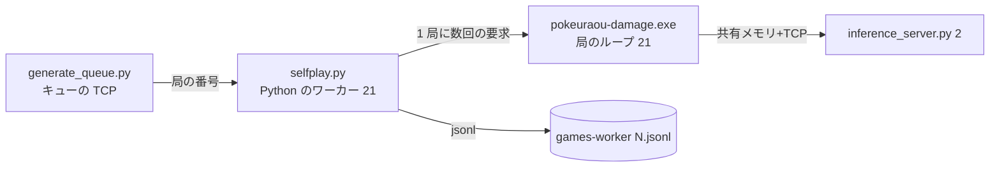
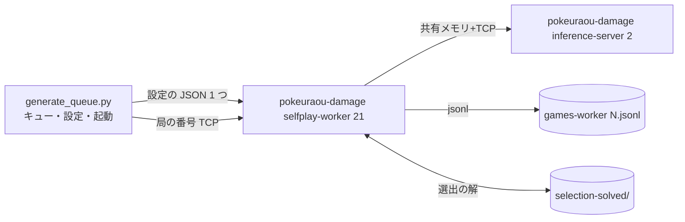

# IKA-458 段 3: 対局の進行と選出を Rust に移す

設計は `records/IKA-457.md` §14。この記録は段 3.1、段 3.4（§2）、段 3.5（§3）まで。

## 1. 段 3.1: 進める（`advanceTurn`）

### 1.1 変えたもの

* 旗は `POKEURAOU_GEN_PORT_ADVANCE=1`（`portlp.ADVANCE`、既定 off）。段 2.4（`DECIDE`）とその下をすべて含む。
* `rust/src/advance.rs`（新）。1 要求で、手番の重みを解き、numpy の `Generator.choice(n, p=...)` と同じ引き方で 1 つ引き、引いた枝の局面を返す。
  * 乱数は numpy の PCG64 の状態（`state`・`inc`）を 16 進の文字列で受け、引いたあとの状態を返す。
  * 引き方は、重みの numpy 流の和（`lp::numpy_sum`）で割り、累積和を最後の値で割り、`random()` を 1 つ使い、右側の `searchsorted` で選ぶ。
  * numpy が拒む重み（負・NaN・和が 1 でない）は `fault` を返す。Python は乱数を動かさずに前の道に戻る。
  * 枝が引かれたときは、その局面が負う交代の要否（`needed`）も返す。次の手番の最初の `replacements_needed` はこれを使う（`rustnode.take_needed`、同じオブジェクトに 1 回だけ）。
  * 一時停止（自己交代）が引かれたときは、番号だけを返す。続きは今までと同じ要求で解く（段 3.2 の対象）。
* Python は `selfplay._advance_turn`、`port.advance`、`RustNode.advance_turn`。乱数の状態は答えが届いてから書き戻す。PCG64 以外の乱数では前の道を使う。
* 見つけた不具合: `fault` を `ask` の内側で投げると、`ask` がプロセスの失敗と見て再起動と再試行を繰り返し、止まらなかった。`fault` は `ask` の外で投げる形にした（テストの注入で見つけた）。

### 1.2 確かめ

| 比べ | 局 | 決定 | 一致 |
|---|---|---|---|
| 1 ワーカー、種 777: 段 2 と段 3.1 | 40 | 493 | 40/40 |
| 同: 零の対照（段 2 と段 2）| 40 | 493 | 40/40 |
| 同: 別の種 778 | 40 | 493 | 0/40 |
| 1 ワーカー、種 999: 段 2 と段 3.1 | 200 | 2,441 | 200/200 |
| 同: 零の対照 | 200 | 2,441 | 200/200 |
| 21 ワーカー・サーバ 2、種 45801: 段 2 と段 3.1（2 回ずつ）| 600 | 7,419 | 600/600、7,419/7,419（全組）|
| 同: 段 2 と段 2、段 3.1 と段 3.1 | 600 | 7,419 | 600/600 |
| 同: 別の種 45899 | 600 | 7,252 | 0/600（決定は 7/7,252）|

* 陽性対照: `advanced` は 1 ワーカー 40 局で 361、200 局で 1,786。`faults solved in Python` は 0。
* テスト `tests/test_advance_turn_port.py`（6 本）。実際の局の手番で、引いた番号・枝の局面・`needed`・重み・注記・乱数の状態が前の道と一致する（一時停止の手番を含む）。別の種は別の引きになる（比べが落ちうる対照）。`fault` の注入と PCG64 以外の乱数は前の道に戻る。
* Rust: `advance::tests` 2 本（numpy の値との一致と、拒む重み）。`cargo test --release` は 37 本通った。
* 直す前の exe（`C:/tmp/ika458/old/`）では、`advanceTurn` を知らない exe が応答せず、テストは 40 秒の時点で止まった（`faulthandler` の Timeout）。落ちる形は assert ではなく待ちである。
* `ruff check`、`port_coverage.py --check`、`port_gate_audit.py --check` は通った。`agent_drift.py --check` の DRIFTED は 8 件のままである。

### 1.3 速さ（21 ワーカー・サーバ 2・600 局、同じ exe、ABBA 2 組）

A は段 2（`DECIDE=1`）、D は段 3.1。組 1 は種 46301（A D D A）、組 2 は種 46302（D A A D）。この間、他の仕事は回していない。

| 回 | 構成 | busy | 局/分 | 1 局の CPU（秒）| ワーカー | port の exe | 推論サーバ |
|---|---|---|---|---|---|---|---|
| g1A1 | 段 2 | 11.70 | 1,358.1 | 0.5169 | 0.0641 | 0.3350 | 0.1177 |
| g1D1 | 段 3.1 | 11.50 | 1,342.0 | 0.5142 | 0.0581 | 0.3355 | 0.1206 |
| g1D2 | 段 3.1 | 11.68 | 1,348.2 | 0.5197 | 0.0592 | 0.3365 | 0.1239 |
| g1A2 | 段 2 | 11.90 | 1,360.1 | 0.5251 | 0.0639 | 0.3403 | 0.1209 |
| g2D1 | 段 3.1 | 11.63 | 1,344.8 | 0.5190 | 0.0581 | 0.3423 | 0.1184 |
| g2A1 | 段 2 | 11.71 | 1,336.9 | 0.5255 | 0.0599 | 0.3478 | 0.1176 |
| g2A2 | 段 2 | 11.74 | 1,348.8 | 0.5220 | 0.0596 | 0.3467 | 0.1155 |
| g2D2 | 段 3.1 | 11.74 | 1,359.2 | 0.5182 | 0.0577 | 0.3416 | 0.1187 |

| 読み（各 4 回の平均）| 段 2 | 段 3.1 | 変化 |
|---|---|---|---|
| 1 局の CPU（秒）| 0.5224 | 0.5178 | −0.9% |
| ワーカー | 0.0619 | 0.0583 | −5.8% |
| port の exe | 0.3425 | 0.3390 | −1.0% |
| 推論サーバ | 0.1179 | 0.1204 | +2.1% |
| 局/分 | 1,351.0 | 1,348.5 | −0.2% |

* 段の CPU（600 局の合計、秒）: `rust.ask` 3.42 → 3.23、`rust.header` 2.20 → 1.94、`completions` 5.40 → 5.27。
* 1 局の CPU は、同じ構成の中の幅（段 2 で 0.5169〜0.5255）と同じ桁で、局/分も差があるとは言えない。ワーカーの減りの向きと、port への要求の減り（1 手番 3 要求から 1 要求）が、この段の証拠である。悪化はない。

### 1.4 知らない `kind` の即答

* 調整役の依頼（3.1 の取り込み後）。知らない `kind` の要求は、fill に落ちて本文を待ち、止まっていた。`kind` が文字列で未知なら、すぐ `error`（`unknown request kind`、`unknownKind: true`）を返す形にした（`rust/src/node.rs`）。局は変わらない。
* テスト `test_an_unknown_kind_is_answered_at_once`。新しい exe で通り、直す前の exe（`C:/tmp/ika458/old/`）では待たずに落ちる。
* 3.1 の `rustnode._NEEDED`（局面のオブジェクトに紐づけた受け渡し）は、段 3.6 で局のループを Rust に移すときに無くす（調整役の注記）。

### 1.5 段 3.2 の見積もり（実装していない）

* 段 3.2（自己交代ノードを Rust へ）の取り分は小さい。`records/IKA-457.md` §13.1 の表で、自己交代の決定は 1 局あたり 0.8 ms（`completions` 0.2、受け渡し 0.4、解決 0.1、合計 0.8 のうち自己交代の列）で、1 局の CPU 0.5178 秒の約 0.15% である。
* 実装は大きい。`_self_switch_encoded` は、一時停止の状態（port 内の続き）、裏の決定化ごとの `alternativesEncoded`、共有する選択肢の符号化の差し替え（`_patched`）、推論サーバへの積み上げ、折り畳みを持つ。`replacenode.rs` と同じ規模の新しい要求になる。
* 提案: 段 3.2 は飛ばし、段 3.3（記録）か段 3.4（裏の決定化、9.0 ms/局）から入る。調整役の判断を待つ。

### 1.6 確かめていないこと

* `merge` ありの設定での 21 ワーカーのビット一致。
* 一時停止が引かれた手番の続き（自己交代ノード）は Python のまま。段 3.2 で移す。
* 別の CPU での結果。本番の長い生成で `faults` が 0 のままか。
* 段 3.2 以降（自己交代ノード、記録、裏の決定化、局の準備、局のループ、ワーカーの実行ファイル化）は未着手。

## 2. 段 3.4: 裏の決定化を Rust に移す（`hiddenStep`）

調整役の順番の変更により、段 3.2 より先に入れた。ユーザーの方針（9/27 追記）に従い、Python の道を消せる形を優先した。

### 2.1 変えたもの

* 旗は `POKEURAOU_GEN_PORT_HIDDEN=1`（`portlp.HIDDEN`、既定 off）。段 3.1（`ADVANCE`）とその下をすべて含む。
* `rust/src/hiddenbench.rs`（新）。要求は 2 つある。
  * `hiddenGame`（答えのない行）。局の 2 つの構築（6 体）と 2 つの選出の事前分布を、Python が付けた番号で 1 局に 1 回だけ渡す。事前分布の確率は base64 の f64 で渡す。
  * `hiddenStep`。局面・これまでの見えた id・先発の組を渡すと、各側の見えた id と枠、補完（species・枠・重み・exact・補完した局面の番号・`pk`）が返る。
* 補完した局面は port が持ち（`held::keep`）、Python は `rustnode.HeldPosition` の番号で後の要求に名指す。Python が読んだときだけ port が書き出す。局面の JSON は往復しない。
* Rust の中身は次の Python の実装と同じ規則である。`seen_identities`・`seen_slots`・`shown_species`・`bench_weights`・`completions`・`substitute`・`_make_pokemon`。重みの和は `lp::python_sum`（Python の `sum`）で、組み合わせの順は `itertools.combinations` と同じにした。
* Python は `hiddenstep.py`（新）、`play_game` の手番の頭と `_do_replacement_node`。port が答えられない入力（定義の無い局・旗が off・`hold_positions` が off・`dex_base_belief`）は `fault` か None で、前の道に戻る。
* `Completion` に `pk`（`beliefnode._node_in_port` が読む種の列）を足した。port が作った補完は、この列を使って局面を読まずに済ませる。
* 見つけたこと: serde_json は 10 進の小数を 1 ulp ずらして読むことがある（`float_roundtrip` を入れていない）。事前分布の確率を JSON の数で渡すと、重みが最後の桁で変わった。base64 で渡す形にした。

### 2.2 確かめ

| 比べ | 局 | 決定 | 一致 |
|---|---|---|---|
| 1 ワーカー、種 777: 段 3.1 と段 3.4 | 40 | 493 | 40/40 |
| 同: 別の種 778（段 3.4 どうし）| 40 | 493 | 0/40 |
| 1 ワーカー、種 999: 段 3.1 と段 3.4 | 200 | 2,441 | 200/200 |
| 21 ワーカー・サーバ 2、種 45801: 段 3.1 と段 3.4（2 回）| 600 | 7,419 | 600/600、7,419/7,419 |
| 同: 段 3.4 どうし | 600 | 7,419 | 600/600 |
| 同: 別の種 45899 | 600 | 7,252 | 0/600（決定は 7/7,252）|

* 陽性対照: `hidden` の要求は 1 ワーカー 40 局で 475、200 局で 2,360、21 ワーカー 600 局で 7,132。`faults` は 0。`completions` の段は 40 局で 968 回から 18 回（残りは段 3.2 の自己交代）。
* テスト `tests/test_hidden_step_port.py`（5 本）。実際の局の 47 局面（16 局ぶん、補完のある側と無い側の両方）で、見えた id・枠・記録・注記・補完の species・枠・重み（ビット一致）・補完した局面の JSON・`pk` が Python の道と一致する。ほかに、別の事前分布は別の重みになること（落ちうる対照）、局面を読んだときだけ port が書き出すこと、定義の無い局は `fault` で Python に戻ること、構築が盤を説明できない側は `error` になることを確かめる。
* Rust: `hiddenbench::tests` 1 本。`cargo test --release` は 38 本通った。
* 直す前の exe（`C:/tmp/ika458/old/`）では、`hiddenGame` と `hiddenStep` を知らない exe が応答せず、テストは待ったまま終わらない（3 分で止めた）。落ちる形は assert ではなく待ちである。
* `ruff check`、`port_coverage.py --check`、`port_gate_audit.py --check` は通った。`agent_drift.py --check` の DRIFTED は 8 件のままである。

### 2.3 速さ（21 ワーカー・サーバ 2・600 局、同じ exe、ABBA 2 組）

A は段 2（今の既定、`DECIDE=1`）、D は段 3.4（段 3.1 を含む）。組 1 は種 46401（A D D A）、組 2 は種 46402（D A A D）。この間、他の仕事は回していない（計測の前後で python・pokeuraou-damage の過程は 0）。

| 回 | 構成 | busy | 局/分 | 1 局の CPU（秒）| ワーカー | port の exe | 推論サーバ |
|---|---|---|---|---|---|---|---|
| g1A1 | 段 2 | 10.97 | 1,223.0 | 0.5380 | 0.0619 | 0.3576 | 0.1184 |
| g1D1 | 段 3.4 | 11.06 | 1,300.9 | 0.5100 | 0.0401 | 0.3469 | 0.1229 |
| g1D2 | 段 3.4 | 11.07 | 1,268.4 | 0.5238 | 0.0415 | 0.3536 | 0.1285 |
| g1A2 | 段 2 | 11.05 | 1,220.1 | 0.5434 | 0.0604 | 0.3590 | 0.1238 |
| g2D1 | 段 3.4 | 11.15 | 1,285.1 | 0.5205 | 0.0403 | 0.3561 | 0.1240 |
| g2A1 | 段 2 | 11.47 | 1,264.4 | 0.5442 | 0.0627 | 0.3547 | 0.1267 |
| g2A2 | 段 2 | 11.30 | 1,243.6 | 0.5450 | 0.0605 | 0.3582 | 0.1262 |
| g2D2 | 段 3.4 | 11.34 | 1,299.2 | 0.5237 | 0.0395 | 0.3535 | 0.1306 |

| 読み（各 4 回の平均）| 段 2 | 段 3.4 | 変化 |
|---|---|---|---|
| 1 局の CPU（秒）| 0.5427 | 0.5195 | −4.3% |
| ワーカー | 0.0614 | 0.0404 | −34.2% |
| port の exe | 0.3574 | 0.3525 | −1.4% |
| 推論サーバ | 0.1238 | 0.1265 | +2.2% |
| 局/分 | 1,237.8 | 1,288.4 | +4.1% |

* 1 局の CPU は 4 回とも段 3.4 が低い（0.5100〜0.5237 対 0.5380〜0.5450）。局/分も 4 回とも高い（1,268〜1,301 対 1,220〜1,264）。
* 段の CPU（600 局の合計、秒）: `completions` 5.46 → 0.15、`rust.ask` 3.43 → 2.43、`rust.header` 2.22 → 2.16。
* この日の機械は前回の測定日より約 4% 遅い（同じ段 2 で 1 局 0.5224 秒 対 0.5427 秒）。比べは同じ日の ABBA の中だけで読む。
* ここは段 3.1 を含む累計である。段 3.1 だけの寄与は §1.3 の −0.9% で、残りが段 3.4 の分と読める。

### 2.4 この段で退役できる Python（今回は消さない）

| 種類 | 名前 | 消せる条件 |
|---|---|---|
| 関数 | `selfplay._bench_weights`、`selfplay._belief_view` | 段 3.2 で自己交代のノードが移り、`_self_switch_spread` が無くなったあと。`dex_base_belief` を使う測定も無いこと |
| 関数 | `hidden.completions`、`hidden.substitute`、`selfplay._make_pokemon` | 同上。人と打つ道具（`humanplay`）と検討（`analysis`）が使うので、それらを Rust の道に移すか残すかを決めてから |
| 関数 | `play_game` の `seen_identities`・`seen_slots` を回す枝と `_shown_record` | 旗を既定 on にしたあと。`replay_shown` は古い記録を読むために残す |
| 関数・属性 | `rustnode.note_completion`、`_DELTAS`、`_Stored.base`・`delta`、`held.define_line` の `base` の枝 | 補完を Python が作る道がすべて無くなったあと |
| 旗 | `POKEURAOU_GEN_PORT_HIDDEN`、`portlp.HIDDEN`、`dex_base_belief`（`play_game` の引数）| 段 4 |

### 2.5 確かめていないこと

* `bench_drop` が none 以外の設定、`merge` ありの設定での 21 ワーカーの一致。
* `dex_base_belief` を使う設定（port の道を通らず、前の道を使う）。
* 本番の長い生成で `faults` が 0 のままか、別の CPU での結果。
* 推論サーバの CPU の増え（+2.2%）の原因。

## 3. 段 3.5: 局の準備を Rust に移す（`prepGame`）

調整役の順番（3.5、3.2、3.6、3.7）に従い、段 3.2 より先に入れた。

### 3.1 変えたもの

* 旗は `POKEURAOU_GEN_PORT_PREP=1`（`portlp.PREP`、既定 off）。段 3.4（`HIDDEN`）とその下をすべて含む。
* `rust/src/prep.rs`（新）。要求は 2 つある。
  * `poolDefine`（答えのない行）。プールの構築（各 6 体の set）と組の一覧を、プールの sha256 ごとに 1 プロセスにつき 1 回だけ渡す。
  * `prepGame`。プールの番号・種・局の番号を渡すと、`generate_pool` の局頭の仕事が 1 要求で済む。順に、組と席の引き（`default_rng([seed, index])` の `integers`・`random`）、選出の解の読み（store のファイル）、両側の 4 体の引き（`BookEntry.draw` の 3 回）、探索の混合（`explore_mixture`）、開始局面（`_opening`）、先発の特性（`apply_lead_abilities`、引きが開く所は同じ乱数で引く）、裏の信念の事前分布。
* 乱数は numpy の PCG64 を Rust で種から作る（`advance.rs`: `SeedSequence` の混ぜ、`pcg64_srandom`、`integers` の 32 ビット Lemire と numpy の 32 ビットの緩衝）。局の入口の `default_rng` が Python から要らなくなる。引いたあとの状態（緩衝も含む）を返し、Python の共有の `Generator` に書く。
* 局の 2 つの構築と事前分布は port が `hiddenStep` 用の局として自分で定義する（`hiddenbench::insert_game`）。Python は番号だけを持つ。`BenchPrior` は、port が答えられずに前の道に戻るときだけ遅延で作る（`prepgame.LazyPriors`）。
* store に解のファイルが無い組は `unsolved` を返し、Python が葉で解いて書いてから同じ要求を出し直す（葉の評価は Python の torch に残る）。タグか組が違うファイルは `stop`（`ValueError`）。クラスが 2 つ以上の選出ゲームと、port が答えられない入力は `fault` で前の道に戻る。
* `serde_json` に `float_roundtrip` を足した。store の戦略は Python の `repr` で書かれた 10 進で、既定の読みは 1 ulp ずれることがある。
* Python は `prepgame.py`（新）、`poolplay.generate_pool`（`scheduled` が乱数を作らず、port が答えた局は共有の `Generator` に状態を書く）、`play_game` の引数 `hidden_game`（port が定義した局を指す。`agent_drift` の対象の引数ではない）。`start` は既存の引数をそのまま使う。
* 開始局面は JSON で Python に返し、`Position.from_json` で読む。局面を Python に渡さない形は段 3.6 で扱う。

### 3.2 確かめ

| 比べ | 局 | 決定 | 結果 |
|---|---|---|---|
| 1 ワーカー、種 777: 段 3.4 と段 3.5 | 40 | 493 | 40/40 が同じ。ただし 17 局は選出の混合 2 本が 1e-18 まで違う（下） |
| 同: 零の対照（段 3.4 どうし）| 40 | 493 | 40/40、混合も一致 |
| 同: 別の種 778 | 40 | 493 | 0/40 |
| 1 ワーカー、種 999: 段 3.4 と段 3.5 | 200 | 2,441 | 混合を除くと 189/200。違う 11 局は同じ長さ・同じ結果。違いは `searchValue` 等の最後の桁 |
| 21 ワーカー・サーバ 2、種 45801: 段 3.4 と段 3.5（2 回）| 600 | 7,419 | 583/600 局、7,377/7,419 決定が同じ（混合を除く）。選んだ手の列は 600 局とも同じ、結果も同じ、`searchValue` の差の最大 2.2e-16 |
| 同: 段 3.4 どうし、段 3.5 どうし | 600 | 7,419 | 600/600、7,419/7,419 |
| 同: 別の種 45899 | 600 | 7,252 | 0/600（決定は 7/7,252）|
| 21 ワーカー、種 46502（第 2 組）: 段 3.4 と段 3.5 | 600 | 7,389 | 579/600、7,333/7,389。選んだ手・結果は同じ、差の最大 1.3e-15 |

* 局が変わる唯一の原因は `exp` である。選出の探索の混合（`ε=0.25`、`T=0.5`）が `np.exp` を通る。この機械の numpy は libm の `exp` と 200,000 点で 1 点も違わず、port の `f64::exp`（mingw）は 977 点で 1 ulp 違う。混合の最後の桁が 90 個のうち数個変わり、事前分布の重みを通って探索の値の最後の桁を動かす。選んだ手と結果は 1,200 局で変わらなかった。`ε=0` では混合も含めて全部がビットで一致する（テストで確認）。ビット一致は要求されていないので、`exp` を揃える作り込みはしなかった。
* 陽性対照: `prepared` は 1 ワーカー 200 局で 200、21 ワーカー 600 局で 600。`faults` は 0。
* テスト `tests/test_prep_game_port.py`（9 本）。実際のプール（我々の構築の 3 変種）の組・席・4 体・方策・混合・値・事前分布・開始局面・乱数の状態（緩衝を含む）が前の道と一致する（`ε` 3 通り、36 局ずつ）。別の種は別の組になること、ファイルの無い組を Python が解いて出し直すこと、別のタグの store は止まること、組の部分集合の添字、ファイルを読んだ数の数え方、そして `generate_pool` で 6 局を打ち切り、段 3.4 と同じ局（混合を 1e-15 の許容で比べて、残りはバイト一致）になること。
* Rust: `advance::tests::a_seed_is_numpys` が numpy の `default_rng` の状態、`integers(7260)` の引き、緩衝の状態に一致する。`cargo test --release` は 39 本通った。
* 直す前の exe（`C:/tmp/ika458c/old/`）では、`prepGame` を知らない exe が `error` を返し、`port.ask` が再起動を繰り返してテストが終わらない（180 秒で止めた）。落ちる形は assert ではなく待ちである。
* `ruff check`、`port_coverage.py --check`、`port_gate_audit.py --check` は通った。`agent_drift.py --check` の DRIFTED は 8 件のままである。

### 3.3 速さ（21 ワーカー・サーバ 2・600 局、同じ exe、ABBA 2 組）

A は段 3.4、D は段 3.5。組 1 は種 45801（A D D A）、組 2 は種 46502（D A A D）。この間、他の仕事は回していない。

| 回 | 構成 | busy | 局/分 | 1 局の CPU（秒）| ワーカー | port の exe | 推論サーバ |
|---|---|---|---|---|---|---|---|
| v6a | 段 3.4 | 11.18 | 1,300.1 | 0.5158 | 0.0410 | 0.3502 | 0.1245 |
| v7a | 段 3.5 | 11.60 | 1,353.6 | 0.5142 | 0.0382 | 0.3531 | 0.1227 |
| v7b | 段 3.5 | 11.32 | 1,337.1 | 0.5081 | 0.0391 | 0.3458 | 0.1232 |
| v6b | 段 3.4 | 11.37 | 1,341.1 | 0.5086 | 0.0420 | 0.3429 | 0.1236 |
| w7a | 段 3.5 | 11.30 | 1,351.0 | 0.5018 | 0.0401 | 0.3414 | 0.1202 |
| w6a | 段 3.4 | 11.20 | 1,343.5 | 0.5003 | 0.0399 | 0.3393 | 0.1209 |
| w6b | 段 3.4 | 11.41 | 1,353.0 | 0.5061 | 0.0415 | 0.3411 | 0.1235 |
| w7b | 段 3.5 | 11.23 | 1,323.8 | 0.5088 | 0.0402 | 0.3451 | 0.1235 |

| 読み（各 4 回の平均）| 段 3.4 | 段 3.5 | 変化 |
|---|---|---|---|
| 1 局の CPU（秒）| 0.5077 | 0.5083 | +0.1% |
| ワーカー | 0.0411 | 0.0394 | −4.1% |
| port の exe | 0.3434 | 0.3463 | +0.8% |
| 局/分 | 1,334 | 1,341 | +0.5% |

* ワーカーの CPU は 8 回のうち組 1 で減り（−7%）、組 2 でほぼ同じ（−1.5%）だった。全体の 1 局の CPU は差があるとは言えない（組の中の幅と同じ桁）。この段の取り分は 1 局あたり 1 ms 前後の仕事で、小さいと見込んでいた通りである。悪化はない。

### 3.4 この段で退役できる Python（今回は消さない）

| 種類 | 名前 | 消せる条件 |
|---|---|---|
| 関数 | `poolplay.generate_pool` の局頭の枝（`draw_pair`・`entry.draw`・`BenchPrior.of`）と `scheduled` の `default_rng([seed, index])` | 旗を既定 on にしたあと。`pool_match_game`（対戦評価）の引きが同じ道に移ってから |
| 関数 | `SolvedSelections._read`・`_kept` と `canonical` の読む枝 | 選出の解を葉の評価ごと port が解くとき（今は解く所だけ Python）。`entry`・`transposed` は人と打つ道具が使う |
| 関数 | `selfplay._opening`・`_made_pokemon`・`position_from_sets`（局の開始のため）| 選出の解の局面作り（`positions_from_sets`）と人と打つ道具が使わなくなってから |
| 関数 | `hiddenstep.Game.of`、`BenchPrior.of` の `generate_pool` からの呼び出し | 旗を既定 on にしたあと |
| 属性 | `prepgame.LazyPriors`、`play_game` の `bench_prior` 引数 | 段 3.6 で局を port が打つとき（fault の戻り先が要らなくなる）|
| 旗 | `POKEURAOU_GEN_PORT_PREP`、`portlp.PREP` | 段 4 |

### 3.5 確かめていないこと

* `pool_match_game`（対戦評価）の準備。`selection_rng` の流れ（`[seed, index, 1, side]`）は同じ `SeedSequence` で作れるが、この段では移していない。
* 構築が 6 体でない場合、クラスが 2 つ以上の選出ゲーム、`--pairs-with` の部分集合の 21 ワーカーでの一致（部分集合は 1 プロセスのテストのみ）。
* 本番の長い生成で `faults` が 0 のままか、別の CPU（`exp` の違い方が変わる）での結果。
* 組 1 と組 2 でワーカーの CPU の減りが違う理由。

## 5. 段 3.2: 自己交代のノードを Rust に移す（`advanceTurn` の `selfSwitch`）

### 5.1 変えたもの

* 旗は `POKEURAOU_GEN_PORT_SELFSWITCH=1`（`portlp.SELFSWITCH`、既定 off）。段 3.5（`PREP`）とその下をすべて含む。
* `rust/src/selfswitch.rs`（新）。`advanceTurn` に `selfSwitch`（各側の葉の推論サーバ、裏の局の番号・見えた id・先発）を渡すと、引いたのが一時停止のとき、port がターンの終わりまで続ける。
  * 選択肢と、それぞれが生むターンを 1 回だけ作る。裏の決定化は `hiddenbench::step_of`（相手側だけ）から取る。
  * 共有できる選択肢（残りのターンが相手の未見の枠に触れない）は、真の葉に完成形のポケモンを差し込んだ葉にする。残りは完成形ごとに解く。
  * 全部の葉を 1 回で符号化し、推論サーバに 1 バッチで送る。終局の葉は結果で置き換える。
  * 折り畳みは numpy の重みの和（補正なしの順次和）、最良は最初の最良。結果の引きは `advance::choice`。最大 5 ノード。
  * Python は各ノードの `Decision`（`selfswitch`）を書き、局面は `Position.from_json(...).to_json()` で正規化する。
* 葉が推論サーバでない場合、`hidden` の局が port に無い場合、`dex_base_belief`、`luck` が動く場合、選択肢に技が混じる場合などは `fault` か送らない形で、前の道に戻る。
* `hiddenbench::side_completions` は `Item` を返す形にした（`hiddenStep` の答えは同じ）。`commands::alternatives_wanted`・`resume_choice` を足した。

### 5.2 確かめ

| 比べ | 局 | 決定 | 結果 |
|---|---|---|---|
| 1 ワーカー、種 777: 段 3.5 と段 3.2 | 40 | | 40/40 バイト一致（自己交代 18 ノード）|
| 1 ワーカー、種 999 | 200 | | 200/200 バイト一致（81 ノード）|
| 21 ワーカー・サーバ 2、種 45801 | 600 | 7,419 | 600/600、7,419/7,419（287 ノード、`faults` 0）。2 回目も同じ |
| 同: 段 3.5 どうし | 600 | 7,419 | 600/600 |
| 同: 別の種 45899 | 600 | 7,252 | 0/600 |
| 制御の exe（最良でなく最悪を選ぶ。`ika458-selfswitch-control`）種 999 | 200 | | 165/200（比べが落ちうる対照）|

* テスト `tests/test_self_switch_port.py`（5 本）。裏あり・両側が自己交代・裏なしで、決定・局面・注記・乱数の状態・サーバへの要求（配列のバイト）が前の道と一致する。別のサーバは別の選択になる。port が局を持たない場合と `fault` は前の道に戻る。
* 直す前の exe（`C:/tmp/ika458c/old/`）では、4 本が落ちる（ポートが動かず、ノード数の陽性対照で落ちる）。
* `cargo test --release` 41 本、`ruff`、`port_coverage`、`port_gate_audit` は通った。`agent_drift.py --check` の DRIFTED は 8 件のまま。
* 関係する既存のテスト（`test_advance_turn_port`・`test_hidden_step_port`・`test_prep_game_port`・`test_hidden_selfswitch`・`test_replacement_node_port` ほか）は通った（skip 4）。

### 5.3 速さ

前の担当は測らずに止めた。次の担当（2026-11-27）が、同じ exe で ABBA を回した（21 ワーカー・サーバ 2・600 局）。A は段 3.5（`PREP`）、D は段 3.2（`SELFSWITCH`）。組 1 は種 45801（A D D A）、組 2 は種 45899（D A A D）。

| 回 | 構成 | busy | 局/分 | 1 局の CPU（秒）| ワーカー | port の exe | 推論サーバ |
|---|---|---|---|---|---|---|---|
| wg1A1 | 段 3.5 | 9.37 | 971.4 | 0.5785 | 0.0374 | 0.3320 | 0.2090 |
| wg1D1 | 段 3.2 | 9.46 | 1,002.0 | 0.5666 | 0.0360 | 0.3263 | 0.2042 |
| wg1D2 | 段 3.2 | 9.01 | 927.7 | 0.5825 | 0.0322 | 0.3080 | 0.2422 |
| wg1A2 | 段 3.5 | 8.88 | 859.1 | 0.6200 | 0.0364 | 0.3145 | 0.2690 |
| wg2D1 | 段 3.2 | 8.89 | 926.7 | 0.5756 | 0.0320 | 0.3119 | 0.2316 |
| wg2A1 | 段 3.5 | 10.08 | 1,167.4 | 0.5180 | 0.0370 | 0.3269 | 0.1539 |
| wg2A2 | 段 3.5 | 9.53 | 1,028.8 | 0.5558 | 0.0355 | 0.3212 | 0.1990 |
| wg2D2 | 段 3.2 | 9.24 | 983.2 | 0.5639 | 0.0345 | 0.3187 | 0.2106 |

| 読み（各 4 回の平均）| 段 3.5 | 段 3.2 | 変化 |
|---|---|---|---|
| ワーカー（秒/局）| 0.0366 | 0.0337 | −8.0% |
| port の exe | 0.3236 | 0.3162 | −2.3% |
| ワーカーと exe の和 | 0.3602 | 0.3499 | −2.9% |
| 推論サーバ | 0.2077 | 0.2222 | +6.9% |
| 1 局の CPU 合計 | 0.5681 | 0.5721 | +0.7% |
| 局/分 | 1,006.7 | 959.9 | −4.6% |

* ワーカーと exe は 8 回とも段 3.2 の側が小さい向きで、段 3.2 は悪化していない。推論サーバの CPU は 0.154〜0.269 の幅があり、合計と局/分はこの幅に隠れる（組の中の幅が差より大きい）。
* 前の段の計測（局/分 1,340 前後）より全体が遅い。計測の間、他の仕事が機械に載っていた（ブラウザ 3 過程が各 1.1 コア前後、ゲーム 1 過程 0.4 コア、前の担当の未終了の推論サーバ 4 組が待機）。この差は A と D に均等に載っていないので、合計と局/分は読まず、ワーカーと exe の CPU を段 3.2 の取り分として読む。
* 陽性対照: 段 3.2 の側の `selfswitch` の段が 287 ノード（`wg1D1` の summary）。`faults` の数はこの summary に出ないので、今回は確かめていない。

### 5.4 この段で退役できる Python（今回は消さない）

| 種類 | 名前 | 消せる条件 |
|---|---|---|
| 関数 | `selfplay._do_self_switch_node`・`_self_switch_encoded`・`_self_switch_spread`・`_self_switch_plans`・`_shared_self_switch_plans`・`_with_bench`・`_record_self_switch`・`_rows` | 旗を既定 on にし、葉が推論サーバでない場合（M-B）の道を決めたあと |
| 関数 | `selfplay._advance`（5 回の繰り返し）| 同上 |
| 関数 | `selfplay._bench_weights`・`_belief_view` | 段 3.6 で局のループが移ったあと |
| 旗 | `POKEURAOU_GEN_PORT_SELFSWITCH`、`portlp.SELFSWITCH` | 段 4 |

## 6. 引き継ぎの注記（中断。段 3.2 のコミットまで）

* 調整役の連絡で中断した。段 3.2 のコード・テスト・一致の確かめは済み、速さの ABBA と対戦評価は未実施。
* 段 3.6（`playGame`）は未着手。読んで分かったこと:
  * 局の 1 手番は、`hiddenStep`（済）→ 交代なら `_do_replacement_node`（選択肢 `switch_actions_after_faint`、`replacementNode`、引き、`resolve_replacements` の引きは `Pcg64` で同じ）→ そうでなければ `_decide`（`rootMenus`+`moveNode` の要求を Python が組む。`beliefnode._node_in_port`）→ 引き（`_sample_index`）→ 記録 → `advanceTurn`（済、自己交代込み）。
  * Rust に足すもの: 交代ノード、`moveNode` の要求の組み立てと答えの読み（戦略・値・`unmodelled`・`rank_views`）、技の選択肢の文字列（`move <番号> <目標> mega`）、`Decision`・`GameRecord` の JSON（`engine` の指紋、`ownTeam` などは Python が渡すか prep のプールから）、`rustnode._NEEDED` の廃止。
  * 提案する分け方: 3.6a 交代ノード、3.6b 手番のノード＋局のループ、3.6c 記録の JSON。各段で局のバイト一致を使う。
* 道具は `C:/tmp/ika458d/`（`modes.sh` は mode 8 が段 3.2、9 が段 3.6 用の予約。`id.sh`・`v.sh`・`ctl.sh`・`abba.sh`・`tab2.py`・`cmp21.py`・`cmpgames.py`）。`run.sh` は自分の worktree を指す。制御の exe は `C:/tmp/ika458d/ctl-target/`。
* worktree には `data` の junction と `vendor/HiGHS` の submodule を足した（コミットしない）。

## 4. 引き継ぎの注記（段 3.5 のあと）

* 担当の文脈が長くなったため、段 3.5 で区切って返した。段 3.2 以降は未着手。
* 道具は `C:/tmp/ika458c/`。`modes.sh`（mode 4 が段 2、6 が段 3.4、7 が段 3.5。段を足すときは mode を足す）、`id.sh`（1 ワーカー）、`v.sh`（21 ワーカー・サーバ 2）、`cmpgames.py`（1 ワーカーの比べ。選出の混合を 1e-15 で許す）、`cmp21.py`、`chosen.py`（選んだ手と結果の比べ）、`decdiff.py`、`tab.py`（速さの表。名前の 2 字目が mode）。
* 段 3.6 では `prepGame` が返す乱数の状態（緩衝を含む）を、Rust の局のループがそのまま引き継げる。`Pcg64`（`advance.rs`）は `integers`・`next_double`・`choose_p` を持つ。
* 段 3.6 で `hiddenGame` の Python からの定義は不要になる。`prepGame` が `hiddenbench::insert_game` で同じ表に入れている。
* `exp` の違い（§3.2）は、numpy 側を libm と揃えない限り残る。対戦評価で SPRT(−10, 0) に出すときは、段 3.5 だけでは局の変化が最後の桁なので、段 3.6 とまとめて 1 回でよいと考える。

## 7. 段 3.6a: 交代のノードを Rust で完結させる（`replacementPhase`）

### 7.1 変えたもの

* 旗は `POKEURAOU_GEN_PORT_PLAY=1`（`portlp.PLAY`、既定 off）。段 3.2（`SELFSWITCH`）とその下をすべて含む。段 3.6b・3.6c も同じ旗に載せる。
* `rust/src/replacephase.rs`（新）。要求 `replacementPhase` が、倒れたあとの交代の 1 手番を 1 要求で済ませる。順に次を行う。
  * 選択肢を作る（`switch_actions_after_faint` に当たる `replacement_options`。誰も出せないときは全員 pass の 1 択）。
  * 両側の裏の決定化を `hiddenbench::step_of` から取る。
  * 決定化ごとの行列を作る。各組の局面を符号化し、推論サーバで採点し、終局の葉を結果に置き換え、引きが開く局面は重みで折る。
  * 両側のベイズ型ゲームを解く。
  * 両側の戦略から 1 つずつ引く（`advance::choice`。numpy の `choice` と同じ演算）。
  * 引いた組で交代の局面を打つ。引きが開くたびに、同じ乱数の流れから `choose_p` で答える（`RustNode._phase` と同じく、重みの合計は Python の `sum`）。
* 共通部分の変更は次の通り。
  * `commands::replacements_encoded_of`（局面と組を読み済みで渡す形。JSON の `replacements_encoded` はこれに任せる）。
  * `commands::replacement_phase_drawn`（引きに答えながら交代の局面を打つ）。
  * `beliefnode::solve_asks`（ゲームの組み立てと解き。`solve_games` はこれに任せる）。
  * `replacenode::score_job`（1 決定化の行列。JSON の `replacementNode` は触っていない）。
  * `selfswitch::Context` の欄と `choice_string`、`resolve::replacement_options` を `pub(crate)` にした。
* Python は `replacephase.py`（新）。`selfplay._do_replacement_node` の先頭で、裏の決定化が port 由来で誤りが無いときに `replacephase.play` を呼ぶ。`Decision` は従来どおり Python が書く。乱数の状態は答えが届いてから書き戻す（緩衝も含む）。
* 前の道に戻る場合（fault）は、推論サーバでない葉、既定でない均衡の選択、port が持たない局、片側の決定化が作れない場合、numpy が断る引き。乱数は触らない。
* `play_game` が `hidden_game.number` を `_do_replacement_node` に渡す（引数 `hidden_number`）。

### 7.2 確かめ

| 比べ | 局 | 決定 | 結果 |
|---|---|---|---|
| 1 ワーカー、種 777: 段 3.2 と段 3.6a | 40 | | 40/40 バイト一致（交代 114 回）|
| 同: 制御の exe（引いた選択肢の次を打つ。`ika458-phase-control`）| 40 | | 0/40（比べが落ちる対照）|
| 1 ワーカー、種 999 | 200 | | 200/200 バイト一致（交代 574 回）|
| 21 ワーカー・サーバ 2、種 45801: 段 3.2 と段 3.6a（2 回ずつ）| 600 | 7,419 | 600/600、7,419/7,419 |
| 同: 段 3.2 どうし | 600 | 7,419 | 600/600 |
| 同: 別の種 45899 | 600 | 7,252 | 0/600（決定は 7/7,252）|
| 共通部分の変更の確認: 段 2 の既定、4 ワーカー、種 45801、前の exe（c5e1786 の build）と今の exe | 60 | 750 | 60/60、750/750 |

* 陽性対照: 段 3.6a の側の `phased` は、1 ワーカー 200 局で 574 回、21 ワーカーでは各ワーカー 86〜97 回（読んだワーカーの範囲）。`faults solved in Python` は読んだワーカーすべてで 0。
* テスト `tests/test_replace_phase_port.py`（4 本）。記録された交代（`replacement-mixed`）で、決定・局面・注記・乱数の状態・サーバへの要求（行数と配列のバイト）が前の道と一致する。サーバ 2 つ・種 12 個ずつ（24 回）で、引いた組が 1 通りでないことも確かめる。別のサーバでは決定が変わること、port が持たない局と fault では前の道に戻ることも見る。
* 直す前の exe（`C:/tmp/ika458c/old/`）では 3 本が「rebuild it」の誤りで落ちる（fault の 1 本は exe を使わない）。
* `cargo test --release` 41 本、`ruff check`、`port_coverage.py --check`、`port_gate_audit.py --check` は通った。`agent_drift.py --check` の DRIFTED は 8 件のまま。

### 7.3 速さ（21 ワーカー・サーバ 2・600 局、同じ exe、ABBA 2 組）

A は段 3.2、D は段 3.6a。組 1 は種 45801（A D D A）、組 2 は種 45899（D A A D）。計測の前に python と `pokeuraou-damage` の過程を数え、自分のもの以外は無かった（調整役が前の担当の推論サーバ 8 過程を止めたあと）。ユーザーの過程（ブラウザ・ゲーム）は止めていない。

| 回 | 構成 | busy | 局/分 | 1 局の CPU（秒）| ワーカー | port の exe | 推論サーバ |
|---|---|---|---|---|---|---|---|
| xg1A1 | 段 3.2 | 9.64 | 1,035.1 | 0.5586 | 0.0341 | 0.3186 | 0.2059 |
| xg1D1 | 段 3.6a | 9.36 | 977.7 | 0.5744 | 0.0304 | 0.3155 | 0.2284 |
| xg1D2 | 段 3.6a | 9.55 | 1,012.9 | 0.5658 | 0.0325 | 0.3163 | 0.2171 |
| xg1A2 | 段 3.2 | 10.27 | 1,183.7 | 0.5208 | 0.0349 | 0.3340 | 0.1519 |
| xg2D1 | 段 3.6a | 9.34 | 981.0 | 0.5713 | 0.0308 | 0.3136 | 0.2269 |
| xg2A1 | 段 3.2 | 9.26 | 958.4 | 0.5794 | 0.0343 | 0.3152 | 0.2299 |
| xg2A2 | 段 3.2 | 9.19 | 941.8 | 0.5853 | 0.0334 | 0.3165 | 0.2353 |
| xg2D2 | 段 3.6a | 9.23 | 939.5 | 0.5891 | 0.0305 | 0.3126 | 0.2458 |

| 読み（各 4 回の平均）| 段 3.2 | 段 3.6a | 変化 |
|---|---|---|---|
| ワーカー（秒/局）| 0.0342 | 0.0310 | −9.2% |
| port の exe | 0.3211 | 0.3145 | −2.1% |
| ワーカーと exe の和 | 0.3553 | 0.3455 | −2.8% |
| 推論サーバ | 0.2058 | 0.2296 | +11.6% |
| 1 局の CPU 合計 | 0.5610 | 0.5752 | +2.5% |
| 局/分 | 1,029.8 | 977.8 | −5.0% |

* ワーカーと exe は 8 回とも段 3.6a の側が小さい。推論サーバの CPU は 0.152〜0.246 の幅があり（A の中でも 0.152〜0.235）、合計と局/分はこの幅に隠れる。サーバの CPU が段で増える理由は調べていない。要求の数と行は同じ（テストで一致）なので、サーバ側の仕事は変わらないはずだが、確かめていない。
* 段 3.2 の計測（§5.3）と同じく、機械は前の段の計測より遅い（約 1,000 局/分）。ワーカーと exe の CPU を段の取り分として読む。

### 7.4 この段で退役できる Python（今回は消さない）

| 種類 | 名前 | 消せる条件 |
|---|---|---|
| 関数 | `selfplay._do_replacement_node` のうち、`switch_actions_after_faint` の選択肢・`replacenode.solve`・行列の組み立て（`matrix`）・`solve_bayesian` の枝・引き・`port.resolve_replacements` | 旗を既定 on にし、葉が推論サーバでない場合（M-B）と `sheets` が無い場合（開いた局）の道を決めたあと |
| ファイル | `replacenode.py`（`replacementNode` の要求の組み立て） | 同上。Rust の `replacenode::node`（JSON の要求）も同時に消せる |
| 関数 | `selfplay.replacement_matrix` | 開いた局の道が無くなったとき |
| 旗 | `POKEURAOU_GEN_PORT_REPLACE`、`portlp.REPLACE` | 段 4 |
| 旗 | `POKEURAOU_GEN_PORT_PLAY`、`portlp.PLAY` | 段 4 |

### 7.5 確かめていないこと

* 開いた局（`sheets` が無い）と M-B の交代。この段は裏の決定化がある局だけを移した。
* `selects` が既定でない場合（Python の `reselect_bayesian` が要る）。fault で前の道に戻る。
* 裏の決定化を二重に作る費用（Python が `hiddenStep` で 1 回、`replacementPhase` が `step_of` でもう 1 回）。段 3.6b で局のループが Rust に移れば 1 回になる。
* `exp` の差は、この段では出ない（`exp` は選出の混合だけ）。

## 8. 引き継ぎの注記（段 3.6a のあと）

* 担当の文脈が長くなったため、段 3.6a で区切って返した。段 3.6b 以降（3.6b、3.6c、対戦評価、3.7）は未着手。
* 道具は `C:/tmp/ika458e/`。`modes.sh`（mode 4 が段 2、7 が段 3.5、8 が段 3.2、9 が段 3.6 = `PLAY`）、`id.sh`（1 ワーカー）、`v.sh`（21 ワーカー・サーバ 2）、`k.sh`（ワーカー数と exe を指定。段 2 の共通部分の確認用）、`ctl.sh`（制御の exe）、`abba.sh`、`tab2.py`、`cmp21.py`（21 ワーカーの比べ）、`cmpgames.py`（1 ワーカー）、`load.ps1`・`ps2.ps1`・`top.ps1`（負荷と過程の一覧）。`run.sh` は今の worktree を指す。制御の exe は `C:/tmp/ika458d/ctl-target/`（`--features ika458-phase-control` で build 済み）。
* worktree には `data` の junction と `vendor/HiGHS` の submodule を足した（コミットしない）。Python は本体の `.venv` で、`PYTHONPATH` は Windows 形式の絶対パス（`C:/Users/...`）で渡す（`$PWD` の形では読まれない）。
* 段 3.6b のために読んで分かったこと:
  * 手番のノードは `selfplay._decide`（`rootmenus.plan` が `rootMenus` の要求を組み、`beliefnode.fused_node` → `_node_in_port` が `moveNode` の要求を組む）が Python 側にある。`_node_in_port` の要求は、参照の符号化、`dirty` の印、`borrowed`・`own`・`packed` の span、折りの木、スタックの葉、解くゲームの重みなど、多くの部品でできている（`beliefnode.py` 545 行以降、`rust/src/beliefplan.rs`・`qmenus.rs` の `move_node`）。Rust の局のループが同じ要求を内部で作るには、この組み立てを Rust に移すか、`beliefplan`・`qmenus` の中を型付きの関数に割る必要がある。JSON を内部で作って読み直す形は、費用が増えるので避けたい。
  * 手番のあとは、戦略から引く（`_sample_index`、numpy の `choice`。`advance::choice` が同じ）、`first_action`・`force_mega`（`_forced_mega_choice`）・`hold_baton`・`ally_targets` の統計、`Decision` の組み立て、`luck` の記録、`_advance_turn`（段 3.1・3.2 で済み）。生成の設定では `first_action`・`force_mega`・`hold_baton`・`ally_targets`・`luck` は使わないので、使うときは局全体を前の道に戻す（fault）形にできる。
  * 段 3.6a の `replacementPhase` は、局のループから内部の関数として呼べる形にしてある（`replacephase::phase` を `Context` と位置と乱数で呼ぶ）。局のループに移すときは、`hiddenStep` の結果（`step`）を渡す形に変えると、裏の決定化の二重の作成（§7.5）が無くなる。
  * 乱数は、`prepGame` が返す状態（緩衝を含む）を `Pcg64::from_json` で読み、局の最後まで Rust が持つ。`rng.to_json_full()` で返す。
* 段 3.6c の見込み（段 3.6b の後に読み直す。§10 の末尾）: `Decision`・`GameRecord` の JSON は、`GameRecord.to_json`（`selfplay.py` 396 行付近）と `Decision` のキーを Rust で組む。`own_team` などは `prepGame` のプール定義から作れる。`engine` の指紋は Python が渡す。

## 9. 推論サーバの CPU の確かめ（段 3.6b の前）

* 依頼の数は局の種で決まり、道では変わらない。21 ワーカー・600 局で、種 45801 は段 3.2 も 3.6a も 15,732 依頼（1 局 26.2）、種 45899 は 15,398 依頼（1 局 25.7）。1 ワーカー 200 局は 5,188 依頼（1 局 25.9）で段 3.2 と 3.6a が同じ。段 2 の 60 局（4 ワーカー）は 1,582 依頼。
* 1 依頼の行数は 585〜615 で、段による差は見えない。サーバが数える行の総数は同じ種・同じ道でも 8.8〜9.7 百万と ±5% ばらつく。同時に来た依頼のまとめ方が時刻で変わるためと考えるが、確かめていない。
* 依頼が細かく割れている形跡は無い。段 3.2 と 3.6a の依頼は同数で、テストでも行とバイトが一致する。
* サーバの CPU の差は GPU 待ちの空回りの長さ。同じ道・同じ種の中で `server.sync` の CPU が 18〜52 秒、1 局の CPU が 0.152〜0.246 とばらつき、`forward` の CPU は 19.6〜21.7 秒でほぼ一定。段 3.2 と 3.6a の +11.6% はこのばらつきの内側。空回りが負荷とどう関わるかは確かめていない。

## 10. 段 3.6b: 局のループを Rust に移す（`playGame`）。引き継ぎの注記つきで中断

### 10.1 入れたもの（コミット済み。`POKEURAOU_GEN_PORT_PLAY=1` に載る。止める旗は `POKEURAOU_GEN_PORT_GAME=0`）

* `rust/src/playgame.rs`（新）。1 要求が、`hiddenStep` → 交代の局面 または 手番のノード（menus_core → move_node_over）→ 2 回の引き → `advance_core`（自己交代込み）を、局が終わるか手が詰まるまで繰り返す。
* 型付きにした所: `qmenus::MenusArgs`・`menus_core`、`advance::advance_core`、`replacephase::phase_core`。裏の決定化は `step_of` の結果をそのまま渡すので 1 回で済む。
* 型付きにしていない所: `move_node_over` に渡す `beliefNode` の要求は、メモリ上の `serde_json::Value`（文字列にせず、読み直さない）。`beliefplan::node` の内側を型に割るのは未着手。
* 手が詰まる所（隠れた裏が説明できない、メニューが空、numpy が断る引き、解けない局面）は、引きも記録もする前に `handoff` で返し、Python が同じ状態から続ける。
* Python: `playgame.py`（`prepare`・`play`・事象の書き戻し）、`beliefnode.book_node`・`book_served`（`_node_in_port` から切り出し）、`play_game` の入口。
* 直した点: 自己交代と交代の局面は、その手番の `seen` を読む。ループが手番ごとに `context.hidden.seen` を更新する（直す前は 40 局中 6 局が違った）。

### 10.2 確かめ

| 比べ | 局 | 決定 | 結果 |
|---|---|---|---|
| 1 ワーカー 種 777、段 3.2 と 3.6b | 40 | | 40/40 バイト一致（`played` 361、fault 0、1 局 2 回の交差）|
| 同 制御の exe（`ika458-play-control`: 後手が引いた次の手）| 40 | | 0/40 |
| 1 ワーカー 種 999 | 200 | | 200/200 一致（`played` 1,786、fault 0）|
| 21 ワーカー・サーバ 2 種 45801 の 3.6a 2 回と 3.6b 2 回 | 600 | 7,419 | すべて 600/600、7,419/7,419 |
| 同 種 45899 の 3.6a と 3.6b 2 回 | 600 | 7,252 | 600/600、7,252/7,252 |
| 別の種どうし（零の対照）| 600 | | 0/600（決定は 7/7,252）|

* 直す前の exe（段 3.6a の commit から build）は「unknown request kind "playGame" ... rebuild it」で止まる。
* 新しいテスト `tests/test_play_game_port.py` は書いたが、まだ一度も走らせていない。ruff・pytest・`cargo test`・`port_coverage`・`port_gate_audit`・`agent_drift` も未実施。

### 10.3 速さ（21 ワーカー・サーバ 2・600 局、同じ exe、ABBA 2 組。A は 3.6a、D は 3.6b）

| 読み（各 4 回の平均）| 3.6a | 3.6b | 変化 |
|---|---|---|---|
| ワーカー（秒/局）| 0.0318 | 0.0073 | −77.0% |
| port の exe | 0.3112 | 0.3049 | −2.0% |
| 推論サーバ | 0.2268 | 0.2567 | +13.1% |
| 1 局の CPU 合計 | 0.5699 | 0.5690 | −0.2% |
| 局/分 | 975.9 | 914.6 | −6.3% |

* ワーカーと exe の CPU は段の取り分として減った。サーバの CPU は A の中でも 0.151〜0.291 と幅があり、合計と局/分はその幅に隠れる。ただし 3.2→3.6a→3.6b とサーバが増える向きと局/分が下がる向きは続いている。
* 計測の前の過程: python と `pokeuraou-damage` は無し。ユーザーの過程（ブラウザ・ゲーム）が約 2.5 コア動いていた。
* 局が 1 要求になるため、決定ごとの表（`timing.decided`）の区間は書き戻しの時点で閉じる。表の読み方が変わる。

### 10.4 引き継ぎ（次にやること）

1. `tests/test_play_game_port.py` を走らせて直す。ruff、`cargo test --release`、`port_coverage --check`、`port_gate_audit --check`、`agent_drift --check`（DRIFTED 8 件のまま）を通す。
2. 共通部分（`advance_core`・`phase_core`・`menus_core`）を変えたので、段 2 の既定が前の exe（段 3.6a の commit）と一致するかを 4 ワーカー 60 局で確かめる。
3. サーバの CPU の切り分け（空回りと負荷）。
4. 段 3.6c: `Decision`・`GameRecord` の JSON を Rust で組む。今の事象の形（`events`）が土台。`rustnode._NEEDED` の廃止も。
5. 対戦評価（見積もりを先に送る）、段 3.7 の判断材料。
6. 道具は `C:/tmp/ika458f/`（`modes.sh` の mode 9 が 3.6b、10 が 3.6a、`v.sh`・`abba.sh`・`cmp21.py`（名前に `-games` を付けない）・`cmpgames.py`・`d1.py`）。制御の exe は `C:/tmp/ika458f/ctl-target/`、直す前の exe は `C:/tmp/ika458f/base-target/`。結果は `yg*`。

### 10.5 退役できる Python（今回は消さない）

| 種類 | 名前 | 消せる条件 |
|---|---|---|
| 関数 | `selfplay.play_game` の局のループのうち hiddenStep・手番・交代・進める部分、`_decide`、`_do_replacement_node`、`_advance_turn`、`_advance` | 旗を既定 on にし、M-B と開いた局の道を決めたあと |
| ファイル | `hiddenstep.py` の `step`、`replacephase.py`、`rootmenus.py` の `menus` | 同上 |
| 旗 | `POKEURAOU_GEN_PORT_GAME`、`portlp.GAME` | 段 4 |

## 11. 段 3.6b の仕上げ（検査と段 2 の既定の一致）

* `portlp.COUNTS` に `played` が無く、新しいテストが `KeyError` で落ちた。キーを足した（段 3.6b の陽性対照の数え）。
* `tests/test_play_game_port.py` は 4 本が通る。直す前の exe（`C:/tmp/ika458f/base-target`）では 3 本が「unknown request kind playGame ... rebuild it」で落ちる（残る 1 本は exe を使わない fault の確かめ）。
* `ruff check`（`beliefnode.py` の未使用 import を 1 つ消した）、関係する pytest 11 ファイル、`cargo test --release`（41 本）、`port_coverage --check`、`port_gate_audit --check` は通った。`agent_drift --check` の DRIFTED は 8 件のまま。
* 共通部分の変更の確認: 段 2 の既定、4 ワーカー、種 45801、60 局。前の exe（段 3.6a から build）と今の exe で、局 60/60、決定 750/750 が一致した。

## 12. 局/分が落ちて見えるかの確かめ（段 2・段 3.2・段 3.6b、同じ exe）

* 設定: 21 ワーカー・サーバ 2・600 局。A は段 2 の既定、B は段 3.2、C は段 3.6b。種 45801 は A B C C B A、種 45899 は C B A A B C の順に 12 回（`C:/tmp/ika458g/zg*`、`abc.sh`・`tab3.py`）。
* 計測の前の負荷: 機械全体の CPU は 18〜24%（ブラウザの Dia が約 2 コア、残りは Spotify など）。python・`pokeuraou-damage`・`inference_server` の過程は無かった。ユーザーのゲームは止まっていた。
* 手順の誤り: 最初の 12 回のうち 10 回は、私が計測中に `rust/src/playgame.rs` を触ったため、exe が「ソースより古い」として止まった（`PortUnavailable`）。触った内容は戻し、同じ内容で build し直して、その 10 回を取り直した。

| 読み（各 4 回の平均）| 段 2 | 段 3.2 | 段 3.6b |
|---|---|---|---|
| 局/分 | 1,311.0 | 1,332.1 | 1,328.8 |
| 使用中のコア | 11.27 | 10.89 | 10.32 |
| 1 局の CPU 合計（秒）| 0.5161 | 0.4904 | 0.4659 |
| ワーカーの Python | 0.0609 | 0.0362 | 0.0079 |
| port の exe | 0.3362 | 0.3312 | 0.3319 |
| 推論サーバ | 0.1189 | 0.1230 | 0.1259 |
| サーバの CPU ÷ 依頼を持つ時間 | 0.480 | 0.469 | 0.412 |

* 結論: 機械が空いているとき、局/分は段 2 から段 3.6b まで 1,311→1,332→1,329 で、下がっていない（+1.4%）。1 局の CPU は −9.7%。前の担当の局/分の低下（−4.6%、−5.0%、−6.3%）は、ユーザーの過程が動いていた時間帯の計測の揺れと読む。1 回ごとの局/分は 1,288〜1,362 の幅で、段の差はこの幅の内側。
* 推論サーバの CPU は 1 局あたり 0.119→0.126（+6%）で、4 回の中の幅（0.116〜0.128）と重なる。段で増えると言える差ではない。
* 使用中のコアは 10〜11 で、16 論理コアを使い切っていない。段が進むほど減る（11.3→10.3）。局/分が同じで CPU が減っているので、待ちで決まる部分が残っている。待ちの内訳（`waitUs` の分布）は調べていない。
* 局の一致: 種 45801 の段 3.2 と段 3.6b は局 600/600、決定 7,419/7,419（種 45899 は 600/600、7,252/7,252）。段 3.2 どうしも 600/600。別の種どうしは 0/600。段 2 と段 3.6b は局 583/600、決定 7,377/7,419（選出の混合の `exp` の最後の桁。§3.2）。
* 計測の窓は約 22 秒（定常の窓）。600 局が 40 秒で終わるので、短い。

### 12.1 推論サーバの CPU の内訳（今の Python の推論サーバ。段 3.6b、種 45801、2 サーバの合計）

| 区間 | CPU（秒、4 回の平均）| 内容 |
|---|---|---|
| `forward` | 19.8 | 価値網の順伝播（積みと起動を含む）|
| `server.graph` + `server.qgraph` | 28.9 | CUDA グラフの再生と配列の写し（価値網と Q）|
| `server.sync` + `server.qsync` | 16.0 | GPU の同期待ち（CPU を使う待ち）|
| `server.read`・`reply`・`write`・`views` | 約 3.6 | 通信の読み書き |
| 起動 | 約 6.3 | モデルの読みと CUDA の準備 |
| 区間に入らない分 | 約 10 | 全体 85.1 秒から上を引いた残り |

* 同期待ちが 16 秒（定常のサーバ CPU 約 79 秒のうち約 20%）。依頼を持つ時間（`server.held`）あたりの CPU は 0.41〜0.48。段 3.6b でこの比が下がるのは、同じ依頼をより短い時間にまとめて持つためと読むが、確かめていない。
* 1 依頼の CPU は約 5 ms（79 秒 ÷ 約 15,200 依頼）。内訳は上の比。待ち行列（`server.queue`）は 8 秒の壁時計で、CPU は使わない。
* Rust の推論サーバの設計の材料: CUDA グラフの再生と写しが最大の区間なので、写しを減らす形（共有メモリから GPU への直接の写し）と、同期待ちをブロッキングにする形が効く可能性がある。どちらも試していない。

### 12.2 退役できる Python

この節で消せるものは無い（計測だけ）。

## 13. 段 3.6c: `Decision` の JSON を Rust で組む

### 13.1 変えたもの

* `rust/src/playgame.rs`: 手番と交代の事象に `decision` を足した。キーは `GameRecord.to_json` の `decisions` と同じ（`turn`・`kind`・`position`・`ownActions`・`ownPolicy`・`foeActions`・`foePolicy`・`searchValue`・`ownChosen`・`foeChosen`・`shownIdentities`・`foeSearchValue`、手番は `rankViews` が 1 つでもあるとき）。事象から `turn`・`position`・`seen`・`ours`・`theirs`・`ownPolicy`・`foePolicy`・`value`・`foeValue`・`chosen`・`rankViews` を外した。
* Python: `selfplay.WrittenDecision`（`decision` の JSON を持ち、`kind`・`turn`・`own_chosen` などを読む）。`GameRecord.to_json` は `WrittenDecision` をそのまま書く。`playgame._write` は `Decision` を組まず、`WrittenDecision` を足すだけにした（約 40 行減）。
* `rustnode._NEEDED`・`take_needed` と、`port.replacements_needed` の先頭の取り出し、`replacephase` の書き込み、`advance_turn` の書き込みを消した。テスト `test_the_needed_comes_with_the_turn` も消した。段 3.1 の最適化（手番の答えに次の交代の要否を載せる）を使う道が、局のループの Rust 化で無くなったため。局の Python の道（旗が off の局と手が詰まった所）は、手番ごとに `replacementsNeeded` を 1 回余分に呼ぶ。
* Rust の答えの `needed` の欄（`advanceTurn`・`replacementPhase`）は残してある（使う側が無い。段 4 で消せる）。

### 13.2 確かめ

| 比べ | 局 | 決定 | 結果 |
|---|---|---|---|
| 1 ワーカー 種 777: 段 3.6a と今の段 3.6b+c | 40 | | 40/40 バイト一致 |
| 1 ワーカー 種 999 | 200 | | 200/200 一致 |
| 21 ワーカー・サーバ 2 種 45801: 前の exe の段 3.2・3.6b と今 | 600 | 7,419 | 600/600、7,419/7,419（どちらも）|
| 段 2 の既定、4 ワーカー、種 45801: 前の exe と今（`_NEEDED` を消したあと）| 60 | 750 | 60/60、750/750 |
| `_NEEDED` を消したあとの 1 ワーカー 種 777 | 40 | | 40/40 一致 |

* 陽性対照: 旗が働いた局のワーカーの CPU は 1 局 0.006 秒（旗を切った段 3.6a は 0.020 秒）。直す前の exe（`C:/tmp/ika458f/base-target`）では `tests/test_play_game_port.py` の 3 本が「unknown request kind playGame ... rebuild it」で落ちる。
* 零の対照は §12 の「別の種どうしは 0/600」を使う。
* `ruff`、関係する pytest（9 ファイル）、`cargo test --release`（41 本）、`port_coverage`・`port_gate_audit`（`--check`）は通った。`agent_drift --check` の DRIFTED は 8 件のまま。
* 21 ワーカー 600 局、1 回の速さは 1,237 局/分（ワーカー 0.0083、exe 0.343、サーバ 0.119）。ABBA は取っていない。事象の JSON が小さくなった以外は段 3.6b と同じ仕事なので、速さの比べは取らなかった。

### 13.3 まだ Python に残る所（`GameRecord` の JSON）

* `GameRecord` の局全体の欄（`ownTeam`・`foeTeam`・選出・`ranking`・`unmodelled`・`finalPosition` など約 40 欄）は、Python の `GameRecord.to_json` が組む。この段では Rust に移していない。移すには、`prepGame` の答えの全体（局の準備）と、選出の解、`play_game` の引数の設定の記録（`rankFill`・`benchDrop` など、設定が既定のときだけ出す欄）を Rust が持つ必要があり、`play_game` の入口と出口の組み替えが要る。段 3.7（ワーカーを Rust にするか）の材料と一緒に決めたい。

### 13.4 この段で退役できる Python

| 種類 | 名前 | 消せる条件 |
|---|---|---|
| 関数 | `Decision` の `playgame` からの組み立て（もう無い）。`Decision` のクラス自体は他の道（Python の局のループ、人と打つ道具）が使う | Python の局のループが消えたあと |
| 欄 | Rust の `needed`（`advanceTurn`・`replacementPhase`）| 段 4 |

## 14. 段 3.7 の材料: ワーカーを Rust の実行ファイルにするか（実装はしない）

### 14.1 今のワーカーの形（段 3.6c のあと）

* ワーカーの Python が 1 局でやること: キューから番号を受ける、`prepGame`（Rust）と選出の組み立て、`playGame`（Rust）を 1 回〜数回呼ぶ、事象を `WrittenDecision` に包む、`GameRecord.to_json` で約 40 欄を組む、jsonl に書く、計時の表（`timing`）を更新する。
* 推論サーバへの依頼は exe が直接出している（`server` の設定は Python が要求に載せる）。ワーカーの Python は推論サーバの依頼を中継していない。

### 14.2 測った数（段 3.6b、21 ワーカー・サーバ 2・600 局、`zg1C1`）

| 項目 | 値 | 読み |
|---|---|---|
| ワーカーの Python の CPU | 1 局 0.0070〜0.0084 秒 | 1 局の CPU 合計（約 0.466 秒）の 1.7% |
| ワーカー 1 つの起動 | 壁時計 約 1.9 秒、CPU 約 1.3 秒（21 ワーカー合計 40.6 秒・26.8 秒）| import と網・規則の読み。長い生成では償却される |
| ワーカーの主記憶 | 1 つ 約 94 MB（Python の過程）| 21 ワーカーで約 2.0 GB（役割の合計の最大。起動の入れ物を含む 42 過程）|
| exe の主記憶 | 1 つ 約 255〜270 MB | 21 で約 3.4 GB |
| 推論サーバの主記憶 | 1 つ 約 2.1 GB | 2 つで約 4.3 GB |
| 過程の数 | Python 42（入れ物を含む）、exe 21、サーバ 4 | サーバ 2 つに見える所は入れ物を含む |

* Rust のワーカーにして減るのは、ワーカーの Python の CPU 約 0.008 秒/局（1.7%）、主記憶 約 2 GB、起動の CPU 約 1.3 秒×ワーカー数。局/分が上がるかは、今の局/分が待ちで決まる部分を含む（§12）ので、1.7% がそのまま出るとは言えない。測っていない。

### 14.3 Rust が持つべきもの

| 今 Python が持つもの | Rust に移すときの中身 | 難しさ |
|---|---|---|
| キュー（`workqueue.WorkClient`、TCP の行）| 局の番号の受け取りと、落ちたときに番号を戻す相手の扱い | 小さい（行の読み書きだけ）|
| 局の種（`np.random.default_rng([seed, index])`）| numpy の `SeedSequence` から PCG64 の状態を作る部分。`prepGame` が状態を返しているので、Rust には `SeedSequence` の混ぜの実装が要る | 中（numpy と同じ値になるか、局の記録の一致で確かめる）|
| 選出の解（`SolvedSelections`、共有ディレクトリ）| 共有のファイルの読み書きと、解く部分は `prepGame` が一部を持つ | 中 |
| 局の記録（`GameRecord.to_json`）| §13.3 の約 40 欄。設定の記録（既定のときだけ出す欄）が多い | 大（設定を Rust に渡す形を決める必要がある）|
| 計時の表（`timing`、`profile_stages` の入力）| 段ごとの壁時計・CPU・呼び数。今の表は Python の段の名前に依存 | 中（表の形を決め直す）|
| 推論サーバへの接続 | 今も exe が持つ | 済み |
| 失敗の扱い（`worker_error`、メモリの停止）| 終了コードと標準エラーの形 | 小〜中 |
| M-B・開いた局・`first_action` などの別の道 | Python の局のループ | 退役の段（IKA-460）で道を決める |

### 14.4 判断の材料としての読み

* 得: ワーカーの Python の CPU と主記憶、過程の数（42 → 21）。Python を残す理由が「局の記録と設定」だけになる。
* 費: `GameRecord` の約 40 欄と、設定の記録の Rust 化。numpy の乱数の再現。計時の表の作り直し。学習・符号化の配列の形は変えない。
* 先に決めること: M-B と開いた局の道を残すか。残すなら Python のワーカーも残る。退役（IKA-460）の判断と同じ。
* 測っていないこと: Rust のワーカーの実際の局/分、起動の短さの実測、Windows の過程の起動費。

### 14.5 退役できる Python（今回は消さない）

Rust のワーカーを作るなら、`tools/selfplay.py`・`poolplay.py` の局のループ、`workqueue.WorkClient`、`selfplay.GameRecord.to_json` が退役の対象になる。今の段階では消せない（M-B・開いた局・人と打つ道具が使う）。

## 15. 段 3.6d と対戦評価（案 A）: 対戦評価の局を段 3.6 の道に乗せる

### 15.1 変えたもの

* 対戦評価（`match_queue.py --pool`、`pool_match.py`）の局は、段 3.6b の道に乗っていなかった。2 つの理由があった。
  * `pool_match_game` は `hidden_game` を渡さず、`play_game` の門が `hidden_game is not None` を求めていた。
  * `match_queue` の腕は評価モデルを別の名前（`value`・`baseline`）で持つので、2 つの腕の葉が別の物になり、門の `leaves[0] is leaves[1]` が成り立たなかった。
* `selfplay.play_game`: 準備されていない局（対戦評価の局）の `hidden_game` を、門の前に `hiddenstep.Game.of` で作る（局のループが最初の手で作るものと同じ）。門から `one_agent` を外した（`one_agent` が変えるのは、裏を決定化しない手番の探索時間の按分だけで、この道は決定化のある局だけを打つ）。
* `rustnode.play_game(request, game)`: 局の定義（`hiddenGame` の行）を、まだ渡していないときに先に送る。`playgame.play` は局の番号でなく `hiddenstep.Game` を受ける。生成の局は `prepGame` が定義済みで、行は空。
* 同じ評価モデルの 2 つの腕は、`--baseline-inference-arm value` を `--` の後ろに渡して、1 つの葉にする（`match_queue` の道具の使い方。コードは変えていない）。2 つの腕が別の評価モデルのときは、これまでどおり Python の道で打つ。段 3.6b の Rust のループは、両側が 1 つの葉・1 つのメニューの規則を前提にしているため。

### 15.2 対戦評価の比べ（調整役の案 A）

* 構成: 生成の形（`match_queue.py --pool regmc-matchupweb`、21 ワーカー、サーバ 2、`--hide-bench`、幅 12、`--rank-leaf --rank-fill q-nocover`、Q は q-mc6、評価モデルは本番の value-mc7・value-mc7-s1 の 2 本、各腕の選出の store は `value-mc7x2`）。2 つの腕は同じ評価モデルで 1 つの葉。種 45901、席ごとに 2,000 局、計 4,000 局を 2 回。
* 2 回の違いは旗だけ。段 2 の既定（`POKEURAOU_GEN_PORT_DECIDE=1` と、その下以外は 0）と、段 3.6（`POKEURAOU_GEN_PORT_PLAY=1`、段 3.2〜3.6c の旗をすべて含む）。道具は `C:/tmp/ika458g/board.sh`・`boardcmp.py`。
* 計測の前: python と `pokeuraou-damage` の過程は 0。推論サーバの担当（IKA-461）の ABBA の終わり（`pg2D2.txt` の `exit 0`）を待ってから回した。

| 読み | 値 |
|---|---|
| 局の一致（段 2 の既定と段 3.6）| 4,000/4,000（選出の混合の `exp` の最後の桁を含めて、バイト一致）|
| 決定の一致 | 49,308/49,308 |
| 違った局 | 0 |
| そのうち選出・先発が違った局 | 0 |
| 違った局の勝敗（段 3.6 側が良い・悪い・同じ）| 0・0・0（符号検定は n=0 で、p は計算しない）|
| 試験側の平均得点 | 段 2 が 0.5000、段 3.6 が 0.5000（同じ評価モデルどうしなので 0.5）|

* 陽性対照: 段 3.6 の側で、21 ワーカーすべてが `playGame` で打った手は合計 35,804、`faults solved in Python` は 0。
* 比べが落ちる対照: 同じ表と種で選出の探索（`--explore-epsilon 0.25`）だけを変えた 20 局は、段 3.6 の側と 0/20 一致（決定は 22/238）。
* 零の対照: 段 2 の既定どうしの 20 局を 2 回回すと 20/20 一致した（`m-smoke4` と `m-smoke4b`）。
* 4,000 局の前に、20 局の小さな回（`m-smoke4` と `m-smoke9`）で 3 局が違った。違いは 3 局とも、直前が交代の手番の相手側の方策と値の 1e-8 台で、選んだ手・勝敗は同じだった。4,000 局の回は同じ局の番号を含み、その 3 局は一致した。原因は調べていない。推論サーバが同時に来た依頼を 1 つの順伝播にまとめる順（時刻で変わる。§9）の効果かもしれないが、確かめていない。
* 結論（調整役の決まりに従う）: 局が 1 局も違わなかったので、悪い向きの差は出ていない。この回は強さの差を測る材料にならず、局が変わる段（段 3.5 の `exp`）の判定は、「4,000 局で 1 局も変わらなかった」ことで済んだとする。生成の形の 21 ワーカー・600 局（§12）で段 2 と段 3.6b が 17/600 局違った `exp` の最後の桁が、この回で出なかった理由は調べていない。

### 15.3 確かめ

* `ruff`、`agent_drift --check`（DRIFTED 8 件のまま）、`test_play_game_port.py`・`test_replace_phase_port.py`・`test_prep_game_port.py`・`test_gen_port_lp.py`・`test_pool_match.py`・`test_poolplay.py`・`test_line_endings.py` は通った。
* `test_play_game_port.py` の fault の差し替えを、新しい `play_game(request, game)` の形に直した。

### 15.4 まだ Python に残る所

* 2 つの腕が別の葉・別の幅・別の順位付けのときの局のループ（対戦評価の本来の使い方）は、Python の道のまま。Rust のループを腕ごとの設定に広げるには、`beliefNode` に側ごとの葉と幅を渡す形が要る。段 4（退役）の前に決めたい。
* `pool_match_game` の選出（`draw_side`、各腕の `entry`）と、`GameRecord` の約 40 欄は Python のまま（§13.3）。

### 15.5 この段で退役できる Python

| 種類 | 名前 | 消せる条件 |
|---|---|---|
| 関数 | 段 3.6a・3.6b の道の外で、`selfplay.play_game` の局のループ（同じ評価モデルの腕どうしの対戦評価の分）| 腕ごとの設定を Rust のループが持ったあと |

## 16. 段 3.7: ワーカーを Rust の実行ファイルにする（2026-11-27）

始点は origin/master の e40bd40。

### 16.1 設計

比べた形は 2 つ。

| 形 | 中身 |
|---|---|
| (a) | 今と同じく、推論サーバ（Rust、別の過程）に共有メモリと TCP で繋ぐ。ワーカーを Rust の過程にし、21 個並べる |
| (b) | 1 つの Rust の過程の中でスレッドが局を打ち、同じ過程が GPU を持つ |

今の計測（IKA-461 §6.1 の D の 8 回の平均、21 ワーカー・サーバ 2・600 局）から、取り分を見積もった。

| 項目 | 1 局の CPU（秒）| 1 局の CPU 合計 0.392 秒に対する割合 | (a) で消える | (b) で消える |
|---|---|---|---|---|
| ワーカーの Python | 0.0089 | 2.3% | 消える | 消える |
| 推論サーバ（依頼の受け取り、写し、GPU の起動と待ち）| 0.0262 | 6.7% | 残る | 写しとソケットの分だけ消える |
| port の exe | 0.356 | 91% | 残る | ソケットの書き読みの分だけ消える |

* 推論サーバの 1 依頼は CPU 約 0.7 ms、写しが壁時計 0.27〜0.35 ms（IKA-461 §4.3）。1 局 26 依頼なので、写しは 1 局 7〜9 ms。(b) で消えるのは、写しと両側のソケットの読み書きで、1 局の CPU の 2〜4% と見積もる。測っていない。
* (b) の局をまたぐ依頼のまとめは、取り分を見込まない。IKA-461 §1.5 で、スロットの空き待ちは 0.00〜0.01 ms だった。IKA-390 段 B でも、まとめて壁時計は変わらなかった。
* (b) の費: port の状態（`held`、`hiddenbench` の局、`prep` のプール、served の接続）はスレッドごとの `thread_local` で、局をスレッドに割ればそのまま動く。一方で、GPU の誤りや panic が 21 局を同時に止める。障害の切り分けも、過程ごとの記録から局ごとの記録に替える必要がある。
* (a) と (b) は、1 局を打つ部分（キューの番号から記録の 1 行まで）を共有する。(b) は (a) の局の部分に、葉の送り先を過程の中の窓口に替える段を足す形になる。

選んだのは (a)。理由は次の 3 つ。

1. (a) は推論サーバの取り決めを変えない。前の Python のワーカーと同じ種で、記録を欄ごとに比べられる。
2. (b) の取り分の見積もり（2〜4%）は、速さの本格的な改善（IKA-462）の範囲で、移行が終わってから測って判断すればよい。
3. (b) は (a) の局の部分をそのまま使う。先に (a) を作っても無駄にならない。

### 16.2 (a) の形

* Python に残すのは、旗の読み取り、局ごとに変わらない設定の組み立て（1 回だけ）、キュー、過程の起動と監視。局ごとの仕事はすべて Rust が行う。
* 設定の JSON（`rustworker.py` が作る）: プール（チームの sheet、記録の `ownTeam` の形、選出の解の `classSets` の形、id、名前、sha256、組）、種、探索の幅、探索の打ち切り、`epsilon`・`temperature`、選出の解の置き場と `tag`、`playGame` の `node` と `context` の静的な部分、`Budget` 2 つ、記録の局ごとに変わらない欄（`GameRecord.to_json` の順の `[key, value]` の列）。
* Rust のワーカー（`rust/src/worker.rs`）の 1 局: キューから番号 → `prep_game`（同じ関数を過程の中で呼ぶ）→ 選出の解が無ければ Rust で解いて置き場に書く → `play_game` → 記録の 1 行を書いて flush → キューに `ok`。
* 共有メモリの block は、Rust のワーカーが自分で作る（`CreateFileMappingW`）。評価モデル用 64 MB、Q 用 8 MB は Python と同じ大きさ。
* 手が詰まる所（`handoff`）は、Python の局のループに戻れない。局を打ち切って記録に書かず、数を出す。Python のループでも、裏が説明できない・メニューが空の 2 つは局を打ち切り、記録に書かなかった（`outcome` が None）。
* 選出の解は Python の `solve_selection` と同じ手順を Rust で行う。8,100 の開幕と先発の特性の分岐、8,192 行ごとの葉、`solve_bayesian`、反対称の確かめ、`BookEntry` の JSON。

### 16.3 handoff の扱いの確かめ（調整役の問い）

* 今の Python のループは、`playGame` が `handoff` を返すと、同じ局面と乱数から自分のループで続ける（`selfplay.play_game`、`playgame.play` のあと）。
* `playgame.rs` の handoff の理由ごとに、Python のループの続きを読んだ。
  * 裏が説明できない（`hidden bench`）: Python も `record.unmodelled` に書いて `break` する。`outcome` が None なので記録しない。
  * メニューが空: Python も `break` する。記録しない。
  * 交代の局面、ノードの fault、引きの誤り、進めるところの誤り: Python は同じ port の要求（`replacementPhase`・`moveNode`・`advanceTurn`）を 1 つずつ出し直す。同じ入力なので同じ誤りになると読むが、確かめていない。
* 数えた数: 生成の形（21 ワーカー・サーバ 2）で、種 45801 と 45899 の 600 局ずつ、計 1,200 局で handoff は 0 局だった（`portlp.COUNTS["handoffs"]` の和。`playgame.play` に理由を stderr に出す行を足して数えた。`C:/tmp/ika458w/h600`・`h600b`）。両方とも 600 局すべてが記録された。
* ABBA の Rust 側 4 回（4,800 局）も handoff は 0 局（ワーカーの最後の行の数）。
* Rust のワーカーは handoff の局を記録せず、理由を stderr に出して数える。0/1,200 なので、データの偏りは測れる大きさでは出ていない。続けて記録する道（Python のループの代わり）は作っていない。

### 16.4 入れたもの（生成）

| 場所 | 中身 |
|---|---|
| `rust/src/worker.rs`（新）| `selfplay-worker`。キューの番号、`prep_game`、選出の解、`play_game`、記録の 1 行、計時の表。`--queue` の代わりに `--first-game`・`--games` でも打てる |
| `rust/src/selection.rs`（新）| 選出の解（`solve_selection`・`book_entry`・`_write` の手順）|
| `rust/src/commands.rs` | `lead_branches`（先発の特性の分岐を重みつきで全部。`RustNode.lead_branches` と同じ幅優先）|
| `rust/src/shm.rs` | `Shared::create`（Windows は `CreateFileMappingW`、Linux は `/dev/shm`）|
| `src/pokeuraou/rustworker.py`（新）| 設定の JSON を作る（`build_config`）、断る旗の一覧（`unsupported`）、起動の行（`command`、古い exe は止める）|
| `tools/selfplay.py` | `--rust-config PATH`: 旗を読んで設定を書き、局は打たずに終わる |
| `tools/generate_queue.py` | 既定で Rust のワーカーを立てる。設定は `tools/selfplay.py --rust-config` で 1 回だけ書く（`<out>/worker-config.json`）。`--python-worker` で前の Python のワーカー |
| `tools/profile_stages.py` | 役割 `rust-selfplay-worker`、`--python-worker` を渡す |
| `src/pokeuraou/playgame.py`・`rootmenus.py`・`selection.py` | `static_node`・`static_request`・`NOTES` を切り出した（設定と前の道が同じ関数を使う）|
| `tests/test_rust_worker.py`（新）| 代役サーバで、Python のワーカーと Rust のワーカーの記録と選出の解を比べる |

* 断る旗: `--inference` なし、`--uniform-selection`、`--no-selection-memo`、`--rank-leaf` なし、q-nocover 以外の順位付け、`--bench-drop` が none 以外、`--deepen`、`--depth 2`、`--record-rank-scores`。生成の形だけを打つ。

### 16.5 確かめ

記録の一致（前の Python のワーカーと同じ exe、同じ種）:

| 比べ | 局 | 決定 | 違う欄 |
|---|---|---|---|
| 種 45801 の 600 局（Python `h600` と Rust `r600`）| 600/600 で手と勝敗が同じ | 7,365/7,365 | `searchSeconds`（時計）と `engine`（exe が別の build）だけ |
| ABBA の同じ種どうし（`q1A1`・`q1R2`、`q1A4`・`q1R3`、`q2A2`・`q2R1`）| 1,200 局ずつ | 14,602/14,602、14,602/14,602、14,617/14,617 | `searchSeconds` だけ |
| 零の対照（Python どうし `q1A1`・`q1A4`）| 1,200 | 14,602/14,602 | `searchSeconds` だけ |
| 別の種どうし（`q1A1`・`q2A2`）| 1,200 | 0/16,863 | ほぼ全部 |

* 欄の順も 600 局すべてで同じだった。
* 符号化の配列: 600 局を `gameIndex` の順に 1 つのファイルに並べ、`tools/encode_dataset.py`（port の `encode-games`）で両方を符号化した。17 の配列のうち 16 がバイト一致。残る `meta_json` の違いは、元のディレクトリ名と `engines`（exe の指紋）だけ。

選出の解（空の置き場から、4 ワーカー・16 局。`storeP`・`storeR`）:

| 欄 | 16 ファイル中の完全一致 | 一致しないときの最大の差 |
|---|---|---|
| `selections`・`classSets`・`value`・`dualityGap`・`antisymmetryError`・`notes` など | 16 | |
| `ourStrategy` | 12 | 5.6e-17 |
| `theirStrategies` | 8 | 1.1e-16 |
| `ourEvLoss` | 3 | 2.2e-16 |
| `theirEvLoss` | 8 | 3.3e-16 |

* 期待損失の差は、numpy の行列とベクトルの積（BLAS）と Rust の順の和の違い。戦略の差は、scipy の HiGHS と port の HiGHS（同じ commit、別の compiler）の違いと読むが、確かめていない。
* この 16 局は、選んだ手の列・選出・勝敗がすべて同じだった。方策の差は最大 2.1e-15（選出の混合の最後の桁が、裏の事前分布の重みに入るため）。
* 解いた点の数は、ワーカーごとに Python と同じ（例: 37,864）。Python のワーカーは Rust が書いた置き場を `BookEntry.from_json` で読める。

テスト（`tests/test_rust_worker.py`、3 本）は通る。陽性対照の exe（`--features ika458-worker-control`: キューの番号の次の局を準備する）では、2 本が落ちる（記録の選出の混合と、置き場のファイルの組）。

### 16.6 速さ（21 ワーカー・サーバ 2・1,200 局、同じ exe、ABBA 2 組）

A は前の Python のワーカー（`--python-worker`）、R は Rust のワーカー。種 45801 は A R R A、種 45899 は R A A R。計測の前の機械全体の CPU は 15〜18%（ユーザーの過程）、python と `pokeuraou-damage` の過程は無かった。

| 回 | 局/分 | busy | 1 局の CPU | ワーカー | port の exe | サーバ | 主記憶の最大 | 過程 |
|---|---|---|---|---|---|---|---|---|
| q1A1 | 2,138.8 | 13.93 | 0.3909 | 0.0091 | 0.3566 | 0.0252 | 8.69 GB | 76 |
| q1R2 | 2,182.8 | 14.15 | 0.3891 | 0.3630 | | 0.0259 | 6.87 GB | 27 |
| q1R3 | 2,156.4 | 13.94 | 0.3879 | 0.3631 | | 0.0246 | 6.75 GB | 27 |
| q1A4 | 2,124.0 | 13.90 | 0.3927 | 0.0087 | 0.3589 | 0.0249 | 8.71 GB | 78 |
| q2R1 | 2,182.4 | 13.93 | 0.3829 | 0.3567 | | 0.0260 | 6.68 GB | 27 |
| q2A2 | 2,166.7 | 14.10 | 0.3906 | 0.0088 | 0.3562 | 0.0254 | 8.57 GB | 72 |
| q2A3 | 2,167.6 | 14.08 | 0.3897 | 0.0089 | 0.3547 | 0.0259 | 8.42 GB | 84 |
| q2R4 | 2,177.0 | 13.92 | 0.3835 | 0.3581 | | 0.0253 | 6.60 GB | 27 |

| 指標（4 回の平均）| A | R | 変化 |
|---|---|---|---|
| 局/分 | 2,149.3 | 2,174.6 | +1.2% |
| 1 局の CPU（秒）| 0.3910 | 0.3858 | −1.3% |
| ワーカーと port の CPU（秒）| 0.3655 | 0.3602 | −1.4% |
| 推論サーバの CPU（秒）| 0.0254 | 0.0255 | 0 |
| 主記憶の最大（過程木の和）| 8.60 GB | 6.72 GB | −1.87 GB |

* 局/分は、組ごとに R が A より高い（種 45801: 2,182.8・2,156.4 対 2,138.8・2,124.0、種 45899: 2,182.4・2,177.0 対 2,166.7・2,167.6）。ただし R の最低（2,156.4）は A の最高（2,167.6）より低く、幅は重なる。
* 1 局の CPU の減り 0.0052 秒は、Python のワーカーの 0.0089 秒より小さい。Rust のワーカーは局ごとに設定の JSON を組み直す（`context`・`node` の複製）ので、その分が残ると読むが、測っていない。
* 起動: 設定を書く `tools/selfplay.py --rust-config` が 1 回（CPU 約 0.75 秒）。ワーカーの起動の費は測っていない。
* 1,200 局の定常の窓は 25〜30 秒。

### 16.7 まだ Python に残る所と、引き継ぎ

* 対戦評価（`match_queue.py --pool` → `pool_match.py`）のワーカーは Python のまま。Rust にするには次が要る。
  * `playGame` を側ごとの設定に広げる。側ごとの葉（評価モデル）、側ごとの Q と幅、側ごとのメニュー（今の `menus_core` は両側が同じ Q の前提）、側ごとの `beliefNode` の解き。自己交代と交代の局面は、すでに側ごとの葉（`servers` と `leaf`）を受ける。
  * 腕ごとの選出（`poolplay.draw_side`、各腕の置き場の `entry`）。今の `prepGame` は 1 つの解から両側を引く。
  * 対戦評価の記録（`worker{N}.jsonl` の結果の行と `--games-out`）の形。`--rust-binary` の板（腕ごとの exe）。
* 生成の Python のループ（`poolplay.generate_pool` の局の部分、`tools/selfplay.py` の局を打つ道）は消していない。テスト（`test_poolplay.py` など約 8 ファイル）が `generate_pool` を局の道具として使っているので、消すにはテストを Rust のワーカーに載せ替える必要がある。`--python-worker` は比べのために残した。
* `timing.py` の段の表は Rust のワーカーには無い。ワーカーは最後に段の秒（準備・解き・局・書き）を stderr に出すだけ。`profile_stages.py` の過程ごとの CPU は読める。

### 16.8 この段で退役できる Python

| 種類 | 名前 | 消せる条件 |
|---|---|---|
| 関数 | `poolplay.generate_pool` の局のループ、`tools/selfplay.py` の局を打つ道、`--python-worker` | テストを Rust のワーカーに載せ替えたあと |
| 関数 | `selfplay.play_game` の局のループ、`playgame.py`、`prepgame.py` | 対戦評価のワーカーを Rust にしたあと（人と打つ道具・検討が使わないことを確かめてから）|
| 関数 | `workqueue.WorkClient` | 同上 |

## 17. 段 3.7 の続き: 対戦評価のワーカーを Rust にする（2026-11-27）

始点は origin/master の 3892a6a。レビューの直しで、元の a6832ab から付け替えた。

### 17.1 入れたもの

| 場所 | 中身 |
|---|---|
| `rust/src/boardworker.rs`（新）| `pool-match-worker`。キューの番号 `i` で局 `i // 2` を打ち、試験側の条件を側 `i % 2` に置く。組と席、条件ごとの選出、裏の事前分布、1 手目の局面、`playGame`、記録の 1 行、条件ごとの結果の行（`worker{N}.jsonl`）|
| `rust/src/playgame.rs` | 要求の `nodes` で側ごとのノードを受ける。2 つのノードが同じなら前と同じ 1 つのノード。違えば側ごとに候補集合と解きを作る（下の 17.2）|
| `rust/src/armexe.rs`（新）| `--rust-binary` の条件。その exe を子過程（`<exe> node <規則>`）に立て、条件の手番ごとに `moveNode` を 1 行送る |
| `rust/src/prep.rs` | 条件ごとの store を読む `stored`、選出の混合の `mixture`、1 手目の局面の `start_position` を外に出した |
| `rust/src/legal.rs` | `Act::from_json`（子過程が返した候補集合を読む）|
| `src/pokeuraou/rustworker.py` | `board_config`（条件ごとの葉・Q・幅・store・exe と、席ごとの記録のひな形 2 つ）、`board_unsupported`、`board_command` |
| `tools/pool_match.py` | `--rust-config PATH`: フラグを読んで設定を書き、局は打たない |
| `tools/match_queue.py` | 既定で Rust のワーカーを立てる。`--served` が要る。設定は `pool_match.py --rust-config` で 1 回だけ書く。`--python-worker` で前の Python のワーカー |
| `tests/test_rust_board_worker.py`（新）| 代役サーバで Python と Rust の対戦評価の記録を比べる。記録のひな形の欄と、断るフラグが断ることを確かめる |
| `rust/Cargo.toml` | 陽性対照の feature を 2 つ（`ika458-arm-control`、`ika458-board-control`）|

* 断るフラグ（理由を言って止める。Python には戻さない）: 葉をワーカーで読む対戦評価（`--value`・`--baseline`）、damage の順位付け、q-nocover 以外の順位付け、`--bench-drop`、`--deepen`、`--depth 2`、`--eq-select`、`--knockouts`、`--line1`、`--hold-baton`、`--bench-oracle`、`--net-scores-ends`、`--ally-targets`。条件ごとに見る。
* 扱う対戦評価: 同じ評価モデルの対戦評価（1 つの葉）、別の評価モデルの対戦評価（`--baseline`、`--baseline-inference` の別サーバも）、hp-share の対戦評価（選出と信念は一様）、`--rust-binary` の対戦評価、`--pairs-*` の組の絞り込み。

### 17.2 側ごとのノード（Python の `play_game` の `same_menu` が偽の道）

* 2 つの条件の候補集合を決めるもの（Q のサーバ、幅、exe）が同じなら、候補集合は 1 組だけ作って両側で使う。Python の道は同じ入力で 2 回作っていた。
* 葉が違えば、側 `s` の解きは相手の補完だけを仕事にする（`belief_solve` の `spreads={1 - side: ...}`）。葉が同じなら両側の補完を仕事にし、解くのは側 `s` だけ。
* `--rust-binary` の条件は、その exe に候補集合とノードを 1 つの `moveNode` で頼む。子過程は局面を持たないので、局面は JSON の文で送る。推論サーバは同じ共有メモリの block を使う。ワーカーは待つ間 block を使わない。交代の局面、自己交代、手番の進行はワーカー自身の exe が行う（Python の道と同じ）。
* 子過程が落ちた、答えが読めないときは、`playGame` の fault にしてワーカーを止める（handoff にはしない）。

### 17.3 確かめ（前の Python のワーカーと同じ exe・同じ種）

構成は生成の形。`match_queue.py --pool regmc-matchupweb --served --servers 2`、21 ワーカー、幅 12、`--rank-leaf --rank-fill q-nocover`、Q は q-mc6。試験側は value-mc7・value-mc7-s1（store `value-mc7x2`）。道具は `C:/tmp/ika458b/board.sh`・`cmp.py`・`dcmp.py`。

| 対戦評価（種、記録の数）| 全欄が一致した局 | 欄の順 | 選出・勝敗 | 決定の一致 | 違った決定で選んだ手が違う数 | 数の差の最大 |
|---|---|---|---|---|---|---|
| 同じ評価モデル（50201、1,200）| 1,172 | 1,200 | 1,200・1,200 | 14,542/14,634 | 0 | 8.7e-15 |
| 別の評価モデル value-mc6x2（50201、1,200）| 1,166 | 1,200 | 1,200・1,200 | 14,713/14,825 | 0 | 1.8e-13 |
| hp-share（50201、1,200）| 1,199 | 1,200 | 1,200・1,200 | 14,318/14,326 | 0 | 3.9e-16 |
| `--rust-binary`（同じ build のコピー、50301、200）| 198 | 200 | 200・200 | 2,388/2,400 | — | — |

* 違う欄は `decisions` の中の `ownPolicy`・`foePolicy`・`searchValue`・`foeSearchValue` の最後の桁だけ。`searchSeconds`（時計）と `engine` は比べから外した。
* 零の対照: 別の評価モデルの対戦評価を同じ種で 2 回ずつ回すと、Python どうし・Rust どうしとも 1,200/1,200 局、14,825/14,825 決定がビット一致した。差は 2 つの道の計算の違いから出ていて、回ごとの揺れは無い。
* 差の出どころの推定: Python の道は裏の事前分布（`BenchPrior.of`）を numpy の和（pairwise）で作り、Rust は順の和（IKA-460 §9.1 の `sum_f64`）で作る。確かめていない。hp-share の対戦評価は事前分布が片側だけで、違った局も 1 局だけだった。読みとして矛盾はない。
* 比べが落ちる対照: 種 50102 の Python の対戦評価と種 50201 の Rust の対戦評価の共通の 12 局は、全欄の一致 0/12、選出 0/12、決定 0/156。
* 陽性対照（側ごとのノード）: 別の評価モデル・hp-share の対戦評価で Rust のワーカーの手番がすべて側ごとのノードで打たれた（ワーカーの最後の行の `with each side's own node` の数が手番の数と同じ）。選出の echo は hp-share の条件が `uniform`、評価モデルの条件が `solved`。
* 陽性対照（`--rust-binary`）: 候補集合を 1 つ短く切る exe（`--features ika458-arm-control`）を条件に名指しすると、名指ししない同じ種の対戦評価と全欄の一致 0/200、決定 651/2,475、勝敗 182/200。子過程への要求の数は手番の数と同じ（例: 83、84）。同じ build のコピーを名指しした対戦評価は、名指ししない対戦評価と決定 2,400/2,400 が一致した（違うのは記録の `rustBinary` と `provenance` だけ）。
* テスト（`tests/test_rust_board_worker.py`、4 本）は通る。陽性対照の exe（`--features ika458-board-control`: 側 1 が側 0 の乱数列から選出を引く）では、hp-share の対戦評価では比べが落ちた。2 つの葉の対戦評価では比べが落ちなかった。代役の葉では選出の均衡が純粋で、どの乱数でも同じ選出になるためと読む。確かめていない。
* 対戦評価の SPRT は回していない。3,800 局で選んだ手・選出・勝敗がすべて同じで、違いは記録の方策と値の最後の桁だけだったため。

### 17.4 速さ（別の評価モデルの対戦評価、2,000 局、21 ワーカー・サーバ 2、同じ exe、ABBA 2 組）

A は前の Python のワーカー（`--python-worker`）、R は Rust のワーカー。種 50401 は A R R A、種 50402 は R A A R。局/分は記録の数を 1 秒ごとに数え、20% から 90% までの間で出した（`abba.sh`・`rate.py`）。計測の前の機械全体の CPU は 54〜57%（ほかの過程。ブラウザなど）だった。

| 回 | 局/分 | 対戦評価の壁時計（秒）|
|---|---|---|
| s1A1 | 1,455.8 | 85.4 |
| s1R2 | 1,751.0 | 68.3 |
| s1R3 | 1,752.6 | 68.8 |
| s1A4 | 1,426.6 | 86.5 |
| s2R1 | 1,739.4 | 69.3 |
| s2A2 | 1,349.2 | 94.5 |
| s2A3 | 1,416.1 | 88.5 |
| s2R4 | 1,714.9 | 70.8 |

| 指標（4 回の平均）| A | R | 変化 |
|---|---|---|---|
| 局/分 | 1,411.9 | 1,739.5 | +23.2% |
| 対戦評価の壁時計 | 88.7 秒 | 69.3 秒 | −21.9% |

* R の最低（1,714.9）は A の最高（1,455.8）より高い。
* 取り分の出どころは測っていない。Python の道は 2 つの葉の対戦評価で局のループを Python で回し、側ごとに候補集合を 2 回作っていた。生成の形の段（§16.6）の差 +1.2% より大きいのは、そのためと読む。
* 1 局の CPU と主記憶は測っていない。同じ評価モデルの対戦評価と hp-share の対戦評価の速さも測っていない。

### 17.5 確かめていないこと

* `--baseline-inference`（別の推論サーバの条件）の対戦評価は回していない。コードは役割（`baseline-inference`）でアドレスを分ける。
* 前の世代の exe（`blas` 欄を要る 87ac703 など）を `--rust-binary` に名指しすることは、Python の道と同じく通らない。
* handoff は 3,800 局で 0 局だった（ワーカーの最後の行）。handoff の局は記録せず、未完の局として数える。
* 両方の条件が同じ `--rust-binary` を名指ししたとき、Rust は側ごとに `moveNode` を 2 回送る（Python は 1 回）。解は同じはずだが、確かめていない。
* `--rust-binary` の子過程の exe は、ワーカーが `process::exit` で止まると Drop が走らない。stdin の EOF で子が終わることを前提にしている。
* `agent_drift.py` は `play_game` の呼び出しを読む道具のままで、Rust の設定は読まない。代わりに、同じ葉と Q の条件のノード・予算・手番の上限が生成の設定と同じかを `test_rust_board_worker.py` が調べる。

### 17.6 引き継ぎ（段 3.7 の残り。まだしていないこと）

1. 生成と対戦評価の Python のワーカーのループを消す。`match_queue.py`・`generate_queue.py` の `--python-worker`、`tools/selfplay.py` と `tools/pool_match.py` の局のループ、`poolplay.generate_pool`・`pool_match_game`・`draw_side`・`draw_line1`・`check_line1`・`check_hold_baton`、`selfplay.play_game` のうち人と打つ道具・検討が使わない部分、`playgame.py`・`prepgame.py`、`workqueue.WorkClient`。消す前に `play_human`・`analyze` の呼び出しを grep で確かめる。
2. `generate_pool` を使うテスト（`test_poolplay.py`・`test_rust_worker.py` ほか約 8 ファイル）を、Rust のワーカーと代役サーバに載せ替える。`test_rust_board_worker.py` の Python 対 Rust の比較と `test_rust_worker.py` の比較は、Python の道が消えたら Rust の記録の形を調べるテストに替える（ひな形の欄を調べるテストは残る）。`test_explicit_baseline.py` の driver のテストは、今は `--python-worker` でフラグの形を見ている。
3. 研究用のフラグ（`--deepen`・`--line1`・`--hold-baton` など）は、局のループと一緒に `pool_match.py` から消すか、断る一覧に残すかを決める。
4. `.github/workflows/ci.yml` の `--absent` の数を、消したテストに合わせて直す（関数の中の `importorskip` も数える）。
5. `agent_drift.py` を Rust の設定に当てはまるように直す（`play_game` の呼び出しが無くなるため）。
6. CLAUDE.md の「生成と学習の流れ」の残りの書き換え（今回は 4. の対戦評価の行だけを直した）。

## 18. 段 3.7 の仕上げ: Python のワーカーのループを消す（2026-11-27）

始点は前の担当の b31af10。作業の途中で、master に入った aeb618b の上へ載せ直した。aeb618b は対戦評価のワーカーと、そのレビューで出た直しを含む。

### 18.1 b31af10 で生成が変わっていないかを確かめる

b31af10 は `playgame.rs` の手番の解き（joint の道を `decide_joint` に分けた）と `worker.rs`・`prep.rs` を変えた。生成の前後の一致は、前の担当が確かめていなかった。

* 構成: `tools/profile_stages.py generation`、Rust のワーカー 21、サーバ 2、種 45801、600 局、幅 12、value-mc7 と q-mc6。
* A は a6832ab の exe（`git archive` を `C:/tmp/ika458r/wtA` に展開して build した）。B は b31af10 の exe。
* 比べの道具は `C:/tmp/ika458r/cmp.py`（前の担当の `C:/tmp/ika458w/cmp.py` のコピー）。

| 比べ | 全欄の一致（`searchSeconds`・`engine` を除く）| 決定の一致 | 違う欄 |
|---|---|---|---|
| A 対 B（同じ種）| 600/600 | 7,365/7,365 | `engine` 600、`searchSeconds` 600 |
| B 対 前の担当の Rust の記録 `ika458w/r600`（a6832ab）| 600/600 | 7,365/7,365 | 同上 |
| 比べが落ちる対照: B 対 別の種 45899（`ika458w/q2R1`）の共通 600 局 | 0/600 | 0/8,540 | ほぼ全部 |

* 欄の順も 600 局すべてで同じだった。
* 速さは参考（外の CPU 23〜31%）。A 2,038.9 局/分、B 2,027.8 局/分で、1 回ずつしか回していない。

### 18.2 消したもの

| 場所 | 消したもの | 残したもの |
|---|---|---|
| `tools/generate_queue.py` | `--python-worker`、`--uniform-selection`、`--record-rank-scores`、Python のワーカーの起動の行 | 設定を書く行（`config_command`）。`--served` と `--value` が要る |
| `tools/selfplay.py` | 局のループ、`--games`・`--queue`・`--value`（ここで読む葉）・`--deepen`・`--depth`・`--bench-drop`・`--uniform-selection`・`--no-selection-memo`・`--record-rank-scores`・`--report` | 設定を書くだけの道具。`--rust-config` が要る |
| `tools/match_queue.py` | `--python-worker`、`--uniform-selection`、Python のワーカーの起動の行 | 設定を書く行。`--served` が要る |
| `tools/pool_match.py` | 局のループと echo、研究用のフラグ（`--value`・`--baseline`、`--deepen`・`--depth`・`--solve-restricted`・`--bench-drop`・`--knockouts`・`--ally-targets`・`--pairs-ally-benefit`・`--eq-select`・`--ally-only-with`・`--line1`・`--line1-back`・`--hold-baton`・`--drive-baton`・`--drive-screens`・`--bench-oracle`・`--line-only-with`・`--net-scores-ends` とその baseline 形）、`--queue`・`--out`・`--device`・`--torch-threads`・`--report-every` | 設定を書くだけの道具。`--inference` と `--rust-config` が要る |
| `src/pokeuraou/poolplay.py` | `generate_pool`、`pool_match_game`、`draw_side`、`draw_line1`、`check_line1`、`check_hold_baton`、`selection_rng`、`HOLD_BATON_SPECIES` | `SolvedSelections`、`transposed`、`SOLVED`、`PoolArm`（名前・葉・選出・幅・順位付け・`rust_binary` だけ） |
| `src/pokeuraou/prepgame.py` | ファイルごと（呼び手が `generate_pool` だけだった）| |
| `src/pokeuraou/rustnode.py` | `prep_game`（`prepGame` を子過程に送る道）| port の `prepGame` の処理（Rust のワーカーが過程の中で使う）|
| `src/pokeuraou/rustworker.py` | `unsupported`・`board_unsupported` のうち、消したフラグを見る行 | 葉が推論サーバに無い、葉の順位付けが無い、q-nocover 以外の順位付け、の 3 つ |
| `tools/diff_generation.py` | ファイルごと（`tools/selfplay.py` の局のループで 2 つの checkout を比べる道具だった）| |

* 調整役の判断（11/27）で、`selfplay.play_game` 本体と `playgame.py` は残した。本番（生成と対戦評価）は `play_game` を通らない。残る呼び手はテストだけで、22 のテストファイルが研究用の機能（`deepen`・`eq_select`・`hold_baton` など）を `play_game` で確かめている。`play_game` の撤去は次の課題に回す。
* `prepgame.py` は、調整役に伝えた予定では残す側だった。呼び手が `generate_pool` だけで、消したあとは呼び手もテストも無いので消した。
* `workqueue.WorkClient` は `tools/time_match.py` が使うので残した。
* `actions.py` の `BATON_DRIVE`・`SCREEN_DRIVE`・`team_ally_benefits` と `selfplay.py` の `force_mega` などは `play_game` の研究用の機能なので、残した。

### 18.3 テストの載せ替え

| ファイル | 変えたこと |
|---|---|
| `tests/test_rust_worker.py` | Python と Rust の記録を比べるテストを、Rust のワーカーだけを調べるテストに替えた。調べること:同じ種と番号が同じ局になる（1 つのワーカーで続けて打つ場合と 2 つに分けた場合）、別の種は別の局（比べが落ちる対照）、store を読む回は解かず記録も同じ、記録の選出の欄と組、組の絞り込み、ミラーの両席が同じ混合 |
| `tests/test_rust_board_worker.py` | Python と Rust の記録を比べるテストを、次を調べるテストに替えた。記録の組と席、側ごとのノードの陽性対照、同じ条件どうしの零の対照（両席が同じ局、別の種は別の局）。ひな形の欄を調べるテストは残した |
| `tests/test_poolplay.py` | `generate_pool` を使う 11 本を消した。選出の解と store を調べるテスト、`pool_pairs` を調べるテストは残した |
| `tests/test_pool_match.py` | `pool_match_game` と局のループを使う 6 本を消した。store の 3 本と `focus_pairs` は残した |
| `tests/test_shipped_rank_fill.py`・`test_q_record.py`・`test_explicit_baseline.py`・`test_sprt.py` | 道具を調べるテストを、設定を書くところ（`rustworker.build_config`・`board_config` を差し替えて受け取る）と、代役のサーバを立てる launcher に載せ替えた |
| `tests/test_worker_drift.py`（新）| 下の 18.4 |
| ほか 13 ファイル | 次を調べるテストを消した。対戦評価の席（`... follows its arm into either seat` の形）、line 1 の選出と記録、Baton の席と記録、`--record-rank-scores` の道具。`test_bench_oracle.py` はファイルごと消した |

* テスト関数の数: 66 本を消し、18 本を足した（`def test_` の行の数。parametrize の数は数えていない）。
* 消したテストに、torch・CUDA で skip するものは無かった。`.github/workflows/ci.yml` の `--absent` の数（torch=30、cuda=23、standings=9）は変えていない。

確かめられなくなったことは次の 4 つ。

* 対戦評価の研究用の設定（deepen・eq_select・bench drop・深さ 2・knockouts・ally targets・line 1・Baton の保留・bench oracle）が、その条件の席に届くこと。Rust の対戦評価のワーカーはこれらを断るので、本番の道には無い。`play_game` の側の機能のテストは残る。
* 2 つの葉の対戦評価で、側ごとの解きが 1 回で済むこと（`test_board_belief_once.py` の 2 本）。Rust のワーカーは側ごとに解く（§17.2）。
* `--uniform-selection` と `--no-selection-memo` の局。Rust のワーカーは打たない。
* `tools/pool_match.py` の echo の行（条件ごとの設定が局に届いた数）。Rust のワーカーは最後の行に、側ごとのノードの数と選出の出どころを出す。

### 18.4 agent_drift を Rust の設定に合わせる

* `rustworker.py` に、打ち手を決める欄を作る関数を置いた。`agent_node`（`node`）、`exact_budget`（`exactBudget`）、`max_turns`（`maxTurns`）、`selection_notes`（`notes`）。`build_config` と `board_config` はこの 4 つの欄を、これらの関数からだけ取る。対戦評価の条件のノードからは、ワーカーが自分で埋めるキー（`BOARD_FILLS`: `server`・`qServer`・`widths`）だけを落とす。
* `tools/agent_drift.py` の `worker_drift` は `rustworker.py` を `ast` で読み、次を確かめる。4 つの欄がそれぞれの関数から来ること。`static_node`・`static_request`・`dump_budget` をその関数の外で呼ばないこと。条件のノードに書き込まず、`BOARD_FILLS` の外のキーを落とさないこと。対戦評価の既定の幅（`pool_match.GENERATION_LIMIT`）が生成の既定の幅（`generate_queue.py --limit`）と同じこと。
* `play_game` を呼ぶ道具を調べる処理は残した。基準の引数は生成の呼び出しから読むのをやめ、`SHIPPING_ARGS` に書いた（葉・順位付け・`sheets`・幅・`bench_prior`・`rank_fill`）。

`--check` が落ちることを、次の対照で確かめた。

| ずらし方 | `--check` |
|---|---|
| ずらさない | 0 |
| `board_config` の `exactBudget` を `dump_budget(Budget.fast())` にする（CLI で 1 回、`C:/tmp/ika458r/drift-control.txt`）| 1（`board_config calls dump_budget`、`board_config's exactBudget comes from dump_budget, fast`）|

`tests/test_worker_drift.py` は `rustworker.py` のコピーを 1 行ずつ変えて、次の 6 つで `worker_drift` が落ちることを確かめる。`exactBudget` を別の予算にする、`maxTurns` を 200 にする、条件のノードにキーを書く、`BOARD_FILLS` の外のキーを落とす、条件のノードを `static_node` で直に作る、生成の `notes` を空にする。

### 18.5 profile_stages を Rust のワーカーに合わせる（レビューの指摘）

* generation と match の workload は `--served` が要る（無ければ道具が止まって理由を言う）。match の workload は `--seed` と `--pool` を `match_queue.py` に渡す（前は「generate_queue.py の旗」として止めていた）。
* Rust のワーカーは timing の報告を書かない。道具は `<out>/logs/worker*.log` の最後の行を読み、段の秒（生成: 準備・解き・局・書き。対戦評価: 全体の秒と解き）と手番の数を足して出す（`rust_workers`）。timing の報告が無く Rust のワーカーの行があれば、その表と過程の CPU と定常の窓だけで summary を書く。
* 過程の役割に `rust-pool-match-worker` を足した。
* 確かめ: match の workload を 200 局/席で回した（`C:/tmp/ika458r/pm1.txt`）。exit 0、`rust-pool-match-worker x21` が CPU の 89.4%、Rust のワーカーの行は 21 本、move nodes 3,486（すべて側ごとのノード）、handoff 0。generation の workload は 600 局で回した（`g1B.txt`）。exit 0、2,086.2 局/分（参考）、Rust のワーカーの行は 21 本。

### 18.6 match_queue のサーバの後始末（レビューの指摘）

* `launch` の中で 2 本目以降のサーバがアドレスを名乗らずに終わったとき、前は先に立てたサーバに terminate を送るだけで wait しなかった。今は `stop_servers()`（terminate、30 秒の wait、kill）を呼ぶ。
* サーバを立てたあと try に入るまでの区間で SystemExit 以外の例外（OSError、import の失敗、KeyboardInterrupt）が出ると、前はサーバが残った。今はサーバを立てるところから局の終わりまでを `_serve_and_run` に入れ、呼ぶ側の `try/finally` で `stop_servers()` を呼ぶ。
* テスト 2 本を足した（`test_explicit_baseline.py`）。2 本目のサーバがアドレスを名乗らない場合と、設定の子過程の起動が OSError になる場合に、立てたサーバがすべて終わっていることを確かめる。陽性対照: aeb618b の `match_queue.py` に戻すと 2 本とも落ちた。

### 18.7 撤去のあとの生成の一致

撤去のあとの `generate_queue.py` では、設定を書く `tools/selfplay.py` に渡すフラグの並びが変わった（`--device`・`--torch-threads` を渡さない）。同じ構成（種 45801、600 局）で回し、18.1 の B と比べた。

| 比べ | 全欄の一致（`searchSeconds`・`engine` を除く）| 決定の一致 |
|---|---|---|
| 撤去のあと（`g1B`）対 18.1 の B（`g0B`）| 600/600 | 7,365/7,365 |

* 設定の JSON（`worker-config.json`）の違いは、回ごとに変わるサーバのアドレスと共有メモリの名前、記録の `engine` の `dirty`・`sources` だけだった。

### 18.8 確かめ

| 検査 | 結果 |
|---|---|
| `uv run ruff check .` | 通る |
| `tools/agent_drift.py --check` | 0 |
| `tools/port_gate_audit.py --check` | 0 |
| `tools/port_coverage.py --check` | 0 |
| 全体の pytest（`-n 14`、oracle は dist が無いので skip）| 下の 18.9 |
| `cargo test --release` | 下の 18.9 |

### 18.9 確かめていないこと

* oracle のテスト（`packages/sim-bridge/dist` が要る）は worktree で skip した。CI に任せる。
* Rust のソースは変えていない。port の `prepGame` と `poolDefine` の処理は、Python の呼び手が無くなったが残した（Rust のワーカーが過程の中で同じ関数を使う）。
* 載せ替えたテストの陽性対照（壊した exe で落ちること）は、18.6 の 2 本のほかは回していない。各テストの中の対照（別の種は別の局）は、比べが落ちうることを示す。
* `README.md` の古い `tools/selfplay.py --games ...` の例（M-B の時代の記録）は直していない。

## 19. 段 3.7 の仕上げの直し（f7dd644 のレビュー、2026-11-27）

f7dd644 のレビューで指摘が 5 つあった。指摘ごとに、変えたことと確かめたことを書く。

### 19.1 generate_queue のサーバの後始末（指摘 1）

* 前はサーバを立てたあとに設定の子過程が失敗すると、サーバを止めずに抜けていた。import の失敗、OSError、Ctrl-C でも同じだった。消したフラグを `--` のあとに書くと `tools/selfplay.py` の argparse が止まるので、この道は通りやすかった。
* 今は `match_queue.py` と同じ形にした。最初のサーバを立ててから局の終わりまでを `try` に入れ、`finally` で `stop_servers()` を呼ぶ。アドレスを名乗らないサーバがあったときも `stop_servers()` を呼び、先に立てたサーバを wait する。
* テスト `tests/test_generate_queue_servers.py` を 3 本足した。設定の子過程が失敗する場合、子過程の起動が OSError になる場合、2 本目のサーバがアドレスを名乗らない場合に、立てたサーバがすべて終わっていることを確かめる。
* 陽性対照: f7dd644 の `generate_queue.py` に戻すと、3 本とも落ちた。

### 19.2 agent_drift を値で比べる（指摘 2）

前の `worker_drift` は `rustworker.py` を `ast` で読んでいた。レビューは `rustworker.py` のコピーを 1 行ずつ変え、8 つの書き方が検査を通ることを示した（`node |= ...`、`del node[...]`、ノードの別名への書き込み、`arm_configs[-1]` を通した書き込み、`dict.update(node, ...)`、予算の展開、手番の上限の半分、notes の一部）。

* 今の `worker_drift` は 2 つの設定を同じ生成の形のフラグから実際に作り、値で比べる（`tests/_worker_agent.py`）。
  * 小さなプールを書き、代役の推論サーバ（葉 1 つと Q 1 つ）を立てる。
  * `tools/selfplay.py --rust-config` と `tools/pool_match.py --rust-config` を同じ過程の中で回す。対戦評価は両方の条件を生成の葉・Q・幅にする。
  * 比べる欄: ノード（ワーカーが埋める `server`・`qServer`・`widths` を除く）、`exactBudget`、`maxTurns`、`notes`、条件ごとの幅、葉と store の tag、Q。2 つの条件のそれぞれを生成の設定と == で比べる。
  * わざと違えてよい欄は `epsilon`・`temperature` だけにした。生成は選出を探索し（0.25）、対戦評価は均衡を打つ（0）。
* Rust の側でノードを変える所は次のとおり。`rust_node_writes` は worker.rs と boardworker.rs のソースを読み、`node["X"] =` と `&mut node["X"]` の X が一覧（`RUST_NODE_FILLS`）にあるかを見る。一覧に無い X や、文字列でない添字での書き込みがあれば落ちる。

| 場所 | 変える欄 | 中身 |
|---|---|---|
| `worker.rs` | `server`・`qServer` | アドレスと共有メモリの名前（`set_shm`）|
| `boardworker.rs` | `server`・`qServer` | 条件の葉と Q のサーバ（アドレス・共有メモリ）|
| `boardworker.rs` | `binary`・`regulation` | `--rust-binary` の条件だけ。`playgame.rs` は使う前に外す |
| `boardworker.rs` | `widths` | 両方の側の幅（席に合わせて並べる）|

* `tests/test_worker_drift.py` の対照（`rustworker.py` のコピーを 1 行変えて差し替える）は 11 個にした。

| 変え方 | 落ちる欄 |
|---|---|
| `exactBudget` を `{**exact_budget(), "maxRows": 1}` にする | 対戦評価の `exactBudget` |
| `maxTurns` を `max_turns(args) // 2` にする | 対戦評価の `maxTurns` |
| `notes` を `selection_notes()[:1]` にする | 対戦評価の `notes` |
| 条件のノードに `node \|= {"budget": {}}` | 条件 0 のノード |
| `del node["budget"]` | 条件 0 のノード |
| 別名 `n2 = node` に書き込む | 条件 0 のノード |
| `dict.update(node, budget={})` | 条件 0 のノード |
| `arm_configs[-1]["node"]["budget"] = {}` | 条件 0 のノード |
| 条件の幅を 1 足す | 条件 0 の幅 |
| 条件の Q の番号を変える | 条件 0 の Q |
| 生成の `notes` を空にする | `notes` |

* Rust のソースの対照: boardworker.rs のテキストに `node["budget"] = ...` を足すと落ち、`node[key] = ...` に変えても落ちる。
* `agent_drift.py --check` は 0 を返す。1 回に約 3 秒かかる（代役のサーバと 2 つの道具を回すため）。

### 19.3 対戦評価で条件ごとの設定を確かめ直す（指摘 3）

`tests/test_rust_board_worker.py` に 4 本を足した。どれも、局の記録・サーバが数えた行の数・ワーカーの出力から確かめる。設定の値は読まない。代役のサーバの葉は 2 つにした。試験側の葉と、その値を 1 から引いた葉（その側は負けるように打つ）で、Q も 2 つ（`q`・`alt`）にした。

| 確かめること | 読む所 | 陽性対照（2 つの条件の設定を入れ替えた設定で回す）|
|---|---|---|
| (a) 各側がその条件の Q で順位付けした（他方の条件に `--baseline-rank-fill q-nocover.alt --q-arm-named alt alt`）| Q が 1 つの対戦評価と比べ、試験側の 1 手目の候補集合は同じで、他方の側は動く | Q の番号を入れ替えると、試験側の候補集合が動いて落ちる |
| (b) 条件ごとの store にその条件の葉の tag の解が書かれ、その側の選出がその store から来る | store のファイルの tag、記録の `ownPick`・`foePick` が自分の条件の解の台の中にある | store・tag・model を入れ替えると、選出が台の外になって落ちる |
| (c) `--rust-binary` の条件 | ワーカーの出力の「requests to other executables」が 0 より大きい。名指ししない対戦評価では 0 | 下の手作業の対照 |
| (d) 側ごとの葉と幅で打った | 記録の候補集合の最大の幅（試験側 4、他方 3）、サーバが葉ごとに数えた行の数、1 から引いた葉の側がすべての局で負けたこと | 幅を入れ替えると {試験側 3, 他方 4} で落ちる。葉を入れ替えると試験側の勝ちが 0/6 で落ちる |

* 入れ替えの対照は `rustworker.board_config` が条件の設定を入れ替える一時の編集で回した（`C:/tmp/ika458r/swap_control.py`、出力は `ctl-q.txt`・`ctl-store.txt`・`ctl-limit.txt`・`ctl-leaf.txt`）。4 つとも、狙ったテストが記録の確かめで落ちた。
* (c) の手作業の対照: 候補集合を 1 つ短く切る exe（`--features ika458-arm-control`、`C:/tmp/ika458r/ctl-target`）を試験側に名指しすると、最大の幅は {試験側 3, 他方 3} になった。他方に名指しすると {試験側 4, 他方 2} になった。CI には control の exe が無いので、テストは要求の数と記録の名前だけを見る。
* 信念（その側が相手の裏をどの store の解で信じたか）は、記録から読めないので確かめていない。
* 2 つのワーカーが同じ store に同時に書く場合の安全は確かめていない。

### 19.4 profile_stages の正規表現のテスト（指摘 4）

* 代役のサーバで回した Rust のワーカーの stderr をログのファイルに書き、`profile_stages.rust_workers` が読めることを確かめるテストを足した。生成（`test_rust_worker.py`）と対戦評価（`test_rust_board_worker.py` の 2 つの葉の板）の両方で調べる。
* 対照として、行の先頭の語を変えたログを渡すと、何も読まない（空の結果）。

### 19.5 CLAUDE.md の直し（指摘 5）

* 生成と対戦評価の行の「`--deepen` なし」「ほかの研究用のフラグは止める」を、今の形に書き換えた。研究用のフラグは道具から消したので、渡すと argparse が止まる。`rustworker.unsupported`・`board_unsupported` が止めるのは、葉が推論サーバに無いとき、葉の順位付けが無いとき、q-nocover 以外の順位付けの 3 つだけになった。

### 19.6 確かめ

* `uv run ruff check .` は通る。`agent_drift.py --check`・`port_gate_audit.py --check`・`port_coverage.py --check` はどれも 0。
* 足したテストと書き換えたテストは、どれも成功で終わった（`test_worker_drift.py` 15 本、`test_generate_queue_servers.py` 3 本、`test_rust_worker.py` 6 本、`test_rust_board_worker.py` 9 本）。
* Rust のソースは変えていない。
