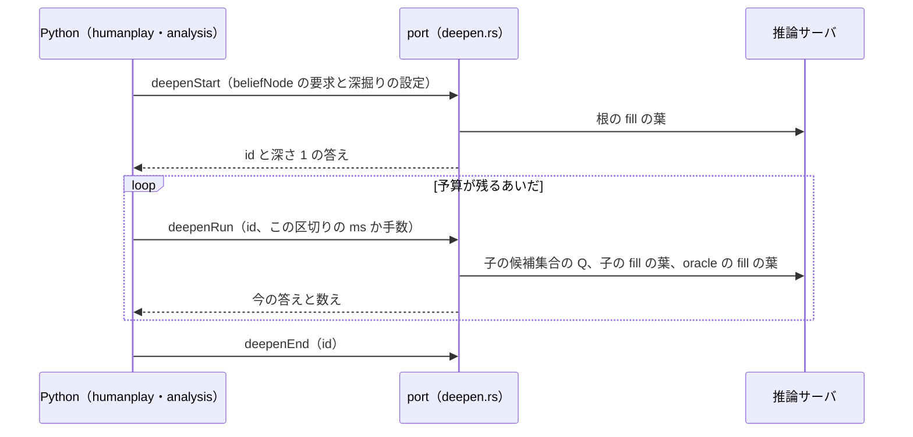

# IKA-464 段 6: 人と打つ道具の深掘りと梯子を Rust に移す

始点は origin/master の 522e0ca（2026-11-27）。

## 0. 前のレビューの軽い指摘

`humanplay._replacement_mixture` の docstring と records/IKA-463.md の 10.3 節は、交代の局面で投げる例外を `ValueError` と書いていた。今は `EquilibriumError`（`RuntimeError` の派生）だけを投げ、要求の `ValueError` は包み直して `__cause__` に残す。2 か所をそう書き直した。

## 1. 棚卸し: 既定の読みが通る道

| 道具 | 既定の読み | 通る Python |
|---|---|---|
| 人と打つ道具の 1 手（`play_human.py`）| 深掘り。oracle は `sall`、深さの上限 16、壁時計 45 秒、4 スレッド | `deepen.deepen_belief`（裏を隠す根）と `deepen.deepen_root`（`search.search` の中、開いた根）。木・優先度・oracle と差し替え・再解きは Python で、LP は scipy。子の候補集合は `narrow` の損傷順の 8 手で、手番と fill は port |
| 人と打つ道具の選出（`selection_deep`）| `stage=L6@0,rects=8-11,confirm=2,shift=add`、壁時計 90 秒 | `L6@0` は梯子の段を 1 つも読まない（`parse_ladder` の `@0`）。各セルは深さ 1 の `beliefNode`（port）で、梯子は根の答えをそのまま返す。90×90 の game の LP は Python の `solve_bayesian` |
| 検討（`analyze.py`）| 深掘り（`--ladder` は名指しのときだけ）| 深掘りと同じ |
| 時間の対戦評価（`time_match.py`）| 条件で名指し | 深掘り、または梯子 |

* 梯子の段を実際に読むのは、`--ladder` を名指ししたとき（人と打つ道具・検討・時間の対戦評価）と、選出の読みに `@0` でない段を名指ししたときだけである。
* 深掘りの中の Python の LP は根の再解き（`solve_bayesian` か `solve`）、子の 8×8 の `solve`、oracle の差し替えの再解きである。

## 2. 設計

### 2.1 深掘りの要求（段 A）

深掘りを port の中の 1 つの読みにする。Python は読みを始め、時間を区切って進め、答えを受け取る。

| 項目 | 決めたこと |
|---|---|
| 要求 | `deepenStart`・`deepenRun`・`deepenEnd` の 3 つ。読みの木は port の過程の中に id で残す。`beliefNode` と同じく、要求を読むスレッドが持つ |
| 根 | `beliefNode` の要求をそのまま受け取り、`beliefplan::belief_node` で根の行列を作る。開いた根は、裏の決定化が 1 つで重さ 1 の Bayes の根として読む（今の開いた深さ 1 のノードと同じ形）|
| 木 | 根のセルは（裏の決定化、行、列）。セルを読むと、その裏の決定化の局面で手番を解き（`resolve_fresh`）、重い 3 分岐を残して足し 1 に直し、分岐ごとに子のノードを作る。子は開いた局面の行列で、零和の LP（`lp::solve`）で解く |
| 子の候補集合 | Q の上位 8 手（`qmenus::menus_core`、幅 8、両側とも子の局面から）。今の既定の `narrow` の損傷順 8 手は Rust に無いので移さない。IKA-322 §18 では、Q の 8 手の子が損傷順の 8 手より NashConv が半分だった。局が変わるので、同じ時間の対戦評価で確かめる |
| 優先度 | `bern/gap` と、親のセルの優先度に分岐の重さを掛けて受け継ぐ規則（`deepen._scores`・`_best`）。深さの上限（`levels`）と割り引き（`discount`）も同じ意味で持つ |
| oracle | `sall` の差し替え（`_BeliefOracle` の probe・widen・swap）。候補の外の手は Python が渡す（今の `outside`）。fill は `belief_node` を解かずに呼ぶ |
| 再解き | セルを読むたびに、子から根までを解き直す。根は Bayes の LP（`lp::solve_bayesian`）。LP が解けないノードは前の答えを残す（今と同じ）|
| 予算 | 壁時計の ms か、数えたセル（`cells`）。数えたセルの予算は決定的で、テストとノード時間の対戦評価が使う |
| 途中の答え | `deepenRun` の答えに、今の根の戦略・裏の決定化ごとの相手の答え・値・根の候補集合と、`Deepened` の数（cells・expanded・depth・refused・probed・widened・swapped・stop・lines・guarded）、木のノード数と上限の線の数を入れる。検討の画面と `Step` はこれを読む |
| 止め方 | Python が区切りごとに、メモリの watch（`halt`）・ponder の `ready`・検討の停止を見る。区切りは既定で 250 ms |
| スレッド | 1 段目は要求を読むスレッドで木を進め、手番の解きと fill は今の port の cell thread（`par`）で並べる。先読みの展開（Python の `_Ahead`・worker 過程）は移さない。速さが足りなければ 2 段目で、上位のセルを cell thread で先に展開する |
| 推論サーバ | 根と子の fill は `belief_node` の served の道（`server`・`shm` は Python の葉のもの）。子の Q は `qServer`（今の `rootMenus` と同じ）|
| Python に残すもの | 画面・道具の main・時間の配り方（`plan_move`）・メモリの watch・ponder。`solve_move` は `deepenStart` の要求を作り、区切りを回し、`SolvedMove` を返す |

### 2.2 梯子と選出の深い読み（段 B）

既定の選出の読みは `L6@0` で、梯子の段を読まない。各セルの値は深さ 1 の `beliefNode` の値そのものである。そこで梯子は Rust に移さず、次のようにする案をとる。

1. `selection_deep.read_cell` は、梯子を通さずに深さ 1 のノード（`belief_solve`）を読む。`@0` の答えと同じになることを、記録のセルで数える。
2. 選出の 90×90 の game の LP（`selection_deep` の `solve_bayesian`）を port の LP（`lp` の要求）に替える。
3. 梯子の段を読む道（`--ladder`、`hidden_ladder`、`root_widths`、選出の段の名指し、`ladder.py`、`time_match` の梯子の条件）を消す。

梯子は研究用の読みで、既定の道は段を読まない。消す前に調整役の判断を仰ぐ。判断が「移す」なら、段 A の木の上に梯子の段（長方形・深さの層・子の段）を載せる形で別の段にする。

### 2.3 段の分け方

| 段 | 中身 | 局が変わるか | 確かめ |
|---|---|---|---|
| A1 | `deepen.rs` の木・優先度・再解き・Q の子・予算。oracle なし | 変わる（子の候補集合と足し順）| Rust の単体テスト。数えたセルの予算で、同じ局面の答えを Python の深掘り（`child_q=8`）と比べる |
| A2 | `sall` の oracle と差し替え。Python の配線（`solve_move`・検討・`time_match` の条件 `deepen=port`）| 変わる | 記録の 556 決定で前後の答えの差を数える。速さ（同じ秒で読むセルの数）。単一コア 4 秒以下の手で、同じ時間の対戦評価 SPRT(−10, 0) |
| A3 | 既定を port の深掘りにし、Python の深掘り（`deepen.py`）と `search.search` の深掘り、その LP を消す | 既定の局は A2 と同じ | テストを、Rust の要求の答えを比べる形に置き換える |
| B | 2.2 の案 | 選出は変わらない見込み | 記録のセルで値の差を数える |

### 2.4 梯子の判断（調整役 2026-11-27）

調整役は 2.2 の案を受け入れた。梯子は Rust に移さず消す。消す前に、選出の深い読みの既定の答えが前後で変わらないことを、記録のセルで数える。

## 3. 段 A1・A2: port の深掘り（2026-11-27）

### 3.1 変えたこと

| 場所 | 変えたこと |
|---|---|
| `rust/src/deepen.rs`（新）| `deepenStart`・`deepenRun`・`deepenEnd`・`deepenCounts` の要求。根・木・優先度・再解き・Q の子・`sall` の oracle と差し替え・数えたセルと壁時計の予算を持つ |
| `rust/src/qmenus.rs` | `qMenus` の本体を、型の付いた局面を受ける `menus_of` に分けた。`qMenus` の答えは前と同じである |
| `src/pokeuraou/beliefnode.py` | `beliefNode` の要求を作る所を `node_request` に分けた。送る要求は前と同じである |
| `src/pokeuraou/portdeepen.py`（新）| 区切りを回し、手の予算を `deepen._Meter` と同じく読み、`deepen.Step` を `progress` に渡し、`Deepened` を返す |
| `src/pokeuraou/humanplay.py` | `solve_move` に `road`（`python` か `port`）を足した。既定は `DEEPEN_ROAD`（今は `python`）|

### 3.2 Python の深掘りとの比べ（代役の葉と Q）

代役の葉（`test_humanplay._noisy`）と代役の Q（`test_port_menus.QStub`）で、同じ局面を port と Python の深掘り（子は Q の 8 手、`child_q=8`）で読んだ。4 局面の両席で、oracle なし、深さの上限 4 である。

| 予算（数えたセル）| 読み | 読んだセルの数・値が一致した読み |
|---|---|---|
| 200 | 8 | 8 |
| 600 | 8 | 8 |
| 1,500 | 8 | 4（2 局面の 4 読みで、途中から別のセルを読んだ）|

* 1,500 で分かれた 2 局面は、どちらも予算 600 までは同じ値だった。`portmenus` の docstring にあるとおり、Q が 2 つの手に同じ値を付けたとき、`qMenus` は並びを別に決めることがある。子の候補集合がそこで変わり、その先の木が分かれたと考えている。分かれた所は確かめていない。
* `sall` の oracle ありでは、予算 600 の 2 局面で、port と Python の答えの値が 4 桁まで一致した（0.4942 と 0.4601）。予算 4,000 では分かれた。Python の開いた根は `_Oracle`（裏の決定化を持たない形）で、port は開いた根も `_BeliefOracle` の形で読むからと考えている。違いの元は確かめていない。
* 速さは参考の値で、1 回ずつ回した。予算 3,000 セルで、Python の深掘りは 0.66 秒と 0.50 秒、port は 0.25 秒と 0.18 秒だった。

### 3.3 テスト

`tests/test_portdeepen.py`（新）に 3 本を置いた。

| テスト | 確かめること |
|---|---|
| `test_the_port_reads_a_move_deeper_on_counted_cells` | 3 局面の両席で、予算 400 セルの読みが予算を使い、セルを読み、値が深さ 1 から動く。同じ予算の 2 回の読みは同じ答えになる |
| `test_the_swap_oracle_brings_in_actions_from_outside` | oracle がセルを fill し、外の手を加える |
| `test_the_port_s_tree_is_the_python_deepening_with_the_q_s_children` | 予算 600 セルの 8 読みすべてで、読んだセルの数・深さ・値・混合が Python の深掘り（`child_q=8`）と合う。混合の答えが 1 つ以上ある |

* 陽性対照として、port の残す分岐を 3 から 2 に替えて 3 本目を回し、落ちることを確かめた。
* Rust の単体テストは 2 本（裏の決定化が 1 つの Bayes の LP が零和の LP と同じ値になること、優先度の順）。

### 3.4 同じ時間の対戦評価（回している）

| 項目 | 設定 |
|---|---|
| 条件 | 第 1 条件 `port:seconds=4,threads=1,cores=1,clock=wall,road=port`、第 2 条件 `python:` は `road` なし（今の既定）。どちらも oracle `sall`、深さの上限 16 |
| 道具 | `tools/time_match.py --pairs 1200 --parallel 10 --served --sprt -10 0`、種 33300、プール regmc-matchupweb、value-mc7 の 2 本、q-mc6 |
| コード | 凍結した worktree `C:/tmp/ika464/wt`（77975ed）と exe のコピー `C:/tmp/ika464/bin`（`POKEURAOU_RUST_NODE_BIN` はこの過程にだけ渡した）|
| 出力 | `C:/tmp/ika464/matchA2`、記録 `C:/tmp/ika464/matchA2.log`、外の負荷 `C:/tmp/ika464/load.txt` |
| 始めた時刻 | 2026-11-27 08:44 UTC。始めの CPU の使用率は 26%。調整役の指示で、並列は 14 を止めて 10 で始め直した |

* スモークテストの 2 対（4 並列）では両条件とも 39 手を打ち、1 手の秒と予算の比の中央値は 1.001 だった。深掘りの手数の中央値は port 674、Python 372 だった。
* 回し始めてからの CPU の使用率は 94〜100% だった。打ち手の過程（python 8 個で 4.4 コア、port 9 個で 4.7 コア）が大半を使う。
* 公平さの確かめ（調整役の指示）: 20 秒の間の過程ごとの CPU 秒を測った。局ごとの port の exe は 0.35〜0.66 コアで、スレッドは 2〜3 本だった。1 コアを超えるものは無かった。打ち手の python は 0.26〜0.40 コアだった。port の深掘りは要求を読むスレッドで木を進め、`threads=1` の条件では cell thread を増やさない。
* 調整役の指示で、62 対を終えた所で並列を 10 から 8 に下げた。`--resume --start 64` で続けた。初めの 62 対は数に入れる。

### 3.4b 対戦評価の結果

| 項目 | 値 |
|---|---|
| SPRT(−10, 0) | 911 対で H1（LLR +2.966）|
| 書き終えた対 | 919 対。port の深掘りの Elo +12.5 [−2.2, +27.2]、負・分・勝 179 / 528 / 212 |
| 勝者なし・退避・メモリ停止 | 0・0・0 |
| 1 手の秒と予算の比 | 中央値 port 1.0017・Python 1.0022、最大 2.06・2.03 |
| 深掘りの手数の中央値 | port 459、Python 282（1.63 倍）|
| 深さの上限 17 に届いた手 | port 5,214、Python 4,460（どちらも 16,601 手）|
| 外の負荷 | 09:35〜13:07 UTC の CPU の使用率は 44〜82%（`load.txt`）|

* 最初の止め直しで対 62 が抜け、SPRT が順に読めなくなった。もう一度止めて、対 62 と 65 を 1 対ずつ打ち直してから続けた（`C:/tmp/ika464/resume.sh`）。
* 結論として、同じ時間で port の深掘りは今の Python の深掘りより弱いとは言えない。ユーザーの方針（弱くならないなら既定にしてよい）で、既定を port にしてよい。既定の切り替えは 5 節の段 A3 で行う。

### 3.5 読みの途中で根を広げる（検討の `grow`）

検討（`analysis`）は、読みの途中で幅を広げる（`grow`、IKA-354）。port の道でも受け付けるようにした。

* `deepenRun` に `grow`（側 0 と側 1 の手）を足した。根に無い手だけを加え、自分の手は行、相手の手は列として、裏の決定化ごとに深さ 1 で fill する。根を解き直し、LP が解けなければ元に戻す。読んだセルとその木は残る。
* `portdeepen.deepen_move` は区切りの前ごとに `grow` を呼ぶ。`Deepened` の `grown`・`grown_cells` を数える。
* テスト `test_a_read_widened_mid_way_keeps_its_tree` を足した。`tests/test_portdeepen.py` の 4 本が通った（`-n 0`）。予算を数えたセルで読み、`grow` か `progress` があるときは 4 手ずつの区切りで回すようにした。区切りの長さで読むセルは変わらない（予算は手ごとに読む）。

## 4. 段 B1: 選出の深い読みを梯子から外す（2026-11-27）

| 場所 | 変えたこと |
|---|---|
| `selection_deep.read_cell` | 梯子（`L6@0`、段なし）を通さず、`humanplay.solve_move` の深さ 1 のノード（port の `beliefNode`）の値を読む |
| `selection_deep.solve_selection_deep` | 90×90 の game を port の LP（`portlp.solve_bayesian_many`）で解く。前は Python の `solve_bayesian` |
| `selection_deep.Reading` | `stage` と `value` を消した。spec の `stage=L6@0`（と `d1`）は受け付け、ほかの段は `ValueError` にする。既定は人と打つ道具の読み（`rects=8-11,confirm=2,shift=add`）|
| `humanplay.PLAY_SELECTION_READING` | `rects=8-11,confirm=2,shift=add`。`PLAY_SELECTION_READING_IKA392`（深さ 2 の段の読み）を消した |
| `tools/selection_sweep.py` | ファイルごと消した。基準の読みを深い段で作る研究用の道具で、梯子の段が無いと動かない |

* 前後の答えの差を、対戦評価のあとに測った（`C:/tmp/ika464/sel_diff.py`・`sel_compare.py`）。前は凍結した src（`C:/tmp/ika464/wt/src`、梯子あり）、後は 4b 節のあとの src（梯子なし。前の道を通ることはできない）で、M-C のプールの本番の評価モデルと Q（推論サーバ）を使った。

| 比べたもの | 数 | 結果 |
|---|---|---|
| 選出のセルの値（`read_cell`）| 200 セル | 差の最大 7.2e-14、1e-9 を超えたもの 0。値は 0.063〜0.985 |
| 組の深い読み（`solve_selection_deep`、人と打つ道具の読み、締め切りなし）| 8 組 | 8 組とも読んだセルの数（129〜184）と最後に終わった段（rect 11 の段 2）が同じ。値の差の最大 2.9e-15、混合の全変動距離の最大 2.7e-14。最も打つ手は 8 組とも同じで、答えは 8 組とも混合 |

* 速さは参考の値で、1 回ずつ回した。200 セルは前 50.6 秒・後 48.9 秒、8 組は前 278.5 秒・後 277.0 秒だった。
* `tests/test_selection_deep.py` は 21 本すべて通った（`-n 2`）。深い段を名指ししていたテストの spec を、深さ 1 の spec に替えた。

## 4b. 段 B2: 梯子を消す（2026-11-27）

### 4b.1 梯子を移さなかった理由

* 既定の道は梯子の段を読まない。人と打つ道具の 1 手は深掘りで読み、選出の深い読みは `L6@0`（段なし）で、各セルは深さ 1 のノードの値だった。
* 梯子の段を読むのは、名指ししたとき（`play_human.py --ladder`、`analyze.py --ladder`、`time_match` の `ladder=` の条件、選出の読みの深い段）だけだった。どれも研究用の読みである。
* `ladder.py` は 3,288 行あり、Rust に移すと段 A と同じ規模の仕事になる。ユーザーの方針（Python は撤去する、多少の犠牲はよい）と調整役の判断（2.4 節）で、移さずに消した。

### 4b.2 消したもの

| 場所 | 消したもの |
|---|---|
| `src/pokeuraou/ladder.py` | ファイルごと |
| `humanplay` | `Agent` の `ladder`・`hidden_ladder`・`ladder_child`・`root_widths`、`RootSteps`・`parse_root_widths`・`check_root_widths`・`ladder_spec_for`・`_ladder_move`・`use_ladder_pool`、`solve_move` の `ladder`、`SolvedMove` の `ladder`・`root`。`ladder_process_leaf`・`ladder_spec` は選出のワーカーが使うので、`worker_leaf`・`worker_spec` と名を替えて残した |
| `analysis` | `Settings.ladder` と梯子の読み |
| `timematch` | 条件の `ladder`・`hidden_ladder`・`root_widths`・`child` |
| `tools/play_human.py`・`analyze.py` | `--ladder`。`play_human.py` には `--road`（2.1 節の深掘りの道）を足した |
| `tools/time_match.py` | `--count-fill`・`--ladder-pool`・`--ladder-servers`・`--ladder-inference`。選出の読みをワーカーで読む部分は `--selection-pool` として残した |
| テスト | `test_ladder.py`・`test_ladder_leaf.py`・`test_ladder_pool.py`・`test_ladder_servers.py`・`test_portserved.py` をファイルごと、`test_portlp.py` の深い子の 3 本、`test_port_menus.py` の梯子の読み 2 本、`test_analysis.py`・`test_targeted_positions.py` の梯子の 1 本ずつ。`test_timematch.py` の `child` の 1 本は `road` の 1 本に替えた |

* 21 ファイルで 5,834 行を消し、147 行を足した。
* `test_ladder_leaf.py` はモジュールごと torch で skip していた。`.github/workflows/ci.yml` の torch の `--absent` を 30 から 29 にした。CI では確かめていない。
* `tests/test_port_menus.py`・`test_portlp.py` が使っていた局面の補助（`_played`・`_chomp_gambit`）は、`tests/_positions.py`（新）に移した。

### 4b.3 できなくなったこと

* 1 手を梯子の段で読むこと（深さ 2 から 9 の一様な層を粗い順に読み、最後に終わった段を答えにする読み）。人と打つ道具・検討・時間の対戦評価のどれでもできない。
* 根の候補集合を手の途中で広げる読み（`root_widths`）と、深い子の読み方の切り替え（`child`）。
* 選出の各セルを深さ 2 以上で読むこと（前の `--selection-reading default`）。
* 梯子だけが使っていた道具は、`portserved`・`subshare`・`search._refine_cells`・`portlp` の子の解き・`portmenus` に残っている。段 A3 で呼び手を数えて消す。

## 5. 引き継ぎ（2026-11-27、ここまで）

### 5.1 まだしていないこと

| 順 | 中身 | 手がかり |
|---|---|---|
| 1 | 段 A3: 既定を port にし（`humanplay.DEEPEN_ROAD`、3.4b 節で H1）、`deepen.py`・`search.search` の深掘り・Python の LP を消す | 呼び手の無い `equilibrium.solve`・`solve_bayesian` も消す。消したテストに合わせて ci.yml の `--absent` を直す。検討の `grow` は 3.5 節で port の道に足した。`humanplay.use_threads` の Python の先読み（`deepen.start_workers`・`set_ahead`）も port の道では使わない |
| 2 | 全体の確かめと CLAUDE.md | pytest 全体、ruff、`agent_drift`・`port_gate_audit`・`port_coverage` の `--check`、`cargo test --release` |

* 既定を port にすると、`tests/test_humanplay.py` などの深掘りする手のテストが止まる。これらは hp-share の葉（`evaluate=None`）と `refs2` で打つが、port の道は推論サーバの葉と Q（`qrank.RemoteQ`）を要る。`tests/test_portdeepen.py` の `served`（代役の葉と `QStub`）に載せ替える。
* port の道は `child_q` を受け付けず、子はいつも Q の 8 手である。`--child-q` と `Agent.child_q` は A3 で消せる。
* 段 A3 の作業は始めていない。B2 は 4 節の測りで選出の答えが変わらないことを確かめた。

## 6. レビューの指摘を直す（2026-11-27、枝 `ika464-a3`、土台 bc47f59）

| 指摘 | 直したこと | 確かめ |
|---|---|---|
| 中: 数えた時計の予算 | `portdeepen` の予算の読みに、`deepen._Meter.spent` と同じく、深さの合計（`cost.level`）と精緻化ごとの根のセルの合計（`cost.root`）を足した。port の probe は Q を使わないので `qs` は 0 である。port は答えに `levelSum`・`rootSum` を足した。値段の付いた予算では 1 手ずつ区切り、手ごとに予算を読む | 新しいテスト `test_a_priced_budget_is_read_as_the_python_deepening_reads_it`: `deepen.COSTS` の予算で、3 局面とも port と Python の深掘り（`c8`）の手数が同じになり、最後の手だけが予算を越える。対照として、深さと根の値段を 100 倍にすると手数が減る |
| 低: `deepenEnd` | `deepenStart` の答えを受けた直後から `try` で囲み、`finally` で `deepenEnd` を送る | 新しいテスト `test_a_read_is_let_go_however_it_ends`: 読みのあとと、`progress` が例外を投げたあとで、`deepenCounts.held` が 0 |
| 低: `grow` の失敗 | 行と列の fill を両方済ませてから根を書き換える。fill が失敗しても読みは元のまま | 失敗を起こすテストは書いていない |
| 低: ponder の 1 ms の区切り | 壁時計の区切りに下限 25 ms（`SLICE_MIN_MS`）を付けた | テストは書いていない |
| 低: 再起動の前提 | `port.ask` の docstring に深掘りの例外を書いた。立て直したあとの `deepenRun` は「the read was lost」で止める | テストは書いていない |

* 壁時計の読み（対戦評価の条件）は区切りの下限で変わった。8 節で直した。区切りの下限 `SLICE_MIN_MS = 25` は最後の区切りも 25 ms 以上にする。前の下限は 1 ms だった。1 手は予算を最大で 25 ms と 1 手分（子の fill を含む 1 回の精緻化）越えうる。25 ms は 4 秒の手の 0.625% である。数えた時計の読みは、Python の深掘りと同じ手数になる向きに変わった。前の 4 手ずつの区切りで何手越えていたかは数えていない。
* `tests/test_portdeepen.py` の 6 本が通った（`-n 0`）。

## 7. 段 A3 の引き継ぎ（2026-11-27）

`DEEPEN_ROAD` を `port` にして、深掘りする手のテストを回した（`test_humanplay`・`test_timematch`・`test_analysis`・`test_targeted_positions`、`-n 4`）。22 本が落ちたので、既定は `python` に戻してある。落ちたテストの一覧は `C:/tmp/ika464/a3_failing.txt` にある。

* 落ちた理由は、これらのテストの打ち手が Q を入れずに（`rank_fill="refs2"`、hp-share の葉）深掘りしていることである。port の道は子の候補集合を推論サーバの Q で作るので、`portdeepen._q_server` が止める。
* 次の担当は、これらのテストの打ち手を代役のサーバ（`tests/test_portdeepen.py` の `served`: `_noisy` の葉と `QStub`）に載せ替え、既定を `port` にする。そのあと `deepen.py`・`search` の深掘り・Python の LP・梯子の名の残る docstring を消し、CLAUDE.md の探索の節を書き直す。

## 8. 段 A3: Python の深掘りを消す（2026-11-27、枝 `ika464-a3b`、始点 887df85）

### 8.1 Q を入れないテストの深掘り

* `tests/conftest.py` に `_q_is_served` を足した。入っている Q が推論サーバの Q（`qrank.RemoteQ`）でないとき、port の深掘りは代役の Q を読む。代役の Q は `standin.stub_q` で、`QStub` を代役サーバに載せたものである。
* hp-share の葉の扱い（`_hp_share_is_served`）と同じ形にした。`@pytest.mark.unserved` の印のテストは入っている Q をそのまま読む。
* `QStub` は `tests/test_port_menus.py` から `src/pokeuraou/standin.py` に移した。`portdeepen._q_server` は、入っている Q を `_installed_q(reg)` で読むようにした。
* 7 節の 22 本はこの変更と既定の `port` で通った（`-n 4`）。陽性対照として、`_q_is_served` がいつも入っている Q を返すようにすると、`test_the_count_clock_replays_byte_for_byte` は `_q_server` の `ValueError` で落ちた。

### 8.2 消したもの

| 場所 | 消したもの |
|---|---|
| `src/pokeuraou/deepen.py` | 木・優先度・oracle・先読みの helper とワーカー・`_q_menus`・ラベルの読み（`DeepenSpec`・`deepen_spec`・`parse_deepen`）。3,542 行が 422 行になった |
| `humanplay` | `DEEPEN_ROAD`・`DEEPEN_ROADS`、`solve_move` の `road`・`child_q`、`Agent` の `road`・`child_q`、記録の `childQ`、`use_threads` の先読みのワーカー・helper・LP を 2 つ同時に解く設定、`served_process_leaf`・`AHEAD_*`・`LP_PAIR_CELLS` |
| `search` | `search` の `deepen` と、深掘りにだけ使う引数（`outside`・`deepen_cost`・`swap`・`levels`・`child_q`・`progress`・`grow` など）。`belief_solve` の `deepen`・`sub_limit`・`sub_branches`。`SearchResult` と `BeliefResult` の `deepened` |
| `equilibrium` | 1 つの game の 2 つの LP を 2 本のスレッドで同時に解く仕組み（`set_lp_pair`・`lp_pair`・`LP_PAIRS`・`_both`・その待ち行列のスレッド）。`solve` と `solve_bayesian` は残した。呼び手が残っているからである |
| `timematch`・`tools/time_match.py` | 条件の `road`・`child_q`、深掘りのワーカーを数える欄（`deepenWorkers`）、ワーカーが生きているかを確かめる所、`--other-value` に `threads=1` を求めて止める所 |
| `tools/play_human.py` | `--road`・`--child-q` |
| `progress` | Python の木を歩く読み（`_pairs`・`_branches`・`_node`・`_draws`・分岐の言葉の読み）。根より下の分岐は出さなくなった |
| `analysis` | 木を歩いて上限の線を数える読み（`_signal_now`）と、その間隔の設定（`guard_every_ms`） |
| `qrank.tail_wants_default_q` | ワーカーの `--deepen` の読み。ワーカーは `--deepen` を受け付けない |
| テスト | `test_deepen.py`・`test_deepen_ahead.py`・`test_deepen_batch.py`・`test_deepen_discount.py`・`test_deepen_grow.py`・`test_deepen_guard.py`・`test_deepen_hidden.py`・`test_deepen_qprobe.py`（8 ファイル、2,558 行）。予算の 4 本は `test_deepen_budget.py`（新）に移した |

* 887df85 から 7674cda までで、47 ファイルの 7,073 行を消し、1,173 行を足した（`git diff --stat 887df85..7674cda`）。
* `test_deepen_guard.py` には torch で skip する 1 本があった。`.github/workflows/ci.yml` の torch の `--absent` を 29 から 28 にした。CI では確かめていない。

### 8.3 port の道に足したもの

Python の道を消すと、port の道で動かない所が 3 つ見つかった。既定を `port` にした時点で、`test_liveview` の 8 本、`test_analysis` の 4 本、`test_analysis_widen` の 2 本、`test_memory_brake` の 1 本が落ちた。見た落ち方は `AttributeError`、上限の線を数えた値が 0 だったこと、時間切れである。1 本ずつの理由は分けていない。

| 所 | 起きたこと | 直したこと |
|---|---|---|
| 画面の読み（`progress.Reader`）| port の根は `rows`・`col_strategy` を持たないので、聞き手がいる人と打つ道具と検討で `AttributeError` になった | 根を `deepen.Root`（Bayes の形）にし、`Reader` はこの形だけを読む。port の snapshot に、深く読んだ根のセル（`deep`）と断ったセル（`refusedCells`）を足した（`rust/src/deepen.rs`）。主な手の組の `read` はこれで `deep` と `leaf` を分ける |
| 検討で上限の線を数える所（`analysis.guard_lines`）| Python の木を歩いて数えていたので、port の道では 0 だった | port の snapshot の `lines` の 3 つ目と `nodes` を読む |
| メモリの watch（`analysis.tree_rss_gb`）| port の深掘りの木は port の過程にあり、watch はその過程を数えていなかった。コードを読んで見つけた。これで落ちたテストは無い | `rustnode.PORT_PIDS` に port の過程を記し、watch はそれも足す。始めたばかりの port で、watch の値が port の 0.0019 GB だけ増えた。長い読みでの増え方は測っていない |

* 画面の読みは、Python の深掘りがしていた根より下の分岐（引きの言葉、変わったこと、下のノードの場）を出さなくなった。port は木を外に出さないからである。形（`PvBranch`・`PvNode`）は、画面と前の記録のために残した。
* `portmenus.child_menus` は `deepen._q_menus` を移したものである。深さ 2 の読み（`search._refine_cells`）の `child_q` がこれを読む。

### 8.4 Python の深掘りと比べるテストを固定の答えに替えた

* `test_the_port_s_tree_is_the_python_deepening_with_the_q_s_children` と `test_a_priced_budget_is_read_as_the_python_deepening_reads_it` は、その場で Python の深掘りを回して比べていた。
* 887df85 の Python の深掘り（`child_q=8`）の答えを `tests/fixtures/ika464-python-deepening.json` に書き出し、port の答えをそれと比べる形にした。書き出しの道具は `C:/tmp/ika464b/ref.py` である。
* 書き出したとき、port と Python の手数は 8 読みすべてと値段付きの 3 読みすべてで同じだった。値の差の最大は 3.7e-15 だった。
* 陽性対照として、port の残す分岐を 3 から 2 にすると、2 本とも落ちた（値 0.44108004 と 0.44108291、手数 34 と 25）。

### 8.5 前の指摘の残り

| 指摘 | 直したこと | 確かめ |
|---|---|---|
| 6 節の壁時計の文 | 6 節の文を直した。区切りの下限 25 ms で、1 手は予算を最大で 25 ms と 1 手分（子の fill を含む 1 回の精緻化）越えうる | 文の訂正だけで、測りはしていない |
| `test_a_read_is_let_go_however_it_ends` | `progress` が最初の報告（`start`、区切りの前）で投げる場合を足した | 7512a40 の前の `portdeepen.py` では、`start` の場合が「a read raised at 'start' was held」（`held` が 1）で落ちた。今のコードでは通った |

### 8.6 局が変わるか（数えた時計）

stand-in の葉（`_noisy`）と `QStub` で、人と打つ道具の数えた時計の局を 12 局（種 0〜11、6 ターンまで、oracle `sall`、深さの上限 16）打って比べた。道具は `C:/tmp/ika464b/games.py`・`cmp.py` である。

| 比べたもの | 手番の決定 | 違った決定 |
|---|---|---|
| 887df85 の port の道 と この枝 | 114 | 0（違いは記録の `engine` の commit と source の hash だけ） |
| 887df85 の既定（Python の道）と この枝 | 110 | 110 |

* port の道の局は変わらない。`portdeepen` の予算の読みを `deepen._Meter` に寄せた変更と、snapshot のキーを足した変更は、局を変えなかった。
* 既定の局は変わる。887df85 の既定は Python の道だったからである。同じ局面での手番の決定 65 のうち 53 で、打ち手の混合が違った。この変化の強さは 3.4b 節の対戦評価で測ってある。

### 8.7 確かめたこと

| 確かめ | 結果 |
|---|---|
| `ruff check .` | 通った |
| `tools/agent_drift.py --check`・`tools/port_gate_audit.py --check`・`tools/port_coverage.py --check` | 通った |
| `cargo test --release` | 48 本が通った |
| 触ったテストのファイル（`test_portdeepen`・`test_humanplay`・`test_timematch`・`test_analysis`・`test_analysis_widen`・`test_targeted_positions`・`test_port_menus`・`test_liveview`・`test_memory_brake`・`test_deepen_budget`・`test_rankedposition`・`test_selfplay_reread`・`test_search`・`test_equilibrium`、`-n 4`）| 147 本が通った |
| 呼び手の近いテストのファイル（`test_beliefnode`・`test_hidden_search`・`test_portlp`・`test_subgame_batch`・`test_timing`・`test_selection_deep` など 27 ファイル）| 239 本が通り、3 本が skip。`test_cli` の 11 本は `data/` が要るので、junction を張って通し、junction を外した |

### 8.8 確かめていないこと

* pytest 全体と CI。
* 壁時計の対戦評価。この段で port の道の局は変わらないので、回していない。
* 長い読みで、メモリの watch が port の過程の増え方を拾うこと。
* 人と打つ道具・検討・`ranked_entry` を実際の推論サーバで起こすこと。Q が無いときに始めで止まること（`play_human.install_deepening_q`）も、道具を起こして確かめてはいない。

### 8.9 残っていること

* 深さ 2 の読み（`search._refine_cells`・`_refined_value` など）と、その道具（`portserved`・`subshare`・`portlp.solve_subs`・`portmenus` の切り替え・`portlp.solve_bayesian_one`）は、局の道から呼ばれない。消すなら次の段で、呼び手（`tools/legal_moves_cost.py`・テスト）を数えて決める。
* 道の切り替えの環境変数の名（`POKEURAOU_LADDER_PORT_*`・`POKEURAOU_LADDER_SHARE_SLOTS`・`POKEURAOU_LADDER_MARKS`）は梯子の名のままにした。docstring には、その名が梯子のものだと書いた。
* `timematch.read_summary` は、時間の対戦評価で 1 席が 1 手を読んだ答えを要約する。その `hard`・`guarantee` は、読みが行列を渡すときだけ出る。梯子が消えてから、行列を渡す読みは無い。port の深掘りの snapshot には根の行列があるが、つないでいない。

## 9. レビューの指摘を直す（2026-11-28、枝 `ika464-a3c`、始点 7674cda）

### 9.1 検討の読みを壁時計の区切りにした

* 指摘: `analysis.StopCost` は `WallCost` でなく `inner` も持たないので、`portdeepen._is_wall` が False を返していた。検討の読みは 1 手ごとに port と往復していた。
* `StopCost` に `wall` を足した。`_is_wall` は `wall` が True の読みも壁時計として扱い、`SLICE_MS`（250 ms）で区切る。
* 検討が `max_steps` で止まる読みでは `wall=False` にした。区切りは 1 手のままで、同じ手数で同じ答えになる。
* 壁時計の区切りでは止めの合図（画面の停止・`max_seconds`・メモリの watch）を区切りの終わりで読む。9.2 節で測ると、4 秒で止める読みは 4.10〜4.14 秒で止まった。

木を歩いて上限の線を数える費用も間引いた。

* port の `deepenRun` に `walk` を足した。false なら木を歩かず、前に歩いた時の線の数（`linesFresh` は false）を答える。
* `portdeepen` は `LINES_EVERY_MS`（1,000 ms）に 1 回だけ歩かせる。前の Python の道の `guard_every_ms` と同じ間隔である。
* 最後の区切りで歩かなかった読みは、終わりに 1 回だけ歩かせる（`steps` 0 の `deepenRun`）。記録の線の数は読み終えた木の数になる。
* テスト `test_the_lines_are_walked_now_and_then_and_at_the_end` を足した。間隔を長くした読みと毎回歩く読みで、線の数・手数・セルが同じになる。間隔を長くした読みでは、途中の区切りが前の線の数を答え、終わりの歩きが 1 回あった。

### 9.2 同じ局面での手数

代役の葉と Q（`tests/test_portdeepen.py` の形）、開いた局面 1 つ、幅 12、深さの上限 16、port のスレッド 1 本で、4 秒の読みを 3 通りの予算の読みで交互に 4 回ずつ回した（`C:/tmp/ika464b/abab.py`）。外の CPU の使用率は始め 8%、終わり 15% だった。

| 予算の読み | 手数（1〜4 回目） | 秒 | 1 秒あたりの手数（2〜4 回目の平均） |
|---|---|---|---|
| `WallCost` | 878・935・936・941 | 4.005〜4.008 | 233.9 |
| `StopCost`（直したあと、`wall`） | 954・966・967・969 | 4.103〜4.138 | 235.3 |
| `StopCost`（直す前の読み、`wall=False`） | 866・878・878・879 | 4.005〜4.013 | 219.1 |

* 直す前の読みは `WallCost` より 1 秒あたりの手数が 6.3% 少なかった。直したあとは 0.6% 多い。
* `StopCost` の手数が多いのは、止めの印が区切りの途中で立ち、読みが 0.10〜0.14 秒長く続いたからである。
* 1 回目は 3 通りとも少ない。始めの準備と考えている。確かめてはいない。
* 長い読みで木を歩く費用がどれだけ減ったかは測っていない。

### 9.3 そのほかの指摘

| 指摘 | 直したこと |
|---|---|
| CLAUDE.md の `deepen.py` に残るもの | `MAX_LEVELS`・`ALL_ACTIONS`・`Grow`・`_lost_options`・`DEFAULT_DEEPEN` を足した |
| CLAUDE.md と README.md の `--selection-reading default` | 深さ 2 の前の既定は IKA-464 で消え、`default` は今の既定（深さ 1）を指すと書いた |
| README.md の「データ生成と対戦評価の柵は `deepen.MAX_LEVELS`」 | 生成と対戦評価は深掘りしないので柵を使わない、と書き直した |
| 8.2 節の数 | `git diff --stat 887df85..7674cda` の 47 ファイル、+1,173 / −7,073 にした |
| 6 節の「セル 1 つ分」 | 「1 手分（子の fill を含む 1 回の精緻化）」にした |
| `provenance.py`・`selfplay.py` の `deepen.parse_deepen` | 今の意味と、IKA-464 まで読んでいた関数の名を書いた |
| `timematch.read_summary` の `hard`・`guarantee` | 行列を読む所（50 行）と `SUMMARY_HARD` を消した。`tools/game_page.py` は、前に書いた要約の欄をそのまま読む。テストは混合の欄だけを確かめる形にした |

### 9.4 確かめたこと

| 確かめ | 結果 |
|---|---|
| `ruff check .`、3 つの `--check` | 通った |
| `cargo test --release` | 48 本が通った |
| 触ったテストのファイル（`test_portdeepen`・`test_analysis`・`test_analysis_widen`・`test_liveview`・`test_humanplay`・`test_memory_brake`・`test_timematch`・`test_targeted_positions`・`test_selfplay_game_page`・`test_deepen_budget`・`test_provenance`、`-n 4`） | 107 本が通った |

* pytest 全体と CI は確かめていない。
