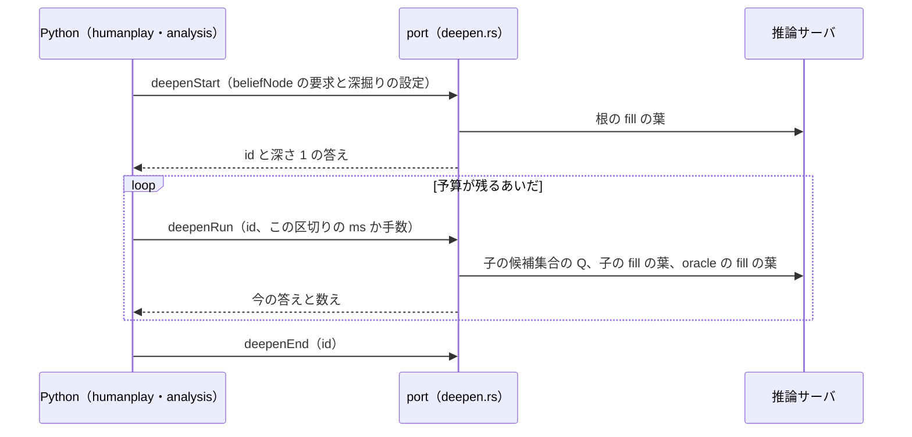

# IKA-464 段 6: 人と打つ道具の深掘りと梯子を Rust に移す

始点は origin/master の 522e0ca（2026-11-27）。

## 0. 前のレビューの軽い指摘

`humanplay._replacement_mixture` の docstring と records/IKA-463.md の 10.3 節は、交代の局面で投げる例外を `ValueError` と書いていた。今は `EquilibriumError`（`RuntimeError` の派生）だけを投げ、要求の `ValueError` は包み直して `__cause__` に残す。2 か所をそう書き直した。

## 1. 棚卸し: 既定の読みが通る道

| 道具 | 既定の読み | 通る Python |
|---|---|---|
| 人と打つ道具の 1 手（`play_human.py`）| 深掘り。oracle は `sall`、深さの上限 16、壁時計 45 秒、4 スレッド | `deepen.deepen_belief`（裏を隠す根）と `deepen.deepen_root`（`search.search` の中、開いた根）。木・優先度・oracle と差し替え・再解きは Python で、LP は scipy。子の候補集合は `narrow` の損傷順の 8 手で、手番と fill は port |
| 人と打つ道具の選出（`selection_deep`）| `stage=L6@0,rects=8-11,confirm=2,shift=add`、壁時計 90 秒 | `L6@0` は梯子の段を 1 つも読まない（`parse_ladder` の `@0`）。各セルは深さ 1 の `beliefNode`（port）で、梯子は根の答えをそのまま返す。90×90 の game の LP は Python の `solve_bayesian` |
| 検討（`analyze.py`）| 深掘り（`--ladder` は名指しのときだけ）| 深掘りと同じ |
| 時間の対戦評価（`time_match.py`）| 条件で名指し | 深掘り、または梯子 |

* 梯子の段を実際に読むのは、`--ladder` を名指ししたとき（人と打つ道具・検討・時間の対戦評価）と、選出の読みに `@0` でない段を名指ししたときだけである。
* 深掘りの中の Python の LP は根の再解き（`solve_bayesian` か `solve`）、子の 8×8 の `solve`、oracle の差し替えの再解きである。

## 2. 設計

### 2.1 深掘りの要求（段 A）

深掘りを port の中の 1 つの読みにする。Python は読みを始め、時間を区切って進め、答えを受け取る。

| 項目 | 決めたこと |
|---|---|
| 要求 | `deepenStart`・`deepenRun`・`deepenEnd` の 3 つ。読みの木は port の過程の中に id で残す。`beliefNode` と同じく、要求を読むスレッドが持つ |
| 根 | `beliefNode` の要求をそのまま受け取り、`beliefplan::belief_node` で根の行列を作る。開いた根は、裏の決定化が 1 つで重さ 1 の Bayes の根として読む（今の開いた深さ 1 のノードと同じ形）|
| 木 | 根のセルは（裏の決定化、行、列）。セルを読むと、その裏の決定化の局面で手番を解き（`resolve_fresh`）、重い 3 分岐を残して足し 1 に直し、分岐ごとに子のノードを作る。子は開いた局面の行列で、零和の LP（`lp::solve`）で解く |
| 子の候補集合 | Q の上位 8 手（`qmenus::menus_core`、幅 8、両側とも子の局面から）。今の既定の `narrow` の損傷順 8 手は Rust に無いので移さない。IKA-322 §18 では、Q の 8 手の子が損傷順の 8 手より NashConv が半分だった。局が変わるので、同じ時間の対戦評価で確かめる |
| 優先度 | `bern/gap` と、親のセルの優先度に分岐の重さを掛けて受け継ぐ規則（`deepen._scores`・`_best`）。深さの上限（`levels`）と割り引き（`discount`）も同じ意味で持つ |
| oracle | `sall` の差し替え（`_BeliefOracle` の probe・widen・swap）。候補の外の手は Python が渡す（今の `outside`）。fill は `belief_node` を解かずに呼ぶ |
| 再解き | セルを読むたびに、子から根までを解き直す。根は Bayes の LP（`lp::solve_bayesian`）。LP が解けないノードは前の答えを残す（今と同じ）|
| 予算 | 壁時計の ms か、数えたセル（`cells`）。数えたセルの予算は決定的で、テストとノード時間の対戦評価が使う |
| 途中の答え | `deepenRun` の答えに、今の根の戦略・裏の決定化ごとの相手の答え・値・根の候補集合と、`Deepened` の数（cells・expanded・depth・refused・probed・widened・swapped・stop・lines・guarded）、木のノード数と上限の線の数を入れる。検討の画面と `Step` はこれを読む |
| 止め方 | Python が区切りごとに、メモリの watch（`halt`）・ponder の `ready`・検討の停止を見る。区切りは既定で 250 ms |
| スレッド | 1 段目は要求を読むスレッドで木を進め、手番の解きと fill は今の port の cell thread（`par`）で並べる。先読みの展開（Python の `_Ahead`・worker 過程）は移さない。速さが足りなければ 2 段目で、上位のセルを cell thread で先に展開する |
| 推論サーバ | 根と子の fill は `belief_node` の served の道（`server`・`shm` は Python の葉のもの）。子の Q は `qServer`（今の `rootMenus` と同じ）|
| Python に残すもの | 画面・道具の main・時間の配り方（`plan_move`）・メモリの watch・ponder。`solve_move` は `deepenStart` の要求を作り、区切りを回し、`SolvedMove` を返す |

### 2.2 梯子と選出の深い読み（段 B）

既定の選出の読みは `L6@0` で、梯子の段を読まない。各セルの値は深さ 1 の `beliefNode` の値そのものである。そこで梯子は Rust に移さず、次のようにする案をとる。

1. `selection_deep.read_cell` は、梯子を通さずに深さ 1 のノード（`belief_solve`）を読む。`@0` の答えと同じになることを、記録のセルで数える。
2. 選出の 90×90 の game の LP（`selection_deep` の `solve_bayesian`）を port の LP（`lp` の要求）に替える。
3. 梯子の段を読む道（`--ladder`、`hidden_ladder`、`root_widths`、選出の段の名指し、`ladder.py`、`time_match` の梯子の条件）を消す。

梯子は研究用の読みで、既定の道は段を読まない。消す前に調整役の判断を仰ぐ。判断が「移す」なら、段 A の木の上に梯子の段（長方形・深さの層・子の段）を載せる形で別の段にする。

### 2.3 段の分け方

| 段 | 中身 | 局が変わるか | 確かめ |
|---|---|---|---|
| A1 | `deepen.rs` の木・優先度・再解き・Q の子・予算。oracle なし | 変わる（子の候補集合と足し順）| Rust の単体テスト。数えたセルの予算で、同じ局面の答えを Python の深掘り（`child_q=8`）と比べる |
| A2 | `sall` の oracle と差し替え。Python の配線（`solve_move`・検討・`time_match` の条件 `deepen=port`）| 変わる | 記録の 556 決定で前後の答えの差を数える。速さ（同じ秒で読むセルの数）。単一コア 4 秒以下の手で、同じ時間の対戦評価 SPRT(−10, 0) |
| A3 | 既定を port の深掘りにし、Python の深掘り（`deepen.py`）と `search.search` の深掘り、その LP を消す | 既定の局は A2 と同じ | テストを、Rust の要求の答えを比べる形に置き換える |
| B | 2.2 の案 | 選出は変わらない見込み | 記録のセルで値の差を数える |
