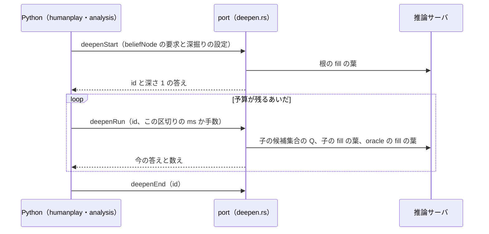

# IKA-464 段 6: 人と打つ道具の深掘りと梯子を Rust に移す

始点は origin/master の 522e0ca（2026-11-27）。

## 0. 前のレビューの軽い指摘

`humanplay._replacement_mixture` の docstring と records/IKA-463.md の 10.3 節は、交代の局面で投げる例外を `ValueError` と書いていた。今は `EquilibriumError`（`RuntimeError` の派生）だけを投げ、要求の `ValueError` は包み直して `__cause__` に残す。2 か所をそう書き直した。

## 1. 棚卸し: 既定の読みが通る道

| 道具 | 既定の読み | 通る Python |
|---|---|---|
| 人と打つ道具の 1 手（`play_human.py`）| 深掘り。oracle は `sall`、深さの上限 16、壁時計 45 秒、4 スレッド | `deepen.deepen_belief`（裏を隠す根）と `deepen.deepen_root`（`search.search` の中、開いた根）。木・優先度・oracle と差し替え・再解きは Python で、LP は scipy。子の候補集合は `narrow` の損傷順の 8 手で、手番と fill は port |
| 人と打つ道具の選出（`selection_deep`）| `stage=L6@0,rects=8-11,confirm=2,shift=add`、壁時計 90 秒 | `L6@0` は梯子の段を 1 つも読まない（`parse_ladder` の `@0`）。各セルは深さ 1 の `beliefNode`（port）で、梯子は根の答えをそのまま返す。90×90 の game の LP は Python の `solve_bayesian` |
| 検討（`analyze.py`）| 深掘り（`--ladder` は名指しのときだけ）| 深掘りと同じ |
| 時間の対戦評価（`time_match.py`）| 条件で名指し | 深掘り、または梯子 |

* 梯子の段を実際に読むのは、`--ladder` を名指ししたとき（人と打つ道具・検討・時間の対戦評価）と、選出の読みに `@0` でない段を名指ししたときだけである。
* 深掘りの中の Python の LP は根の再解き（`solve_bayesian` か `solve`）、子の 8×8 の `solve`、oracle の差し替えの再解きである。

## 2. 設計

### 2.1 深掘りの要求（段 A）

深掘りを port の中の 1 つの読みにする。Python は読みを始め、時間を区切って進め、答えを受け取る。

| 項目 | 決めたこと |
|---|---|
| 要求 | `deepenStart`・`deepenRun`・`deepenEnd` の 3 つ。読みの木は port の過程の中に id で残す。`beliefNode` と同じく、要求を読むスレッドが持つ |
| 根 | `beliefNode` の要求をそのまま受け取り、`beliefplan::belief_node` で根の行列を作る。開いた根は、裏の決定化が 1 つで重さ 1 の Bayes の根として読む（今の開いた深さ 1 のノードと同じ形）|
| 木 | 根のセルは（裏の決定化、行、列）。セルを読むと、その裏の決定化の局面で手番を解き（`resolve_fresh`）、重い 3 分岐を残して足し 1 に直し、分岐ごとに子のノードを作る。子は開いた局面の行列で、零和の LP（`lp::solve`）で解く |
| 子の候補集合 | Q の上位 8 手（`qmenus::menus_core`、幅 8、両側とも子の局面から）。今の既定の `narrow` の損傷順 8 手は Rust に無いので移さない。IKA-322 §18 では、Q の 8 手の子が損傷順の 8 手より NashConv が半分だった。局が変わるので、同じ時間の対戦評価で確かめる |
| 優先度 | `bern/gap` と、親のセルの優先度に分岐の重さを掛けて受け継ぐ規則（`deepen._scores`・`_best`）。深さの上限（`levels`）と割り引き（`discount`）も同じ意味で持つ |
| oracle | `sall` の差し替え（`_BeliefOracle` の probe・widen・swap）。候補の外の手は Python が渡す（今の `outside`）。fill は `belief_node` を解かずに呼ぶ |
| 再解き | セルを読むたびに、子から根までを解き直す。根は Bayes の LP（`lp::solve_bayesian`）。LP が解けないノードは前の答えを残す（今と同じ）|
| 予算 | 壁時計の ms か、数えたセル（`cells`）。数えたセルの予算は決定的で、テストとノード時間の対戦評価が使う |
| 途中の答え | `deepenRun` の答えに、今の根の戦略・裏の決定化ごとの相手の答え・値・根の候補集合と、`Deepened` の数（cells・expanded・depth・refused・probed・widened・swapped・stop・lines・guarded）、木のノード数と上限の線の数を入れる。検討の画面と `Step` はこれを読む |
| 止め方 | Python が区切りごとに、メモリの watch（`halt`）・ponder の `ready`・検討の停止を見る。区切りは既定で 250 ms |
| スレッド | 1 段目は要求を読むスレッドで木を進め、手番の解きと fill は今の port の cell thread（`par`）で並べる。先読みの展開（Python の `_Ahead`・worker 過程）は移さない。速さが足りなければ 2 段目で、上位のセルを cell thread で先に展開する |
| 推論サーバ | 根と子の fill は `belief_node` の served の道（`server`・`shm` は Python の葉のもの）。子の Q は `qServer`（今の `rootMenus` と同じ）|
| Python に残すもの | 画面・道具の main・時間の配り方（`plan_move`）・メモリの watch・ponder。`solve_move` は `deepenStart` の要求を作り、区切りを回し、`SolvedMove` を返す |

### 2.2 梯子と選出の深い読み（段 B）

既定の選出の読みは `L6@0` で、梯子の段を読まない。各セルの値は深さ 1 の `beliefNode` の値そのものである。そこで梯子は Rust に移さず、次のようにする案をとる。

1. `selection_deep.read_cell` は、梯子を通さずに深さ 1 のノード（`belief_solve`）を読む。`@0` の答えと同じになることを、記録のセルで数える。
2. 選出の 90×90 の game の LP（`selection_deep` の `solve_bayesian`）を port の LP（`lp` の要求）に替える。
3. 梯子の段を読む道（`--ladder`、`hidden_ladder`、`root_widths`、選出の段の名指し、`ladder.py`、`time_match` の梯子の条件）を消す。

梯子は研究用の読みで、既定の道は段を読まない。消す前に調整役の判断を仰ぐ。判断が「移す」なら、段 A の木の上に梯子の段（長方形・深さの層・子の段）を載せる形で別の段にする。

### 2.3 段の分け方

| 段 | 中身 | 局が変わるか | 確かめ |
|---|---|---|---|
| A1 | `deepen.rs` の木・優先度・再解き・Q の子・予算。oracle なし | 変わる（子の候補集合と足し順）| Rust の単体テスト。数えたセルの予算で、同じ局面の答えを Python の深掘り（`child_q=8`）と比べる |
| A2 | `sall` の oracle と差し替え。Python の配線（`solve_move`・検討・`time_match` の条件 `deepen=port`）| 変わる | 記録の 556 決定で前後の答えの差を数える。速さ（同じ秒で読むセルの数）。単一コア 4 秒以下の手で、同じ時間の対戦評価 SPRT(−10, 0) |
| A3 | 既定を port の深掘りにし、Python の深掘り（`deepen.py`）と `search.search` の深掘り、その LP を消す | 既定の局は A2 と同じ | テストを、Rust の要求の答えを比べる形に置き換える |
| B | 2.2 の案 | 選出は変わらない見込み | 記録のセルで値の差を数える |

### 2.4 梯子の判断（調整役 2026-11-27）

調整役は 2.2 の案を受け入れた。梯子は Rust に移さず消す。消す前に、選出の深い読みの既定の答えが前後で変わらないことを、記録のセルで数える。

## 3. 段 A1・A2: port の深掘り（2026-11-27）

### 3.1 変えたこと

| 場所 | 変えたこと |
|---|---|
| `rust/src/deepen.rs`（新）| `deepenStart`・`deepenRun`・`deepenEnd`・`deepenCounts` の要求。根・木・優先度・再解き・Q の子・`sall` の oracle と差し替え・数えたセルと壁時計の予算を持つ |
| `rust/src/qmenus.rs` | `qMenus` の本体を、型の付いた局面を受ける `menus_of` に分けた。`qMenus` の答えは前と同じである |
| `src/pokeuraou/beliefnode.py` | `beliefNode` の要求を作る所を `node_request` に分けた。送る要求は前と同じである |
| `src/pokeuraou/portdeepen.py`（新）| 区切りを回し、手の予算を `deepen._Meter` と同じく読み、`deepen.Step` を `progress` に渡し、`Deepened` を返す |
| `src/pokeuraou/humanplay.py` | `solve_move` に `road`（`python` か `port`）を足した。既定は `DEEPEN_ROAD`（今は `python`）|

### 3.2 Python の深掘りとの比べ（代役の葉と Q）

代役の葉（`test_humanplay._noisy`）と代役の Q（`test_port_menus.QStub`）で、同じ局面を port と Python の深掘り（子は Q の 8 手、`child_q=8`）で読んだ。4 局面の両席で、oracle なし、深さの上限 4 である。

| 予算（数えたセル）| 読み | 読んだセルの数・値が一致した読み |
|---|---|---|
| 200 | 8 | 8 |
| 600 | 8 | 8 |
| 1,500 | 8 | 4（2 局面の 4 読みで、途中から別のセルを読んだ）|

* 1,500 で分かれた 2 局面は、どちらも予算 600 までは同じ値だった。`portmenus` の docstring にあるとおり、Q が 2 つの手に同じ値を付けたとき、`qMenus` は並びを別に決めることがある。子の候補集合がそこで変わり、その先の木が分かれたと考えている。分かれた所は確かめていない。
* `sall` の oracle ありでは、予算 600 の 2 局面で、port と Python の答えの値が 4 桁まで一致した（0.4942 と 0.4601）。予算 4,000 では分かれた。Python の開いた根は `_Oracle`（裏の決定化を持たない形）で、port は開いた根も `_BeliefOracle` の形で読むからと考えている。違いの元は確かめていない。
* 速さは参考の値で、1 回ずつ回した。予算 3,000 セルで、Python の深掘りは 0.66 秒と 0.50 秒、port は 0.25 秒と 0.18 秒だった。

### 3.3 テスト

`tests/test_portdeepen.py`（新）に 3 本を置いた。

| テスト | 確かめること |
|---|---|
| `test_the_port_reads_a_move_deeper_on_counted_cells` | 3 局面の両席で、予算 400 セルの読みが予算を使い、セルを読み、値が深さ 1 から動く。同じ予算の 2 回の読みは同じ答えになる |
| `test_the_swap_oracle_brings_in_actions_from_outside` | oracle がセルを fill し、外の手を加える |
| `test_the_port_s_tree_is_the_python_deepening_with_the_q_s_children` | 予算 600 セルの 8 読みすべてで、読んだセルの数・深さ・値・混合が Python の深掘り（`child_q=8`）と合う。混合の答えが 1 つ以上ある |

* 陽性対照として、port の残す分岐を 3 から 2 に替えて 3 本目を回し、落ちることを確かめた。
* Rust の単体テストは 2 本（裏の決定化が 1 つの Bayes の LP が零和の LP と同じ値になること、優先度の順）。

### 3.4 同じ時間の対戦評価（回している）

| 項目 | 設定 |
|---|---|
| 条件 | 第 1 条件 `port:seconds=4,threads=1,cores=1,clock=wall,road=port`、第 2 条件 `python:` は `road` なし（今の既定）。どちらも oracle `sall`、深さの上限 16 |
| 道具 | `tools/time_match.py --pairs 1200 --parallel 10 --served --sprt -10 0`、種 33300、プール regmc-matchupweb、value-mc7 の 2 本、q-mc6 |
| コード | 凍結した worktree `C:/tmp/ika464/wt`（77975ed）と exe のコピー `C:/tmp/ika464/bin`（`POKEURAOU_RUST_NODE_BIN` はこの過程にだけ渡した）|
| 出力 | `C:/tmp/ika464/matchA2`、記録 `C:/tmp/ika464/matchA2.log`、外の負荷 `C:/tmp/ika464/load.txt` |
| 始めた時刻 | 2026-11-27 08:44 UTC。始めの CPU の使用率は 26%。調整役の指示で、並列は 14 を止めて 10 で始め直した |

* スモークテストの 2 対（4 並列）では両条件とも 39 手を打ち、1 手の秒と予算の比の中央値は 1.001 だった。深掘りの手数の中央値は port 674、Python 372 だった。
* 回し始めてからの CPU の使用率は 94〜100% だった。打ち手の過程（python 8 個で 4.4 コア、port 9 個で 4.7 コア）が大半を使う。
* 公平さの確かめ（調整役の指示）: 20 秒の間の過程ごとの CPU 秒を測った。局ごとの port の exe は 0.35〜0.66 コアで、スレッドは 2〜3 本だった。1 コアを超えるものは無かった。打ち手の python は 0.26〜0.40 コアだった。port の深掘りは要求を読むスレッドで木を進め、`threads=1` の条件では cell thread を増やさない。
* 調整役の指示で、62 対を終えた所で並列を 10 から 8 に下げた。`--resume --start 64` で続けた。初めの 62 対は数に入れる。

### 3.5 読みの途中で根を広げる（検討の `grow`）

検討（`analysis`）は、読みの途中で幅を広げる（`grow`、IKA-354）。port の道でも受け付けるようにした。

* `deepenRun` に `grow`（側 0 と側 1 の手）を足した。根に無い手だけを加え、自分の手は行、相手の手は列として、裏の決定化ごとに深さ 1 で fill する。根を解き直し、LP が解けなければ元に戻す。読んだセルとその木は残る。
* `portdeepen.deepen_move` は区切りの前ごとに `grow` を呼ぶ。`Deepened` の `grown`・`grown_cells` を数える。
* テスト `test_a_read_widened_mid_way_keeps_its_tree` を足した。Rust のビルドは対戦評価が終わるまで待つので、まだ回していない。

## 4. 段 B1: 選出の深い読みを梯子から外す（2026-11-27）

| 場所 | 変えたこと |
|---|---|
| `selection_deep.read_cell` | 梯子（`L6@0`、段なし）を通さず、`humanplay.solve_move` の深さ 1 のノード（port の `beliefNode`）の値を読む |
| `selection_deep.solve_selection_deep` | 90×90 の game を port の LP（`portlp.solve_bayesian_many`）で解く。前は Python の `solve_bayesian` |
| `selection_deep.Reading` | `stage` と `value` を消した。spec の `stage=L6@0`（と `d1`）は受け付け、ほかの段は `ValueError` にする。既定は人と打つ道具の読み（`rects=8-11,confirm=2,shift=add`）|
| `humanplay.PLAY_SELECTION_READING` | `rects=8-11,confirm=2,shift=add`。`PLAY_SELECTION_READING_IKA392`（深さ 2 の段の読み）を消した |
| `tools/selection_sweep.py` | ファイルごと消した。基準の読みを深い段で作る研究用の道具で、梯子の段が無いと動かない |

* 前後の答えの差（記録のセルと組）は、対戦評価が終わってから測る。道具は `C:/tmp/ika464/sel_diff.py` で、前の src（`C:/tmp/ika464/wt/src`）と今の src で 1 回ずつ回し、セルの値と組の深い解きを比べる。
* `tests/test_selection_deep.py` は 21 本すべて通った（`-n 2`）。深い段を名指ししていたテストの spec を、深さ 1 の spec に替えた。

## 4b. 段 B2: 梯子を消す（2026-11-27）

### 4b.1 梯子を移さなかった理由

* 既定の道は梯子の段を読まない。人と打つ道具の 1 手は深掘りで読み、選出の深い読みは `L6@0`（段なし）で、各セルは深さ 1 のノードの値だった。
* 梯子の段を読むのは、名指ししたとき（`play_human.py --ladder`、`analyze.py --ladder`、`time_match` の `ladder=` の条件、選出の読みの深い段）だけだった。どれも研究用の読みである。
* `ladder.py` は 3,288 行あり、Rust に移すと段 A と同じ規模の仕事になる。ユーザーの方針（Python は撤去する、多少の犠牲はよい）と調整役の判断（2.4 節）で、移さずに消した。

### 4b.2 消したもの

| 場所 | 消したもの |
|---|---|
| `src/pokeuraou/ladder.py` | ファイルごと |
| `humanplay` | `Agent` の `ladder`・`hidden_ladder`・`ladder_child`・`root_widths`、`RootSteps`・`parse_root_widths`・`check_root_widths`・`ladder_spec_for`・`_ladder_move`・`use_ladder_pool`、`solve_move` の `ladder`、`SolvedMove` の `ladder`・`root`。`ladder_process_leaf`・`ladder_spec` は選出のワーカーが使うので、`worker_leaf`・`worker_spec` と名を替えて残した |
| `analysis` | `Settings.ladder` と梯子の読み |
| `timematch` | 条件の `ladder`・`hidden_ladder`・`root_widths`・`child` |
| `tools/play_human.py`・`analyze.py` | `--ladder`。`play_human.py` には `--road`（2.1 節の深掘りの道）を足した |
| `tools/time_match.py` | `--count-fill`・`--ladder-pool`・`--ladder-servers`・`--ladder-inference`。選出の読みをワーカーで読む部分は `--selection-pool` として残した |
| テスト | `test_ladder.py`・`test_ladder_leaf.py`・`test_ladder_pool.py`・`test_ladder_servers.py`・`test_portserved.py` をファイルごと、`test_portlp.py` の深い子の 3 本、`test_port_menus.py` の梯子の読み 2 本、`test_analysis.py`・`test_targeted_positions.py` の梯子の 1 本ずつ。`test_timematch.py` の `child` の 1 本は `road` の 1 本に替えた |

* 21 ファイルで 5,834 行を消し、147 行を足した。
* `test_ladder_leaf.py` はモジュールごと torch で skip していた。`.github/workflows/ci.yml` の torch の `--absent` を 30 から 29 にした。CI では確かめていない。
* `tests/test_port_menus.py`・`test_portlp.py` が使っていた局面の補助（`_played`・`_chomp_gambit`）は、`tests/_positions.py`（新）に移した。

### 4b.3 できなくなったこと

* 1 手を梯子の段で読むこと（深さ 2 から 9 の一様な層を粗い順に読み、最後に終わった段を答えにする読み）。人と打つ道具・検討・時間の対戦評価のどれでもできない。
* 根の候補集合を手の途中で広げる読み（`root_widths`）と、深い子の読み方の切り替え（`child`）。
* 選出の各セルを深さ 2 以上で読むこと（前の `--selection-reading default`）。
* 梯子だけが使っていた道具は、`portserved`・`subshare`・`search._refine_cells`・`portlp` の子の解き・`portmenus` に残っている。段 A3 で呼び手を数えて消す。

## 5. 引き継ぎ（2026-11-27、ここまで）

### 5.1 まだしていないこと

| 順 | 中身 | 手がかり |
|---|---|---|
| 1 | 対戦評価 3.4 の結果を読み、調整役に送る | `C:/tmp/ika464/matchA2/sprt.json`・`summary.json`。H1 なら `humanplay.DEEPEN_ROAD` を `port` にする |
| 2 | 段 B1 の前後の差を測る | `C:/tmp/ika464/sel_diff.py OUT N_CELLS N_PAIRS` を `PYTHONPATH=C:/tmp/ika464/wt/src`（前）と今の src（後）で回す |
| 3 | 段 B2 の確かめ | 4b 節で消した。2 の測りで選出の答えが変わらないことを確かめてから取り込む。梯子だけが使う `portserved`・`subshare`・`search._refine_cells` などは、段 A3 で `deepen.py` と一緒に、呼び手を数えて消す（`C:/tmp/ika463/reach.py`）|
| 4 | 段 A3: 既定を port にし、`deepen.py`・`search.search` の深掘り・Python の LP を消す | 呼び手の無い `equilibrium.solve`・`solve_bayesian` も消す。消したテストに合わせて ci.yml の `--absent` を直す。検討の `grow` は 3.5 節で port の道に足した。`humanplay.use_threads` の Python の先読み（`deepen.start_workers`・`set_ahead`）も port の道では使わない |
| 5 | 全体の確かめと CLAUDE.md | pytest 全体、ruff、`agent_drift`・`port_gate_audit`・`port_coverage` の `--check`、`cargo test --release` |
