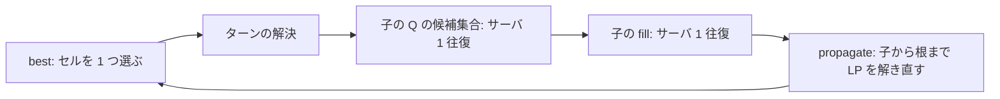

# IKA-466 検討の読みがスレッドの数で速くならない理由

## 要点

* 検討の読み（port の深掘り）は 1 手ごとに 1 つのセルを広げて根まで解き直す直列の繰り返しである。1 手の中でスレッドを使う所が無いので、`--threads` を変えても速さは変わらない。
* 1 手は局面 A で 17.7 ms、局面 B で 4.7 ms だった。読みの時間のうち、根のベイズ型の LP の解き直しが局面 A で 69%、局面 B で 23% を占めた。
* 推論サーバの待ちは局面 A で 11%、局面 B で 29〜31% だった。子の Q の候補集合と子の fill がそれぞれ 1 回ずつサーバに問い合わせる。
* 速くする案は 3 つある。LP を前の基底から解き直す案、答えが変わらない解き直しを飛ばす案、数個のセルをまとめて広げてスレッドに配る案である。

## 1. 測り方

* `C:/tmp/ika465/probe.py` は推論サーバ（評価モデル value-mc7・value-mc7-s1、Q は q-mc6）を 1 本立てる。同じ過程の中で `tools/analyze.py --no-view --max-seconds 10 --threads N` を呼ぶ。
* `portdeepen._ask_run` を包み、最後の `deepenRun` の答えの `waitUs`（サーバの待ち）と `elapsedMs`（port の読みの時間）を読んだ。
* `rust/src/deepen.rs` に一時的な計時を入れて、1 手の段ごとの時間を足し合わせた（`C:/tmp/ika465/deepen-instrumented.rs`、`instr.py`）。計測のあとで元に戻し、master には入れていない。
* 局面は IKA-459 §5 と同じ 2 つである。局面 A は `C:/tmp/ika459/gen1/games-worker0.jsonl` の `--game 0 --decision 2`、局面 B は `games-worker1.jsonl` の `--game 1 --decision 3` である。
* §2.1 は c3fca39 の source で作った exe で測った。§2.2 はその source に計時を足して作った exe で測った。

## 2. 結果

### 2.1 スレッドの数とサーバの待ち（局面 B、計時なしの exe）

| スレッド | 手 | セル | 読みの時間 | サーバの待ち |
|---|---|---|---|---|
| 1 | 2,042 | 15,106 | 9.70 秒 | 3.00 秒 |
| 16 | 1,944 | 14,539 | 9.67 秒 | 2.88 秒 |
| 1 | 2,073 | 15,284 | 9.69 秒 | 2.92 秒 |
| 16 | 2,043 | 15,111 | 10.14 秒 | 3.04 秒 |

* 1 スレッドと 16 スレッドの手の数の差は、同じスレッドの数の 2 回の差と同じくらいだった。
* 1 手で広げるセルは 1 つで、そのセルの子のノードは平均 1.03 個だった。1 回の子の fill は平均 6 セルほどである。

### 2.2 1 手の段ごとの時間（1 スレッド、計時を入れた exe）

| 段 | 局面 A | 局面 B |
|---|---|---|
| 根の大きさ（自分 × 相手 × 裏の決定化）| 64 × 61 × 6 | 61 × 47 × 1 |
| 10 秒の手の数 | 544 | 2,078 |
| 1 手の時間 | 17.7 ms | 4.7 ms |
| 値を根まで戻して解き直す（`propagate`）| 7.20 秒（75%）| 5.02 秒（52%）|
| うち根の LP（`Root::solve`）| 6.65 秒（69%）| 2.25 秒（23%）|
| 子の Q の候補集合（`qmenus::menus_of`）| 0.94 秒 | 2.54 秒 |
| 子の fill（`beliefNode`）| 0.76 秒 | 1.36 秒 |
| 子の LP | 0.16 秒 | 0.44 秒 |
| ターンの解決 | 0.02 秒 | 0.03 秒 |
| 次のセルを選ぶ（`best`）| 0.07 秒 | 0.05 秒 |
| サーバの待ち（上の 2 段に含まれる）| 1.05 秒 | 2.85 秒 |
| 読みの時間 | 9.63 秒 | 9.67 秒 |

* 局面 A の根の LP は 1 回 12.2 ms、局面 B は 1 回 1.1 ms だった。根は裏の決定化が 6 つあると、行列 6 枚のベイズ型の LP になる。
* 局面 B は子のノードの下をさらに広げる手が多く（深さ 14）、根より下の LP の解き直しが 2.77 秒あった。
* `lp::solve`・`lp::solve_bayesian` は毎回 LP を作り直し、presolve から解く。前の答えの基底は使っていない。

## 3. スレッドが効かない理由

* 図の 5 段は 1 本のスレッドで順に進む。次の手は前の手の `propagate` の答えでセルを選ぶので、前の手が終わるまで始まらない。
* 子の fill は 1 回 6 セルほどなので、fill の中で仕事を分けても速くならない。
* `--threads` は port のスレッドの数を決めるが、深掘りの繰り返しはそのスレッドに仕事を配らない。IKA-459 §5 で 16 スレッドの port の過程にスレッドが 19 本あったのに CPU が 1 コアに届かなかったのは、このためである。

## 4. 速くする案

| 案 | 局が変わるか | 見込み |
|---|---|---|
| 根の LP を前の基底から解き直す（HiGHS の基底を残して、変わった 1 つの係数だけを替える）| 同点の均衡の選び方だけが変わりうる | 局面 A の 69% を占める段が縮む |
| 答えが変わらない解き直しを飛ばす（変えたセルの行と列で今の均衡が最適のままか確かめる）| 変わらない | 均衡の外のセルを広げた手の分だけ縮む |
| 数個のセルをまとめて広げ、ターンの解決・Q・fill をスレッドとサーバの 1 回の依頼に配り、解き直しを 1 回にする | 変わる。同じ時間の対戦評価で判定する | スレッドの数で伸びる。サーバの往復も減る |

* 1 つ目と 2 つ目は読みの中身をほぼ変えないので、先に入れられる。3 つ目は IKA-32 の先読みのワーカーと同じ向きの変更で、CLAUDE.md の決まりどおり同じ時間の対戦評価で判定する。

## 5. 分かっていないこと

* 均衡の外のセルを広げる手の割合は数えていない。2 つ目の案の効きはこの割合で決まる。
* HiGHS の基底から解き直す速さは測っていない。
* 人と打つ道具の 30〜45 秒の読みでは測っていない。測ったのは検討の 10 秒の読みの 2 局面だけである。

## 6. ファイル

| 中身 | 置き場 |
|---|---|
| 計測の道具 | `C:/tmp/ika465/probe.py`・`instr.py`・`deepen-instrumented.rs` |
| 計測の出力 | `C:/tmp/ika465/b.log`・`b2.log`・`b3.log`・`a3.log`・`out/` |
