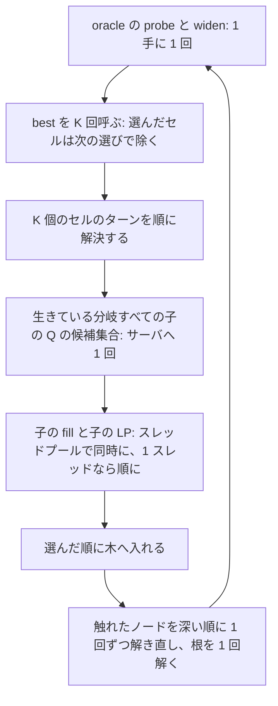

# IKA-467 深掘りの 1 手で数個のセルを広げ、根を 1 回だけ解き直す

## 要点

* port の深掘り（`rust/src/deepen.rs`）は、1 手で優先度の高いセルを K 個選んで広げられるようになった。K は `deepenStart` の `batch` で、Python の既定は `portdeepen.BATCH = 1`（前の読み）のままにした。
* K 個のセルの子の Q の候補集合はサーバへの 1 回の依頼で求める。子の fill と子の LP は port のスレッドプールで同時に進める。根のベイズ型の LP は 1 手に 1 回だけ解く。
* K を決めれば、スレッドの数によらず同じ木になる。K = 1 は前の読みと同じ答えを返す。
* 検討の 10 秒の読みでは、K = 8 で 1 秒に広げるセルが K = 1 の 1.56〜4.11 倍になった（局面 2 つ、スレッド 1・4・16）。
* 同じ時間の対戦評価（1 手 4 秒、1 スレッド）では、K = 8 対 K = 1 が上限の 1,200 対で決まらなかった。Elo は −7.5 [−19.6, +4.5]、SPRT(−10, 0) の LLR は −0.674 だった。H1 にならなかったので、既定は 1 のままにした。

## 1. 変えたこと

### 1.1 1 手の流れ

* 前の読みは 1 手でセルを 1 つ広げ、その子から根までの LP をすべて解き直していた（IKA-466 §3）。
* 壁時計の区切りと `steps` は前と同じく手と手の間で確かめる。1 手で K 個を広げるので、壁時計の予算は 1 手の分だけ超えうる。超えた量は 4.2 節で測った。
* 数えたセルの予算は選んだセルを木へ入れる間にも確かめる。予算を使い切ったら、その手の残りのセルは入れず、数えもしない（`cutSteps`）。スレッドで先に作ったそれらの fill は捨てる。これで予算を超える量は K = 1 と同じく広げた 1 セルの分までになる。
* 価格で読む予算（`deepen.Cost`、数の時計）は Python が手ごとに読む。port は価格を知らないので、Python が残りの予算で払えるセルの数を見積もり、`deepenRun` の `batch` で 1 手のセルの数を抑える。見積もりにはこれまでの 1 セルあたりの単位の平均と、直前の手の 1 セルあたりの単位のうち大きいほうを使う。

### 1.2 スレッドの数によらず同じ答えにする仕組み

* 選ぶ・ターンの解決・Q の候補集合・木へ入れる・解き直す段は、要求を読むスレッドで決まった順に進む。スレッドに配るのは子の fill と子の LP だけで、その答えは選んだ順に並べ直して使う（`par::Pool::map_with`）。
* 位置は `Rc` を持つので、スレッドには局面を JSON に書いて渡す。各スレッドは自分で読み直す。符号化の `Encoder` はスレッドごとに持つ。手が終わると語彙とキャッシュをスレッドに残し、次の手で同じ regulation の `Encoder` を組み直す（`Encoder::into_parts`・`from_parts`）。
* スレッドプールの中の fill がさらにプールを使わないように、`par::Pool::global()` はプールの項目の中では None を返す（`par.rs` の `IN_MAP`）。
* 推論サーバに配列を渡す共有メモリの block は、呼び手の block を要求を読むスレッドだけが使う。ほかのスレッドは同じ大きさの block を自分で作って使う（`deepen.rs` の `own_server`）。2 つのスレッドが 1 つの block に書くと、互いの行を読んでしまうからである。
* 1 スレッドのときと K = 1 のときは、前と同じく位置を番号で渡し、子の fill を 1 つずつ順に行う。子の fill が拒否されたら、そのセルの残りの子は fill しない。プールで同時に fill したときも、拒否された子より後の答えは数えない。

### 1.3 解き直しを 1 回にする

* 1 手で広げたセルの値を書き、そのセルの上のノードを深い順（level の大きい順、同じ level は作った順）に 1 回ずつ解く。根は最後に 1 回解く。
* LP が解けなかったノードは前の答えを残し、そのノードから上へは値を渡さない。前の読みの決まりと同じである。親は、別の子から値が来たときだけ解き直す。
* K = 1 ではこの手順が前の `propagate` と同じ順になる。

### 1.4 予算の数え方

| 数 | 数え方 |
|---|---|
| `refines`・`levelSum`・`expanded`・`refused` | 広げたセル 1 つごとに足す（前と同じ）|
| `rootSum` | 1 手に 1 回、根のセルの数を足す。根の LP を解く回数に合わせた |
| `childPasses` | 1 手に 1 回。1 手の子の Q の候補集合を 1 回の依頼で求めるため |
| `guarded` | 1 手に 1 回。手の最初のセルを選ぶときに、上限より先のセルのほうが優先度が高かったら数える |
| `cells`・`fills` | 前と同じ（子の行列のセル、fill の数）|

* `deepen.Cost` の `root` は「1 手ごとに根を解き直す」費用を数える値なので、根を解く回数に合わせた。K = 1 では 1 手に 1 セルなので、前と同じ数になる。
* `deepen.COSTS` の価格は 1 手に 1 セルの読みで当てはめた値で、K = 8 では当てはめ直していない。
* K の違う読みの `childPasses` と `guarded` は手の数で割って比べる。広げたセルの数で割ると、K が大きいほど小さく見える。

### 1.5 答えに足した欄

| 欄 | 中身 |
|---|---|
| `batch` | 1 手で広げるセルの数 |
| `rootSolves` | 根の LP を解いた回数（始めの 1 回を含む）|
| `parallelFills` | スレッドプールで fill した子の数 |
| `cutSteps` | 数えたセルの予算で、選んだセルを入れきらずに止めた手の数 |
| `phaseUs` | 段ごとのマイクロ秒（選ぶ・ターン・Q の候補集合・fill と子の LP・解き直し・oracle）|

### 1.6 Python の側

* `portdeepen.deepen_move` と `humanplay.solve_move` に `batch` を足した。None なら `portdeepen.BATCH` を使う。
* `humanplay.Agent` に `batch` を足した。時間の対戦評価の条件は `batch=K` で名指しできる（`timematch.Condition`、`tools/time_match.py`）。局の記録の `clock` には、局が読んだ `batch` をいつも書く（名指しが無ければ `BATCH`）。
* 手の報告 `Deepened` に `batch` と `steps` を足した。検討の記録にも残る。
* 人と打つ道具・検討・時間の対戦評価は、名指しが無ければ `BATCH` を使う。

## 2. 確かめたこと

### 2.1 K = 1 は前の読みと同じ

* `tests/test_portdeepen.py` で凍結した答え（Python の深掘り）と比べるテストは、K = 1 で全部通った。
* 推論サーバ（value-mc7 の 2 本、q-mc6）で、局面 A と B を 60 手ずつ読んだ。前の exe（e96bc48 から作った `C:/tmp/ika467/bin-base`）と新しい exe で、セル・手・広げた数・fill・値・混合がビットまで同じだった（1 スレッドと 4 スレッド）。

| 局面 | exe | セル | 手 | fill | 値 |
|---|---|---|---|---|---|
| A | 前 | 6,424 | 60 | 94 | 0.9664979344399447 |
| A | 新 | 6,424 | 60 | 94 | 0.9664979344399447 |
| B | 前 | 1,837 | 60 | 76 | 0.9775430631202386 |
| B | 新 | 1,837 | 60 | 76 | 0.9775430631202386 |

### 2.2 K > 1 でスレッドの数によらず同じ木

* 新しいテスト `test_a_batch_reads_the_same_tree_on_one_thread_and_on_several` は K = 8 の読みを 1 スレッドと 3 スレッドで比べる。セル・手・根の LP の回数・値・混合・根の行列がビットまで同じである。
* 陽性対照は 3 つある。3 スレッドでは子がスレッドプールで fill された（`parallelFills` > 0、1 スレッドでは 0）。1 手で 2 つ以上のセルを広げた。根の LP の回数は手の数 + 1 以下だった。K = 1 では、根の LP の回数が広げたセルの数 + 1 と等しい。
* 比べが落ちうることも確かめた。テストの代役の葉（`standin.served_from`）は、受けた要求を 1 つの `RemoteValue` に送る。その block は 1 つなので、同時に来た 2 つの要求が互いの行を書き換えていた。このままでは 3 スレッドの読みの値が変わり、テストが落ちた（セル 3,013 対 3,353）。代役の葉が要求を 1 つずつ処理するように直すと通った。
* 推論サーバでも確かめた。対戦評価に使う exe で局面 A と B を K = 8 で 30 手ずつ読み、1 スレッドと 16 スレッドで比べた。セル・広げた数・ノードの数・根の LP の回数・値・混合が同じだった。

| 局面 | セル | 広げたセル | ノード | 根の LP | 値 |
|---|---|---|---|---|---|
| A | 17,648 | 232 | 363 | 32 | 0.9667935124825646 |
| B | 9,855 | 240 | 356 | 31 | 0.977489054809999 |

* 局面 A の根の LP は 30 手で 32 回だった。1 手が oracle の widen で、手を足したあとと 1 つ外したあとに根を 1 回ずつ解いたからである。始めの 1 回と残り 29 手の 29 回を足すと 32 回になる。

### 2.3 予算を超える量

* 新しいテスト `test_a_batch_on_counted_cells_stops_near_its_budget` は 3,000 セルの予算の読みを K = 1 と K = 8 で 4 局面ずつ行う。どの読みも、予算を超えた量が広げた 1 セルの上限（1 + 3 × 8 × 8 = 193 セル）以下だった。K = 8 の読みでは、予算で止めた手が 1 つ以上あった（`cutSteps` > 0）。
* 途中のコードでは手のセルの数を 1 セルあたりのセルの見積もりで抑えるだけで、手の中では止めなかった。このコードでは同じ局面の K = 8 の読みが 8 セルの手を 5 回打ち、3,266 セルで終わった。予算を 266 セル超えて、上の上限を上回った。見積もりは 4 手目までの平均の 71 セルで、5 手目は 1 セルあたり 123 セルだった。
* 価格で読む予算（`COSTS["local", 1]`、400 ミリ秒の分、13,986 単位）では、3 局面で次のとおりだった。

| 局面 | K = 1 で超えた単位 | K = 8 で超えた単位 | K = 8 の 1 セルあたりの単位 |
|---|---|---|---|
| 1 | 25 | 812 | 389 |
| 2 | 57 | 153 | 456 |
| 3 | 63 | 740 | 566 |

* 価格で読む予算では、K = 8 の読みが広げた 1〜2 セルの分だけ予算を超えた。port は価格を知らないので、1 手の中で止められない。

## 3. 速さ

### 3.1 測り方

* `C:/tmp/ika467/probe.py` は推論サーバを 1 本立て、同じ過程の中で `tools/analyze.py --no-view --max-seconds 10` を呼ぶ。`portdeepen.BATCH` を K に替え、`--threads` を N にした。
* 局面は IKA-466 と同じである。局面 A は `C:/tmp/ika459/gen1/games-worker0.jsonl` の `--game 0 --decision 2`（根は 64 × 61 × 6）、局面 B は `games-worker1.jsonl` の `--game 1 --decision 3`（61 × 47 × 1）である。
* K は 1・4・8・16、スレッドは 1・4・16 の 12 通りを、局面ごとに 2 回読んだ。1 回目と 2 回目で順を逆にした。始めの CPU の使用率は 24% で、ほかの重い仕事は無かった。

### 3.2 1 秒に広げたセル

表の値は 2 回の平均で、括弧の中は同じスレッドの数の K = 1 に対する比である。

| 局面 | K | 1 スレッド | 4 スレッド | 16 スレッド |
|---|---|---|---|---|
| A | 1 | 61 | 61 | 61 |
| A | 4 | 157（2.59 倍）| 174（2.86 倍）| 173（2.82 倍）|
| A | 8 | 211（3.49 倍）| 246（4.04 倍）| 252（4.11 倍）|
| A | 16 | 262（4.33 倍）| 321（5.27 倍）| 349（5.70 倍）|
| B | 1 | 240 | 226 | 229 |
| B | 4 | 368（1.54 倍）| 405（1.79 倍）| 395（1.72 倍）|
| B | 8 | 373（1.56 倍）| 464（2.05 倍）| 479（2.09 倍）|
| B | 16 | 323（1.35 倍）| 488（2.16 倍）| 519（2.27 倍）|

### 3.3 段ごとの秒（10 秒の読み、1 回目）

| 局面 | K | スレッド | 選ぶ | Q の候補集合 | fill と子の LP | 解き直し |
|---|---|---|---|---|---|---|
| A | 1 | 1 | 0.08 | 0.73 | 0.88 | 7.41 |
| A | 8 | 1 | 0.44 | 2.02 | 3.07 | 4.31 |
| A | 8 | 16 | 0.51 | 2.40 | 1.54 | 4.97 |
| B | 1 | 1 | 0.05 | 2.16 | 1.80 | 5.44 |
| B | 8 | 1 | 0.16 | 3.17 | 4.59 | 2.15 |
| B | 8 | 16 | 0.21 | 4.17 | 2.79 | 2.86 |

* 局面 A・1 スレッドの根の LP は、K = 1 で 569〜590 回、K = 8 で 266〜277 回だった。解き直しの段は 7.4 秒から 4.2〜4.3 秒に減った。
* スレッドを増やすと fill の段は縮むが、Q の候補集合の段は 1 本のスレッドで進むので縮まない。K を大きくすると、この段が読みの時間の大きな部分になる。
* K = 16 は局面 B の 1 スレッドで K = 8 より遅かった。どの局面でもスレッドの数によらず速くなる値として、対戦評価には K = 8 を出した。

### 3.4 スレッドが符号化の Encoder を持ち越す

* レビューの指摘で、スレッドの `Encoder` を手ごとに作り直すのをやめ、語彙とキャッシュを次の手に持ち越すようにした（1.2 節）。局面 A を K = 8 で 10 秒ずつ読み、持ち越す前の exe（cae1d1e）と後の exe を新・前・前・新の順に比べた。

| exe | スレッド | fill と子の LP の段 | 1 秒に広げたセル |
|---|---|---|---|
| 持ち越す前 | 1 | 2.82 / 2.83 秒 | 216.8 / 218.3 |
| 持ち越した後 | 1 | 2.83 / 2.87 秒 | 217.1 / 218.0 |
| 持ち越す前 | 16 | 1.49 / 1.49 秒 | 268.3 / 270.8 |
| 持ち越した後 | 16 | 1.44 / 1.43 秒 | 265.7 / 265.6 |

* 16 スレッドの fill の段は 3〜4% 縮んだ。1 秒に広げたセルの数の差は同じ exe の 2 回の差と同じくらいだった。1 スレッドの読みはスレッドプールを使わないので、変わらない。
* 3.3 節の表（1 回目の読み）の 3.07 秒と 1.54 秒は、同じ exe のこの計測の 2.82 秒と 1.49 秒にあたる。窓が違うので、そろえて比べるのはこの表の中だけにする。

## 4. 同じ時間の対戦評価

| 項目 | 設定 |
|---|---|
| 条件 | 第 1 条件 `b8:seconds=4,threads=1,cores=1,clock=wall,batch=8`、第 2 条件 `b1:` は同じ設定で `batch=1`。どちらも oracle `sall`、深さの上限 16 |
| 道具 | `tools/time_match.py --pairs 1200 --parallel 10 --served --sprt -10 0`（対 319 から `--parallel 14`）、種 33300、プール regmc-matchupweb、value-mc7 の 2 本、q-mc6 |
| コード | 凍結したコード `C:/tmp/ika467/wt`（cae1d1e の `git archive`、`data` は本体の `data` への junction）と exe のコピー `C:/tmp/ika467/bin`（`POKEURAOU_RUST_NODE_BIN` はこの過程にだけ渡した）|
| 出力 | `C:/tmp/ika467/board1`、記録 `C:/tmp/ika467/board1.log`、外の負荷 `C:/tmp/ika467/load.txt` |
| 始めた時刻 | 2026-11-27 20:56 UTC。始めの CPU の使用率は 22% |

* 調整役の指示で、並列を 10 から 14 に上げた。10 並列のときの CPU の使用率（`% Processor Time`）は 57.9〜59.6% で、79 分で 318 対（1 分に 4.0 対）だった。22:15 UTC に止めた時点で、対 0〜316 と 318 が書き終わっていた。対 317 を 1 対だけ打ち直し（22:18 UTC）、続けて対 319 から 14 並列で再開した（`C:/tmp/ika467/board2.sh`、`board2.log`）。再開した時点で、SPRT は対 0〜318 の 319 対を順に読めていた。止めたときに打っていた対のうち、318 より後の対は再開した回で打ち直した。再開してから 15.5 分で 83 対（1 分に 5.4 対）を書き、CPU の使用率は 67.6〜74.0% だった。

* スモークテストの 2 対（4 並列、`C:/tmp/ika467/smoke-match`）では、両条件とも 39 手を打った。1 手の秒と予算の比の中央値は b8 が 1.0041、b1 が 1.0016 だった。深掘りの手数の中央値は b8 が 1,112、b1 が 588 だった。

### 4.1 結果

| 項目 | 値 |
|---|---|
| SPRT(−10, 0) | 上限の 1,200 対で決まらず（LLR −0.674、境界 ±2.944）|
| Elo（b8 から見た値）| −7.5 [−19.6, +4.5]。負・分・勝 237 / 752 / 211 |
| 勝者なし・退避・メモリ停止 | 0・0・0 |
| 終わった時刻 | 2026-11-28 00:53 UTC。再開してからの回は 155.3 分 |
| 深掘りした手の広げたセルの中央値 | b8 449、b1 263（1.71 倍）|

* b8 は同じ時間で 1.71 倍のセルを広げたが、強いとも弱いとも言えなかった。区間の下の端は −19.6 で、SPRT が H1 にするには届かなかった。
* 1 スレッドの対戦評価では、スレッドプールで fill を同時に進める分の得は出ない。この評価で測れたのは、根の LP とサーバへの往復を減らした分と、K 個を一度に選ぶ読みの質の変化である。
* 4 スレッドの小さい対戦評価は回していない。1,200 対の評価だけで 4 時間ほどかかったためである。

### 4.2 壁時計の予算を超えた量

局の記録の深掘りした手（各条件 21,555 手）で、1 手の秒と予算の比（`ratio`）と、超えたミリ秒を数えた（`C:/tmp/ika467/overshoot.py`、`overshoot.txt`）。

| 条件 | 比の中央値 | 比の 90% 点 | 比の 99% 点 | 比の最大 | 超えた ms の中央値 | 90% 点 | 比が 1.05 を超えた手 |
|---|---|---|---|---|---|---|---|
| b8 | 1.0080 | 1.0246 | 1.5267 | 10.372 | 32 | 98 | 3.95% |
| b1 | 1.0027 | 1.0080 | 1.5047 | 11.557 | 11 | 32 | 2.06% |

* b8 は 1 手の中で予算を確かめないので、中央値で 21 ミリ秒、90% 点で 66 ミリ秒だけ b1 より長く読んだ。1 手 4 秒の 0.5〜1.7% にあたる。
* 99% 点と最大は両条件で同じくらいだった。比が 1.25 を超えた手は b8 で 1.50%、b1 で 1.34% だった。

## 5. 分かっていないこと・していないこと

* K = 8 が同じ時間で弱いのか、差が無いのかは分かっていない。区間は −19.6 から +4.5 までである。
* Q の候補集合の段（合法手の一覧・配列づくり・Q の LP）は 1 本のスレッドで進む。K = 8 ではこの段が読みの時間の 2〜4 割になる。この段もスレッドに配れば、さらに速くなる見込みがある。測ってはいない。
* 検討の 10 秒の読みの 2 局面と、1 手 4 秒・1 スレッドの対戦評価のほかでは測っていない。人と打つ道具の 30〜45 秒・4 スレッドの読みと、4 スレッドの対戦評価は回していない。
* `deepen.COSTS` の値（数の時計の価格）は 1 手に 1 セルの読みで当てはめた値のままである。K > 1 で当てはめ直してはいない。
* 全体のテストは CI に任せた。worktree で回したテストは次のとおりである。深掘り・検討・人と打つ道具・時間の対戦評価・ワーカーの設定のテスト、`cargo test --release`、`tools/agent_drift.py --check`、`tools/port_coverage.py --check`、`tools/port_gate_audit.py --check`、`ruff check .`。`tests/test_port_threads.py` の 2 本と `tests/test_rust_node.py` の 22 本は、worktree に使用率のデータ（`data/`）が無いので落ちた。今回の変更とは関わらない。
* `shm.rs` の Linux の部分（7 節の 7）は、この機械では build も test もしていない。CI の Linux で確かめる。
* `tests/test_timematch.py::test_the_person_seat_solves_its_replacements` は、K = 8 では 12 ターンの間に人の側の交代が起きず、陽性対照が成り立たなかった。この局の条件を `batch=1` にして、前の局のままにした。既定を 1 に戻したあとも、この指定は残した。

## 7. レビューで直したこと

対戦評価を回している間に、調整役から 7 つの指摘を受けた。直したのは 6c6db2e で、凍結したコード（cae1d1e）と対戦評価には入っていない。

| 指摘 | 直したこと | 局が変わるか |
|---|---|---|
| 1. 局の記録に読んだ batch が無い | 局の行の `clock` に `batch` をいつも書く。`Deepened` に `batch` と `steps` を足した | 変わらない（記録の行に欄が増える）|
| 2. 予算を 1 手の分だけ超える | 数えたセルの予算は、手の中のセルを入れる間に確かめて止める（1.1 節、2.3 節）。価格で読む予算は Python が 1 手のセルの数を抑える。壁時計の予算は 4.2 節で測った | K > 1 で、数えたセルか価格で読む予算の手だけ変わる。K = 1 と壁時計の手は変わらない |
| 3. 既定の K | 対戦評価が H1 でないので 1 にした | 変わらない（前の既定のまま）|
| 4. 古い説明 | `deepen.rs` の数え方の説明、`deepen.py` の冒頭、`Cost.root`、`_Meter.roots` を「1 手ごと」に直した。`COSTS` は K = 1 で当てはめたと書いた | 変わらない |
| 5. `guarded` と `childPasses` | `guarded` は手の最初のセルを選ぶときだけ数える。`childPasses` は 1 手に 1 回の Q の依頼と書いた（1.4 節）| 変わらない（数えるだけの値）|
| 6. スレッドが毎手 `Encoder` を作る | 語彙とキャッシュをスレッドに残して持ち越す（3.4 節）| 変わらない（答えは同じで、速さだけ）|
| 7. Linux の block が残る | `shm.rs` が作った `/dev/shm` のファイルを、値を落とすときに消す | 変わらない |

* 1 と 5 は記録の数を直しただけで、読みは変えていない。
* 2 で数えたセルの予算を直したあとも、K = 1 は 1 手に 1 セルなので止める所が無く、前と同じ読みになる。直したあとの exe で局面 A と B を 60 手ずつ読み直し、2.1 節の前の exe とセル・手・広げた数・fill・ノード・値・混合が同じだった。

## 6. ファイル

| 中身 | 置き場 |
|---|---|
| 計測の道具 | `C:/tmp/ika467/probe.py`・`table.py` |
| 速さの出力 | `C:/tmp/ika467/speed.log`・`speed-results.txt`・`out/` |
| K = 1 で前の exe と比べた出力 | `C:/tmp/ika467/k1baseA.log`・`k1baseB.log`・`k1newA.log`・`k1newB.log`・`k1new2A.log`・`k1new2B.log` |
| スレッドの数を比べた出力（推論サーバ）| `C:/tmp/ika467/det2-a.log`・`det2-b.log` |
| Encoder を持ち越す前と後を比べた出力 | `C:/tmp/ika467/enc.log` |
| 対戦評価 | `C:/tmp/ika467/board.sh`・`board2.sh`・`board1/`・`board1.log`・`board2.log`・`load.txt`・`smoke.sh`・`smoke-match/` |
| 壁時計の予算を超えた量 | `C:/tmp/ika467/overshoot.py`・`overshoot.txt` |
| 前の exe | `C:/tmp/ika467/bin-base/pokeuraou-damage.exe`（e96bc48）|
