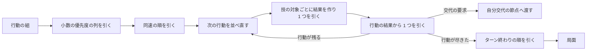

# IKA-469 打つターンを 1 本の道で引く

課題: Notion の Issues（ID IKA-469）。ブランチ `ika469-weight-draw`（origin/master 98fe0a5 から）。計測の道具と生の出力は `C:/tmp/ika469/` に置き、コミットしていない。

IKA-462 §2.2 の計測では、打つターンの解決は 1 局の実時間（約 200 ms）の約 8%（約 16 ms）だった。この課題でその解決を全分岐から 1 本の道に替えた。

## 要点

* Rust のワーカーの `playGame` は打つターン（exact の予算）の全分岐を作ってから 1 つを重みで引いていた。今はターンの偶然の分かれ目に出会うたびに 1 つを引き、引いた道の局面だけを作る（`resolve::sample_turn`）。
* 探索の中の fill（葉の評価のためのターンの解決）は変えていない。fill が使う `resolve_turn` の手順は前と同じで、引く道具（`Turn.sampler`）は打つターンにだけ付く。同じ種の局の最初の手番の決定は前の exe と一致した（§3.3）。
* 前の exact の解決が刈り込まない手番では、引く分布は前と同じである。全経路の確率と列挙の重みの差は 1.1e-14 以下で、引いた頻度は χ² 検定で棄却されない。重みを 2 乗する陽性対照の exe では、どちらの検査も落ちる（§2）。
* 前の exact の解決が刈り込んでいた手番は、生成の記録の 1,000 決定のうち 560（56.0%）だった。刈り込みは、分岐を捨てるか乱数の幅を粗くすることを指す（`exact` が偽）。新しい道は刈り込まないので、その 560 決定では刈り込む前の分布から引く。前の道とは引く分布が違う（§2.3）。
* 速さ: 生成の形の ABBA（2,000 局 × 8 回）で、局/分が 2,060.3 から 2,238.1（+8.6%）、1 局の CPU が 0.3748 秒から 0.3367 秒（−10.1%）になった（§3）。
* 対戦評価は回していない。打つターンの解決は両席に共通で、2 つの条件の強さの差にならないためである。調整役の判断で、分布を確かめる 3 つの検査に置き換えた（§4）。

## この記録で使う言葉

| 言葉 | 意味 |
|---|---|
| 打つターン | 局を実際に進めるターンの解決。予算は `Budget.exact()`（乱数 16 通り、急所・命中・状態・追加効果・素早さの同速をすべて分ける、分岐の上限 512） |
| fill | 探索の行列を埋めるためのターンの解決。予算は `Budget.matrix()` |
| 刈り込み | 前の `run_queue` が、生きている分岐の数で上限 512 を割り、1 つの行動の分け方を粗くすること（`Budget::narrowed`）と、上限を超えた分岐を捨てること。どちらかが起きると `exact` が偽になる |
| 1 本の道で引く | 分かれ目ごとに 1 つを引いて、その道だけを進めること |

## 1. 変えたこと

### 1.1 打つターンの流れ

* `resolve.rs` に `sample_turn` を足した。前の `resolve_turn_inner` の準備（Showdown の揮発状態の取り込み、対応の確かめ、行動の列づくり）は `prepare_turn` に切り出し、`resolve_turn` と `sample_turn` が同じものを使う。
* 分かれ目は、小数の優先度の列、同速の順、アンコールの対象の変え、行動ごとの結果、ターン終わりの同速の順の 5 か所である。加えて、攻撃技の中で対象ごとに結果のリストを 1 つに引く（`resolve::collapse`、`moves.rs` の 2 か所）。引いたものはリストの重みの合計を持つので、ほかのリストと並べる呼び手の重みは変わらない。
* 引く道具は `Turn.sampler`（`Rc<RefCell<Chances>>`）である。`sample_turn` が作る局面にだけ付く。`collapse` は道具の無い局面のリストをそのまま返す。交代の要求で止まった局面は道具を外してから自分交代の節点へ渡す。自分交代の節点は前と同じく全分岐を作る。
* 引き方は numpy の `choice` と同じ計算（`advance::choice`）で、局の PCG64 から引く。`playGame` は `advance::advance_sampled` を呼ぶ。
* 行動 1 つの中の分け方（乱数 16 通り・急所・命中など）は、`hit_target` の中で前と同じく全部を作る。1 本の道では生きている分岐が 1 つなので、上限 512 で行動の分け方を粗くすることは起きない。

### 1.2 変わらないもの

| 道 | 扱い |
|---|---|
| 探索の fill（`node.rs`・`encoded_node.rs`・`beliefplan` など） | `resolve_turn` のまま。`Turn.sampler` は付かず、`collapse` はリストを変えない |
| 自分交代の節点・交代の局面 | 前と同じく全分岐を作る |
| `advanceTurn` の要求（Python の `port.advance`） | 前と同じく全分岐を作って引く。呼ぶのはテストだけ |
| 人と打つ道具（`humanplay._advance_turn`） | 前と同じく重みを取ってから Python の乱数で引き、引いた分岐を取りに行く。全分岐の解決は 1 手に 2 回で、1 回は平均 約 2 ms（§2.4）。1 手 30〜45 秒の予算に比べて小さいので、直していない |
| 対戦評価のワーカー（`pool-match-worker`） | `playGame` の同じ道を通るので、打つターンは 1 本の道で引く |

前の exact の解決が刈り込む手番では、2 つの道が違う分布から引く。生成と対戦評価（新しい道）は刈り込む前の分布から引き、人と打つ道具と `advanceTurn`（全分岐を作る道）は上限 512 で刈り込んだ分布から引く。

### 1.3 前と違う点

* 決定の記録（`Decision`）の欄は前と同じである。
* `playGame` の手番の `index` は、引いたときは常に 0 になる（分岐の一覧が無いため）。記録には書かれない。
* 手番の `advanceNotes`（未対応の注記）は引いた道の注記だけになる。前は全分岐の和だった。局の記録の `unmodelled` はこれを集めたものである。
* 途中の分かれ目のリストが空か、重みの合計が 0 なら、`sample_turn` は誤りを返し、局は handoff で止まる。前は、その道が分岐を出さないだけで、ほかの分岐から引いていた（分岐が 1 つも無ければ unresolved で終わっていた）。行動の列が空の手番は、前と同じく unresolved で終わる（`Drawn::Nothing`）。
* port が手番を拒否したときの handoff の文の書き出しが変わった。前は `resolve: <理由>` で、今は `advance: {"refused":"<理由>"}` である。

## 2. 引く分布

### 2.1 検査の方法

port に診断の要求 `sampleCheck`（`rust/src/drawcheck.rs`）を足した。1 つの局面と行動の組について、次の 2 つを答える。

* 全経路: `sample_turn` を、分かれ目の答えの組すべてについて 1 回ずつ走らせる（上限の経路数まで）。各経路の確率は通った答えの正規化した重みの積である。行き着いた局面を `merge_branches` と同じ比べ方でまとめ、`resolve_turn` の分岐と比べる。答えは確率の差の最大値（`maxDiff`）。
* 引き: 1 つの PCG64 から多数回引き、行き着いた局面を `resolve_turn` の分岐に当てはめて数える。どの分岐にも当たらない数（`unmatched`）も答える。

列挙の予算は exact の予算で、分岐の上限だけを 4,096 に上げた。上限 512 では刈り込みが多く、比べられる手番が少ないためである。引く側は打つターンと同じ exact の予算（上限 512）で引く。1 本の道が上限で行動の分け方を粗くするのは、上限が 1 行動の 128 通りより小さいときだけなので、上限 512 と 4,096 で引く道は同じである。比べるのは列挙が刈り込まなかった手番だけである。

### 2.2 結果

テスト（`tests/test_sample_turn.py`）は、Rust のワーカーが代役のサーバで打った 6 局の決定を使う。生成の記録は gen-7w の `data/selfplay-mc7w/games-b00-worker0.jsonl` の決定から 7 つおきに取った。

| 対象 | 決定 | 列挙が刈り込まない | 全経路を歩いた（うち分岐が 2 つ以上） | 確率の差の最大 | 引いた決定（各回数） | χ²（自由度） | p |
|---|---|---|---|---|---|---|---|
| テストの 6 局、新しい exe | 53 | 25 | 23（14） | 7.7e-15 | 15（2,000） | 362.8（354） | 0.36 |
| テストの 6 局、陽性対照の exe | 83 | 48 | 44（33） | 0.135 | 37（2,000） | 7,942.6（708） | 0.0（浮動小数の下限より小さい） |
| 生成の記録 400 決定、新しい exe | 400 | 280 | 216（142） | 1.1e-14 | 198（500） | 1,805.9（1,863） | 0.83 |

* 陽性対照の exe は feature `ika469-control` で、どの分かれ目も重みを 2 乗して引く。局も変わるので、テストの決定の数が違う。`pytest tests/test_sample_turn.py` は、この exe で 2 本とも落ちた。新しい exe では 2 本とも通った。
* 引いた局面が列挙のどの分岐にも当たらなかった数は、刈り込まなかった手番で 0 だった。
* χ² 検定が落ちうることを、同じ数え上げで確かめた。2 番目に重い分岐の重みの半分を最も重い分岐に移した分布と比べると、テストの 6 局で χ² 3,247.3（自由度 354）になり、棄却された。
* 全経路を歩けなかった手番は、経路が上限（テスト 5,000、記録 2,000）を超えたものである。それらは引きの χ² だけで比べた。

### 2.3 前の exact の解決が刈り込んでいた手番

| 対象 | 決定 | 上限 512 で `exact` が偽 |
|---|---|---|
| 生成の記録 1,000 決定 | 1,000 | 560（56.0%） |
| そのうち最初の 400 決定 | 400 | 232（58.0%） |

* 前の `run_queue` は次の行動の分け方を 512 ÷ 生きている分岐の数に収まるまで粗くする。exact の予算の 1 行動は 128 通り（乱数 16 × 急所 2 × 命中 2 × 状態 2）なので、生きている分岐が 5 つ以上になると粗くなる。
* 最初の 400 決定のうち 112 決定では、上限 512 の列挙が刈り込み、上限 4,096 の列挙は刈り込まなかった。その手番では、新しい道は上限 4,096 の列挙と同じ分布から引く（§2.2 の行に入っている）。
* 刈り込んだ手番で新しい道が引いた局面のうち 25.1% は、上限 512 の列挙の分岐に無かった（試しの 100 決定のうち刈り込んだ 57 決定、各 50 回）。

### 2.4 1 回の解決の時間（参考）

計測の道具は機械を独占せずに走らせたので、時間は参考にとどめる。生成の記録の 100 決定で、上限 512 の全分岐の解決は 1 回平均 2,014 µs、1 本の道で引く 1 回は平均 68 µs だった。

## 3. 速さ

### 3.1 設定

| 項目 | 値 |
|---|---|
| 形 | IKA-462 の ABBA と同じ。`tools/profile_stages.py generation --games 2000 --seed S --served --servers 2 --device cuda --workers 21 --limit 12 --value data/models/value-mc7.pt --q-model data/models/q-mc6.pt --pool regmc-matchupweb --hide-bench -- --rank-leaf --selection-store data/selection-solved/value-mc7 --rank-fill q-nocover`。exe は `POKEURAOU_RUST_NODE_BIN` で指す |
| A | origin/master 98fe0a5 の exe（sha256 の先頭 83bc1a7dec0191fa） |
| B | このブランチの exe（同 90090dff01ed5c59） |
| 順 | 種 46901 で A B B A、種 46902 で B A A B |
| 排他 | `heavy.py --exclusive --gpu` |

### 3.2 結果

21 ワーカー・サーバ 2・各回 2,000 局。どの回の出力にも「定常状態でない」の警告は出なかった。1 局の CPU は推論サーバを含む port の exe の過程すべての合計である（IKA-462 と同じ）。各回の前に `load.ps1` で CPU 負荷を 5 秒測った。負荷は 9.7〜42.4% で、python 系の過程（別の作業のものを含む）は 7〜9 個あった。高かったのは ab1A2 の前の 1 秒（42.4%）と ab2B1 の前（19.1〜27.3%）である。

| 回 | 構成 | 窓の局数 | 窓の秒 | 局/分 | 1 局の CPU（秒） |
|---|---|---|---|---|---|
| ab1A1 | A | 1,604 | 47.4 | 2,036.5 | 0.369 |
| ab1B1 | B | 1,605 | 43.2 | 2,240.9 | 0.337 |
| ab1B2 | B | 1,604 | 44.9 | 2,167.1 | 0.333 |
| ab1A2 | A | 1,601 | 47.9 | 2,021.5 | 0.374 |
| ab2B1 | B | 1,596 | 43.2 | 2,203.1 | 0.336 |
| ab2A1 | A | 1,595 | 45.5 | 2,106.2 | 0.379 |
| ab2A2 | A | 1,591 | 45.9 | 2,077.0 | 0.377 |
| ab2B2 | B | 1,591 | 40.8 | 2,341.1 | 0.341 |

| 指標（4 回ずつの平均） | A（前） | B（新） | 変化 |
|---|---|---|---|
| 局/分 | 2,060.3 | 2,238.1 | +8.6% |
| 1 局の CPU（秒） | 0.3748 | 0.3367 | −10.1% |

* 種ごとの組でも同じ向きだった。種 46901 は局/分 2,029.0 対 2,204.0（+8.6%）、CPU 0.3715 対 0.3350 秒（−9.8%）。種 46902 は 2,091.6 対 2,272.1（+8.6%）、0.3780 対 0.3385 秒（−10.4%）。
* B の 4 回の局/分（2,167.1〜2,341.1）は、どれも A の 4 回（2,021.5〜2,106.2）より高い。
* IKA-462 §2.2 では、打つターンの解決はワーカー 1 つ・100 局の時計で 1 局 約 16 ms（1 局の実時間 約 200 ms の約 8%）だった。ここの 1 局の CPU の差 0.038 秒は 21 ワーカーと推論サーバの過程の合計の差で、同じ量ではない。差が 16 ms より大きい理由は調べていない。

### 3.3 fill が変わらないこと

同じ種の A と B の局を、局の番号で組にして比べた。最初の手番の決定は打つターンより前にある。そのため、決定の局面・候補集合・方策・探索値が一致すれば、fill・LP・候補集合づくりが変わっていないことになる。

| 比べた回 | 局 | 最初の手番の決定が一致 | 2 手番目の局面が一致 | 局の決定すべてが一致 |
|---|---|---|---|---|
| ab1A1 と ab1B1（種 46901） | 2,000 | 2,000 | 1,017 | 0 |
| ab2A1 と ab2B1（種 46902） | 2,000 | 2,000 | 1,012 | 1 |
| ab1A1 と ab1A2（同じ exe、対照） | 2,000 | 2,000 | 2,000 | 2,000 |
| ab1B1 と ab1B2（同じ exe、対照） | 2,000 | 2,000 | 2,000 | 2,000 |
| ab1A1 と ab2A1（別の種、比べが落ちる対照） | 2,000 | 0 | 0 | 0 |

* 2 手番目の局面が一致した局（1,017 局と 1,012 局）では、2 手番目の決定の方策と探索値も、すべて一致した。局の途中の局面でも fill の答えは同じである。
* 局が変わったことは、2 手番目の局面の半分ほどが違うことで分かる。新しい道が実際に打つターンを解いた陽性対照になる。
* ABBA の B の exe を作ったあとで、`playgame.rs` の先頭の説明の文を 1 行足した。足したあとの exe とはバイトが違う。違いの中身は調べていない。§5 のテストは足したあとの exe で回した。

## 4. 対戦評価を回さなかった理由

* 打つターンの解決は、対戦評価でもワーカーの exe（`playGame`）が両席に共通で行う。`--rust-binary` で条件ごとに名指す exe は手を選ぶ要求（`moveNode`）だけを受け持つ。
* この変更は偶然の引き方だけを変え、両側の手の選び方を変えない。両席が同じ環境で打つので、2 つの条件の強さの差は原理の上で出ない。
* 調整役は判定 2 の対戦評価を §2 の検査に置き換えると決めた（11/28）。

## 5. テスト

| テスト | 結果 |
|---|---|
| `cargo test --release`（origin/master 9d68df3 に rebase した木） | 47 件が通った |
| `pytest` 全体（rebase した木、`-n 9`） | 2,900 件のうち 4 件が落ちた。直したあと、落ちた 4 件を含む 4 ファイル（`test_notes_ja`・`test_gate_fields_in_dump`・`test_timing`・`test_sample_turn`）を回し直し、49 件が通った |
| `pytest tests/test_*_oracle.py`（port 対 Showdown、24 ファイル） | 618 件が通った。skip は 0 件 |
| `pytest tests/test_sample_turn.py` ほか関係する 12 ファイル（`test_branch_merge`・`test_chance_tags`・`test_rust_worker`・`test_rust_board_worker`・`test_port_roads`・`test_final_position`・`test_encode_games_port`・`test_worker_drift`・`test_worker_failures`・`test_line_endings`・`test_no_machine_specific_paths`） | 81 件が通った |
| `pytest tests/test_sample_turn.py`、陽性対照の exe | 2 件とも落ちた |
| `ruff check .`、`port_coverage.py --check`、`port_gate_audit.py --check`、`agent_drift.py --check` | 通った |

* pytest 全体で落ちた 4 件と、その扱いは次のとおり。
  * `test_notes_ja::test_every_fixed_port_note_is_said`: `sample_turn` で `report("encore override ...")` を 1 行で書いたので、この検査の正規表現が注記を拾った。注記は日本語の表（`notes_ja.FIXED`）に無く、テストが落ちた。前の 2 か所は引数を次の行に書いていたので、検査がこの注記を拾っていなかった。表に訳（「近似: アンコールで技が変わったが、ふいうちは元の技に対して読んだ」）を足し、検査の正規表現を改行を許す形（`report\(\s*"([^"]+)"\s*,?\s*\)`）にした。新しい正規表現で増えた注記はこの 1 つだけである。
  * `test_gate_fields_in_dump` の 2 件: worktree に `node_modules` が無く、`require('pokemon-showdown')` が失敗した。別の worktree の `node_modules` を junction で借りて回し直すと通った。
  * `test_timing::test_a_part_is_charged_its_child_s_cpu`: CPU の時計の割合を見るテストで、0.4 ± 0.1 のところが 0.1875 だった。ほかの作業が機械を使っている間に回した。4 ファイルだけを回し直すと通った。原因は調べていない。
* skip の監査（`tools/ci_skip_audit.py --absent standings=9 --absent vendor=2`）が出した問題は 1 件で、standings を「無い」と宣言したのに data の junction で有ったことによる。
* pytest は worktree の `src` を `PYTHONPATH` にして、本体の `.venv` で回した。sim-bridge の `dist` は `packages` と `vendor` が同じ別の worktree（933a2c2）の build を junction で借りた。
* `tests/test_sample_turn.py` は 1 回 約 45 秒かかる（6 局を打ち、決定ごとに上限 4,096 の列挙と 2,000 回の引きと全経路を回すため）。

## 6. 確かめていないこと

* 上限 4,096 でも刈り込む手番（記録の 400 決定のうち 120）では、新しい道の分布を刈り込まない列挙と比べていない。
* 行動 1 つの中の分け方（`hit_target` の中）は、1 本の道でも全部を作っている。そこを引く形にすれば、さらに速くなる見込みがある。調べていない。
* 学習した葉の強さへの影響（新しい道で作ったデータで学んだ葉と、前の道のデータで学んだ葉を比べること）は調べていない。§2 の手番では分布が同じで、刈り込んだ手番では刈り込む前の分布から引く。
* pytest 全体と CI は回していない。
